# Management Methodology Diagrams (Open Source · Editable · 20 Frameworks)

**Language Ngôn ngữ 语言**：[中文](README.md) · **English** · [Tiếng Việt](README.vi.md)

All diagrams are drawn with **Mermaid** text syntax (open format, [mermaid-js/mermaid](https://github.com/mermaid-js/mermaid) 82k+ stars).
Any Mermaid-compatible tool can render them directly:

- **`index.html` in this folder**: double-click to view the full set of rendered diagrams in your browser (no installation needed)
- **GitHub / Gitee**: upload directly, auto-rendered
- **VS Code**: install the extension "Markdown Preview Mermaid Support"
- **Typora / Obsidian**: native support

To edit a diagram, just change the text — no drawing software required.

## Quick Finder by Scenario

| What you need to do | Recommended tools |
|---|---|
| Set goals | SMART, OKR, 5W2H |
| Plan / break down tasks | 5W2H, WBS, Gantt chart |
| Find root causes | 5Why, fishbone, 80/20 rule |
| Make decisions / analyze | SWOT, Eisenhower matrix, Six Thinking Hats, BCG matrix, Porter's Five Forces |
| Execute / continuous improvement | PDCA, DMAIC, 8D |
| Communicate and present | Pyramid Principle, Golden Circle |
| Retrospect and review | GRAI |

## Tool Selection Roadmap

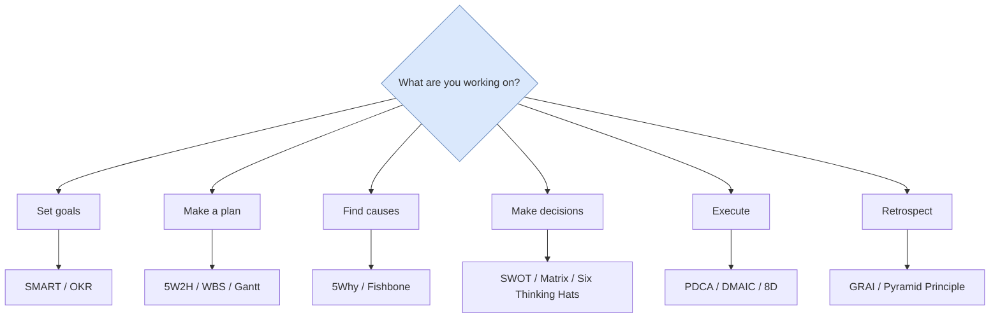

---

## I. Goal & Planning

### 1. SMART (Goal Setting)

**One-liner:** A good goal must be Specific, Measurable, Achievable, Relevant, and Time-bound.

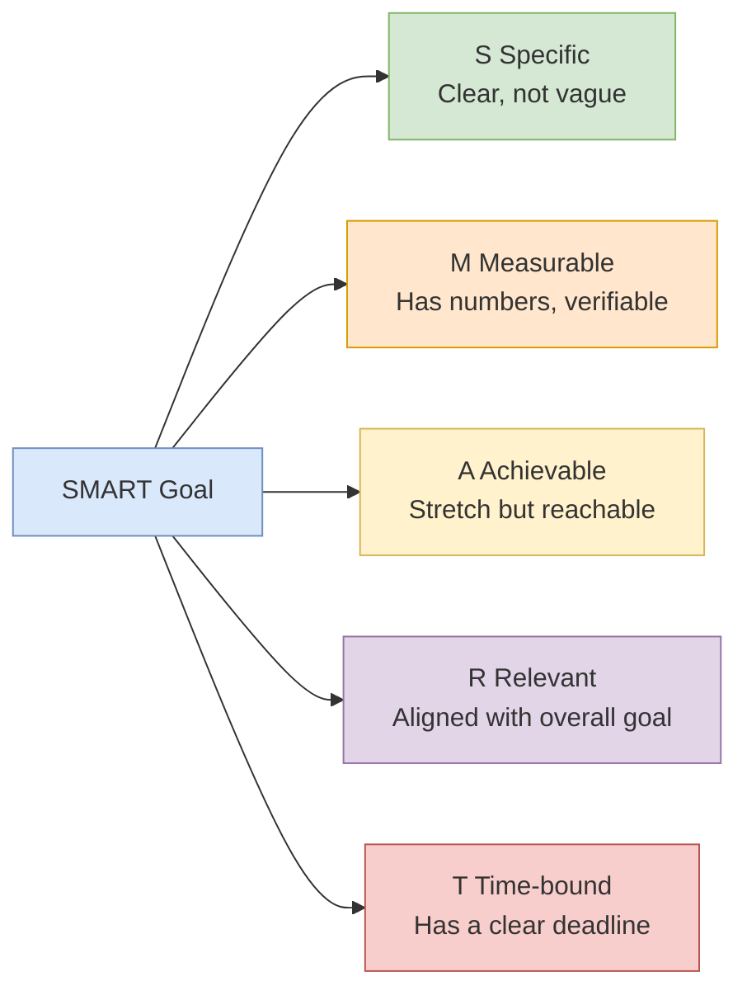

**Bad example:** "Improve customer satisfaction" (vague)
**Good example:** "Within 3 months, reduce first-response time from 4 hours to under 1 hour" (meets all SMART criteria)

---

### 2. 5W2H (Think Through a Task)

**One-liner:** Use seven questions to capture the full picture of a task or plan, preventing omissions and blind action.

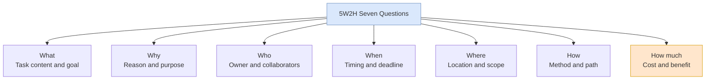

**When to use:** Assigning tasks, writing proposals, making reports, or checking for missed points in a retrospective.

---

### 3. OKR (Objectives and Key Results)

**One-liner:** The Objective is an inspiring qualitative goal; Key Results are measurable outcomes that show whether the goal is met.

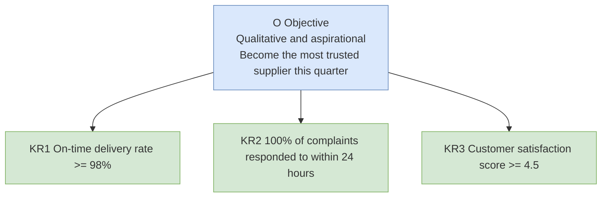

**Key points:** One O with 3-5 KRs; 60-70% completion is ideal (shows the goal is challenging); do not tie directly to bonuses.

---

### 4. WBS Work Breakdown Structure (Decompose Tasks)

**One-liner:** Break a large project down by deliverables into small tasks that are actionable, assignable, and estimable.

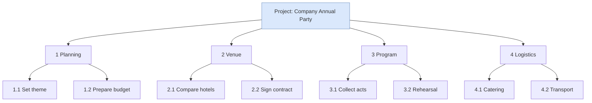

**Key points:** 100% rule — decomposition must cover all project work; lowest-level tasks should be finishable in 1-2 days.

---

### 5. Gantt Chart (Schedule)

**One-liner:** A horizontal timeline showing who does what when, and the dependencies between tasks.

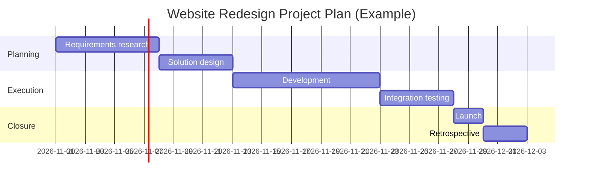

**When to use:** Project scheduling, cross-functional collaboration, and progress reporting to leadership.

---

## II. Problem Analysis

### 6. 5Why (Drill Down to Root Cause)

**One-liner:** Ask "why" repeatedly to get past symptoms and reach an actionable root cause.

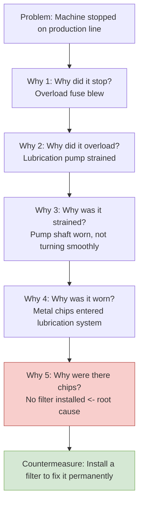

**Key points:** Ask "why," not "whose fault"; each link in the causal chain needs evidence — stop and check data when you cannot answer.

---

### 7. Fishbone / Cause-and-Effect Diagram (Find Causes Comprehensively)

**One-liner:** Brainstorm possible causes across dimensions such as Man, Machine, Material, Method, and Environment to avoid fixating on one angle.

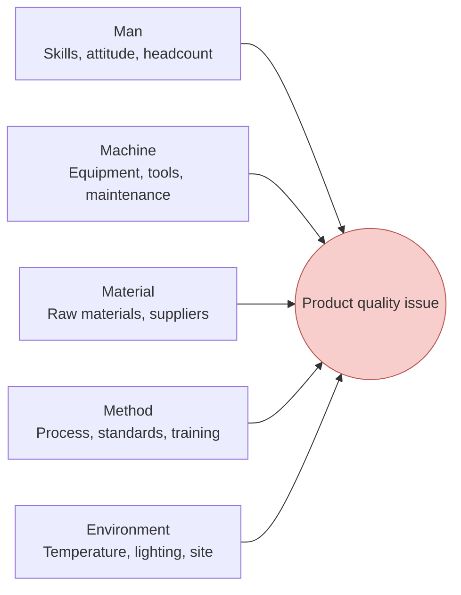

**Usage:** First diverge (brainstorm to fill every bone), then converge and use 5Why to dig deeper into the most suspicious bones. On shop floors, 4M1E / 6M are common (adding Measurement and Mother Nature).

---

### 8. 80/20 Rule / Pareto Principle (Catch the Main Contradiction)

**One-liner:** 80% of results often come from 20% of key factors — find that 20% first.

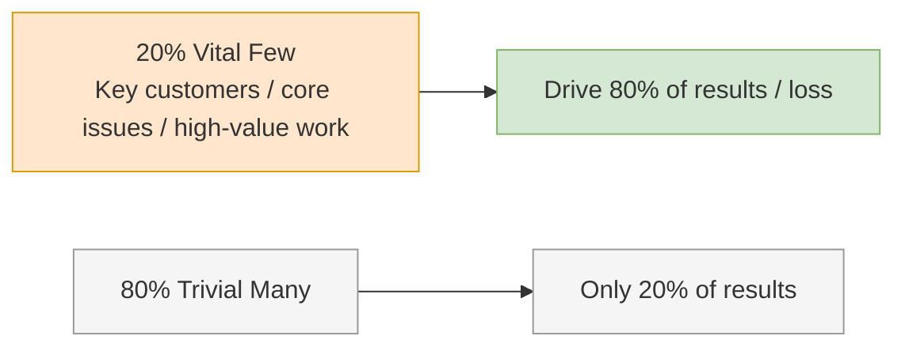

**When to use:** Prioritization, locating quality hotspots (Pareto chart), time management (eat the frog first).

---

## III. Decision & Analysis

### 9. SWOT (Strategic Direction)

**One-liner:** Lay internal strengths and weaknesses against external opportunities and threats, then derive action strategies.

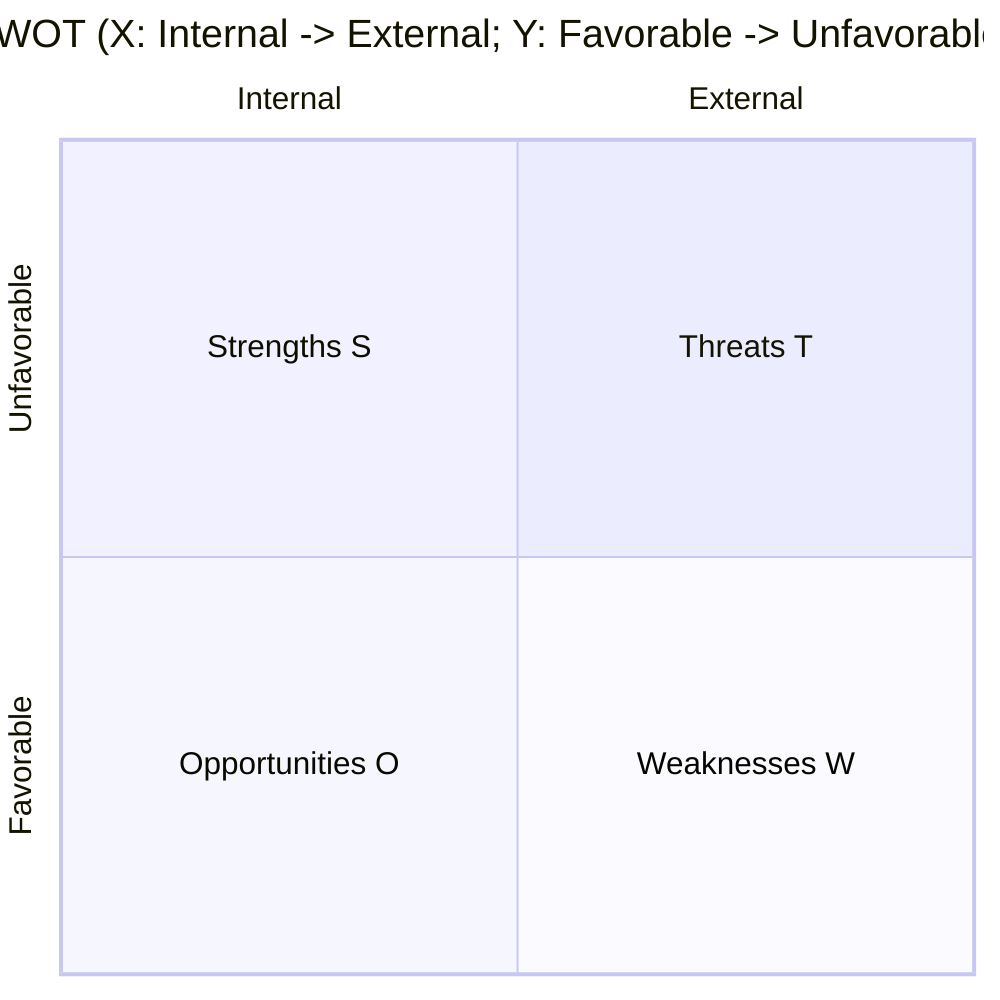

**Example:** Strengths = strong technology, good brand; Weaknesses = weak channels, talent shortage; Opportunities = policy support, market growth; Threats = intensifying competition, substitutes emerging.

**Cross-quadrant strategies:**

| Combo | Strategy | Meaning |
|---|---|---|
| S + O | SO Growth | Use strengths to seize opportunities; attack aggressively |
| W + O | WO Turnaround | Fix weaknesses to capture opportunities |
| S + T | ST Defense | Use strengths to withstand threats |
| W + T | WT Contraction | Reduce investment and survive first |

---

### 10. Eisenhower Matrix (Time Management)

**One-liner:** Sort tasks by importance and urgency, and reserve energy for "important but not urgent" work.

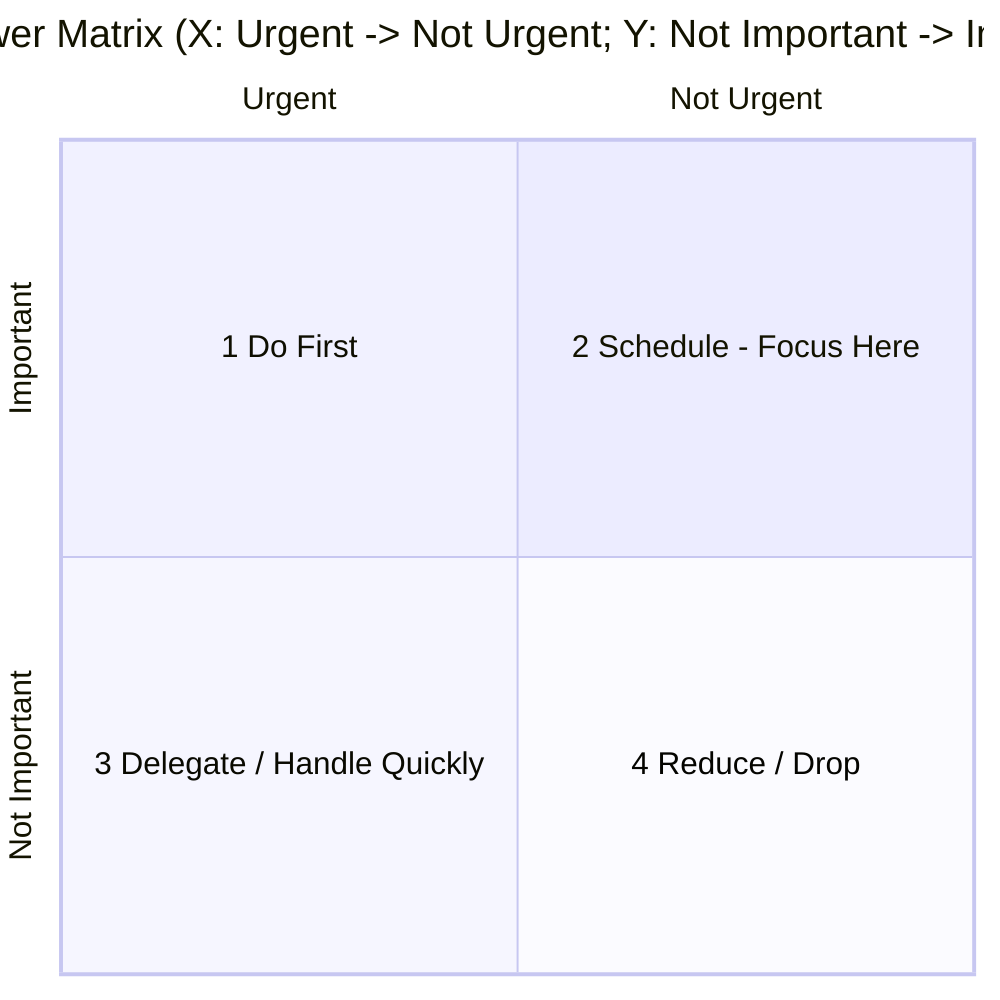

- **1 Important + Urgent** (crises, deadlines) → Do immediately
- **2 Important + Not Urgent** (planning, learning, prevention, exercise) → Do with a plan, **highest value**
- **3 Not Important + Urgent** (interruptions, some meetings) → Delegate or handle quickly
- **4 Not Important + Not Urgent** (mindless scrolling, idle chat) → Reduce or skip

**Core insight:** High performers spend most of their time in Q2; Q1 keeps catching fire precisely because Q2 is neglected.

---

### 11. Six Thinking Hats (Team Discussion)

**One-liner:** Wear one hat at a time and use only one mode of thinking, avoiding arguments and mental chaos.

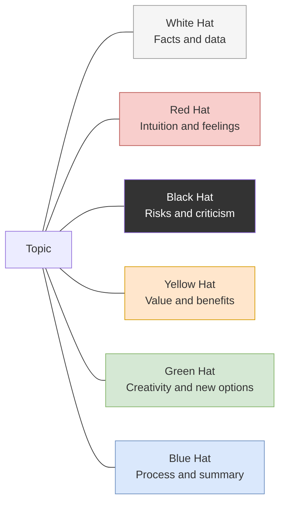

**Typical sequence:** Blue (set process) → White (state facts) → Green (generate options) → Yellow (see value) → Black (find risks) → Red (share feelings) → Blue (decide).

---

### 12. BCG Boston Matrix (Portfolio Decision)

**One-liner:** Classify businesses by market growth rate and relative market share, then decide whether to invest or harvest.

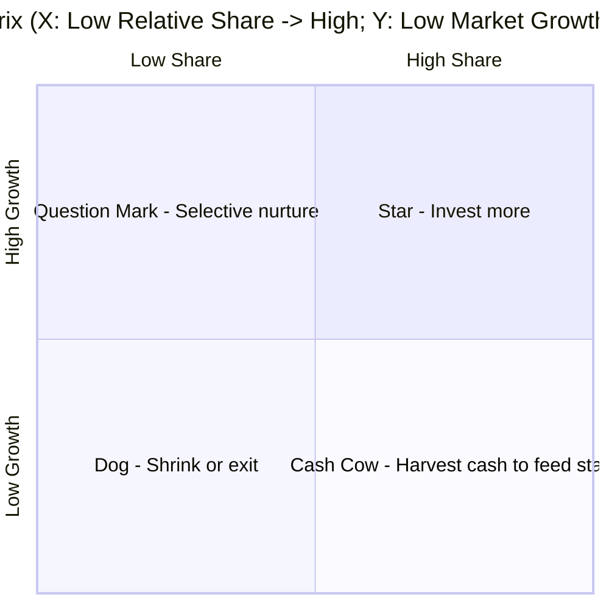

---

### 13. Porter's Five Forces (Industry Competition)

**One-liner:** Industry attractiveness is shaped by five forces; analyze them before deciding whether and how to enter.

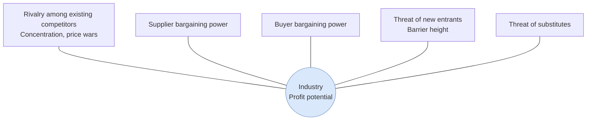

**The stronger the five forces, the lower the industry's average profit.**

---

### 14. MECE (Structured Breakdown)

**One-liner:** Categorize so categories are Mutually Exclusive and Collectively Exhaustive — no overlap, no omission.

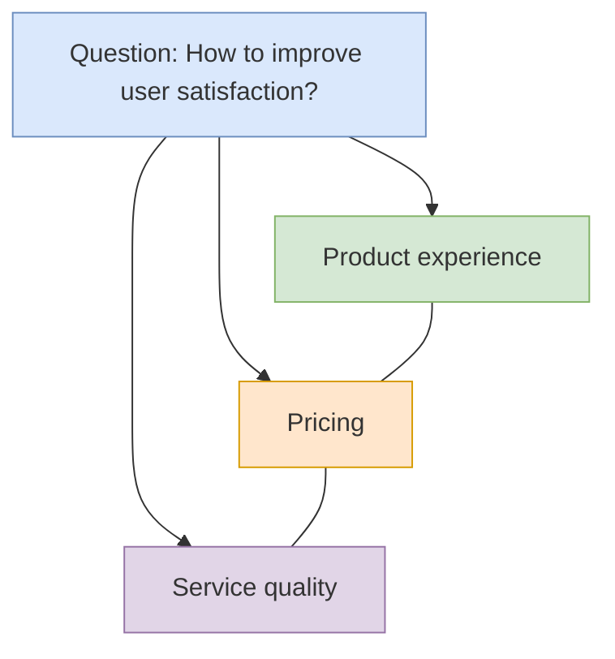

**Test:** If any two items can be merged, they are not mutually exclusive; if you can name a counterexample, they are not collectively exhaustive. MECE is a foundational skill of the pyramid principle and McKinsey-style consulting.

---

## IV. Communication & Expression

### 15. Pyramid Principle / SCQA (Reporting and Writing)

**One-liner:** Lead with the conclusion, support from above, group by category, and progress logically.

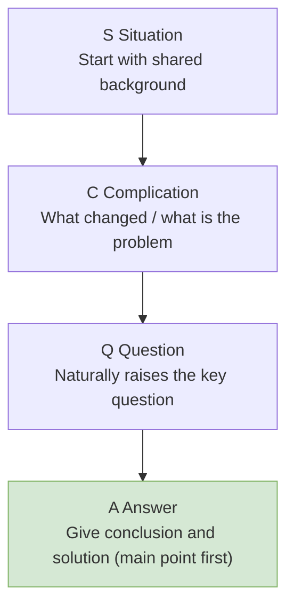

**Contrast:** "Boss, here is the budget, headcount, and progress... so I want to add people" (long buildup)
**SCQA:** "Boss, the project is at risk of delay (C). I recommend adding 2 developers (A). The reason is... (S + Q details)"

---

### 16. Golden Circle (Inspirational Communication)

**One-liner:** Great organizations communicate from "why"; mediocre ones only talk about "what."

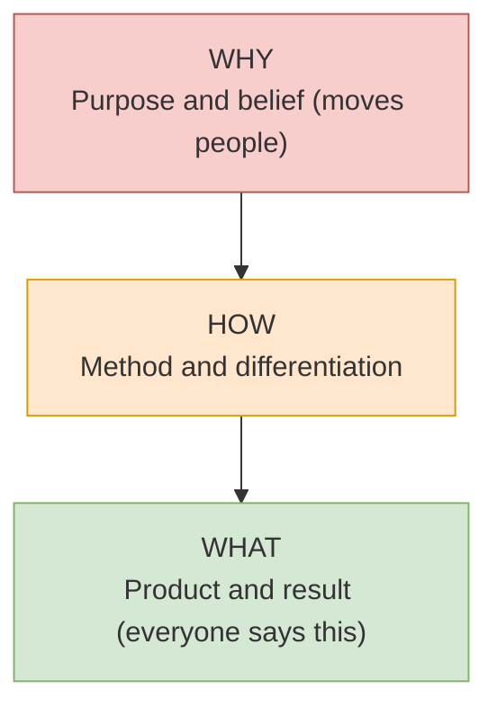

**Example:** Apple does not say "We make computers (What)"; it says "We believe in challenging the status quo (Why), so we design differently (How), and that produces great computers (What)."

---

## V. Execution & Improvement

### 17. PDCA Cycle (Continuous Improvement)

**One-liner:** Plan, Do, Check, Act — repeat the cycle, and level up with each turn.

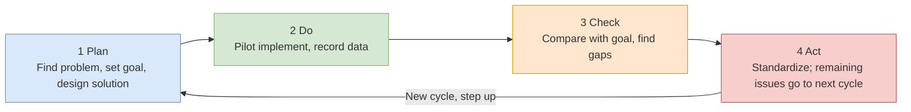

**Key points:** Check is the step most people skip; in Act, practices proven effective should be standardized (this is the basis of "big cycle containing small cycles" improvement).

---

### 18. DMAIC (Six Sigma Improvement)

**One-liner:** A data-driven five-step process for solving complex quality problems; heavier on measurement and statistics than PDCA.

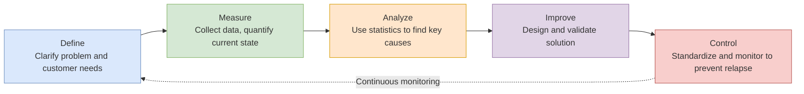

**When to use:** Manufacturing quality improvement, high defect rates, complex problems with sufficient data.

---

### 19. 8D Report (Customer Complaint / Quality Incident Handling)

**One-liner:** The automotive industry's standard team-based problem-solving process: D3 stops the bleeding first, then D4-D5 fix the root cause.

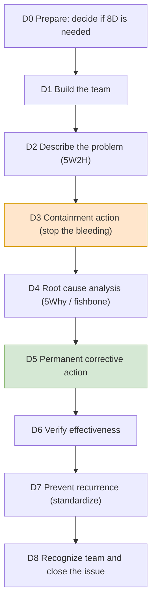

**Note:** Talking about a permanent fix without D3 containment is like performing surgery while the patient is bleeding out.

---

### 20. GRAI Retrospective (Turn Experience into Capability)

**One-liner:** Goal-Result-Analysis-Insight — four steps to turn "what happened" into "what to do next time."

```mermaid
flowchart LR
    G["G Goal Review<br/>What did we originally want?"] --> R["R Result Assessment<br/>What actually happened? Where are the gaps?"]
    R --> A["A Analysis<br/>Root causes of what went right / wrong"]
    A --> I["I Insight<br/>Reusable patterns: stop / continue / start"]
    I --> G2["Feed into next goal (PDCA closed loop)"]
    style G fill:#dae8fc,stroke:#6c8ebf
    style R fill:#d5e8d4,stroke:#82b366
    style A fill:#ffe6cc,stroke:#d79b00
    style I fill:#f8cecc,stroke:#b85450
```

**Key point:** A retrospective is not a blame session; judge the issue, not the person. Insight must translate into "what specifically to do next time."

---

## Ready-Made Open Resources

| Resource | Description |
|---|---|
| [mermaid-js/mermaid](https://github.com/mermaid-js/mermaid) | The open-source chart engine used for all diagrams in this file |
| [MackDing/mentalModelMap](https://github.com/MackDing/mentalModelMap) | 79 classic mental-model visual maps (Chinese, open source) |
| ["12 Tools for Life" PDF](http://chenweixiang.github.io/docs/12_tools_for_everyone.pdf) | Illustrated collection of SWOT/PDCA/6W2H/SMART/WBS/80-20 and more |
| [drawio (diagrams.net)](https://app.diagrams.net) | Free open-source diagramming tool with built-in management chart templates |
| [Excalidraw](https://excalidraw.com) | Open-source hand-drawn style whiteboard, great for quick framework sketches |
| [Miro Templates](https://miro.com/templates) | Huge library of ready-made templates for SWOT, fishbone, 5Why, etc. (some free) |
| [5xWhys Free Tools](https://5xwhys.com/tools/) | Online generators for 5Why, fishbone, and Pareto charts with export options |

## Usage Tips

1. **Start with the roadmap:** Pick a tool by your current task type; do not try to use all 20.
2. **Combine tools:** Use 5W2H to describe the problem (D2 in 8D) → fishbone to diverge → 5Why to converge on root cause → PDCA to track improvement.
3. **Edit diagrams:** Just change the text inside the `mermaid` code blocks; GitHub, Typora, and `index.html` will update automatically.
