# Management Methodology Diagrams (Open Source · Editable · 60 Frameworks)

**Language**：**English** · [中文](README.md) · [Tiếng Việt](README.vi.md)

All diagrams are drawn with **Mermaid** text syntax (open format, [mermaid-js/mermaid](https://github.com/mermaid-js/mermaid) 82k+ stars).
Any Mermaid-compatible tool can render them directly:

- **`index.html` in this folder**: double-click to view the full set of rendered diagrams in your browser (no installation needed)
- **GitHub / Gitee**: upload directly, auto-rendered
- **VS Code**: install the extension "Markdown Preview Mermaid Support"
- **Typora / Obsidian**: native support

To edit a diagram, just change the text — no drawing software required.

## Quick Finder by Scenario

| What you need to do | Recommended tools |
|---|---|
| Set goals | SMART, OKR, 5W2H |
| Plan / break down tasks | 5W2H, WBS, Gantt chart |
| Find root causes | 5Why, fishbone, 80/20 rule |
| Make decisions / analyze | SWOT, Eisenhower matrix, Six Thinking Hats, BCG matrix, Porter's Five Forces |
| Execute / continuous improvement | PDCA, DMAIC, 8D |
| Communicate and present | Pyramid Principle, Golden Circle |
| Retrospect and review | GRAI |
| Factory quality analysis | QC Seven Basic Tools, control chart, CPK, GRR, FMEA |
| Factory floor and equipment | 5S, Poka-Yoke, TPM, OEE, SMED |
| Line efficiency & logistics | Line balancing, Kanban, VSM, EOQ |
| Floor management & change control | Gemba walk, 4M change, Visual management |
| Inspection & quality system | AQL, Control plan, SDCA, FIFO traceability |
| Needs & strategy | Kano, PEST, Ansoff matrix |
| Leading teams | RACI, GROW, KPT, Conflict five strategies, Maslow |
| Project & risk | Critical path, Risk matrix |
| Workplace safety | Heinrich's Law |
| Improvement activities | QCC, A3 report |

## Tool Selection Roadmap

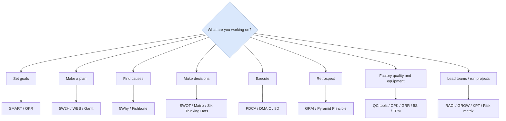

---

## I. Goal & Planning

### 1. SMART (Goal Setting)

**One-liner:** A good goal must be Specific, Measurable, Achievable, Relevant, and Time-bound.

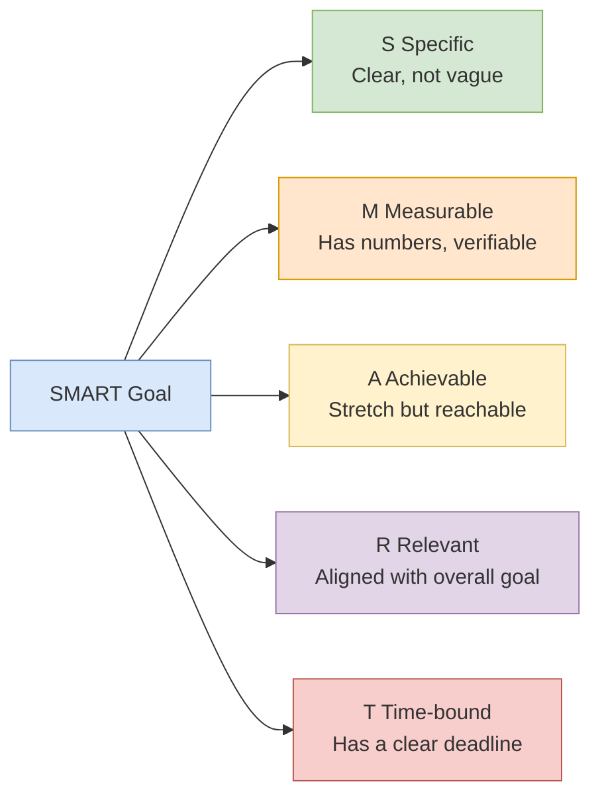

**Bad example:** "Improve customer satisfaction" (vague)
**Good example:** "Within 3 months, reduce first-response time from 4 hours to under 1 hour" (meets all SMART criteria)

---

### 2. 5W2H (Think Through a Task)

**One-liner:** Use seven questions to capture the full picture of a task or plan, preventing omissions and blind action.

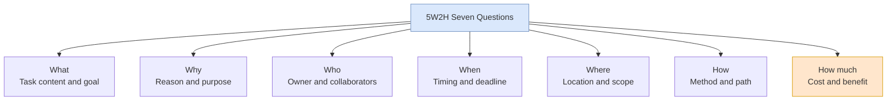

**When to use:** Assigning tasks, writing proposals, making reports, or checking for missed points in a retrospective.

---

### 3. OKR (Objectives and Key Results)

**One-liner:** The Objective is an inspiring qualitative goal; Key Results are measurable outcomes that show whether the goal is met.

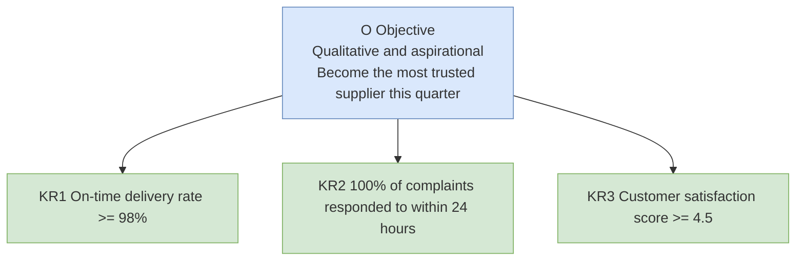

**Key points:** One O with 3-5 KRs; 60-70% completion is ideal (shows the goal is challenging); do not tie directly to bonuses.

---

### 4. WBS Work Breakdown Structure (Decompose Tasks)

**One-liner:** Break a large project down by deliverables into small tasks that are actionable, assignable, and estimable.

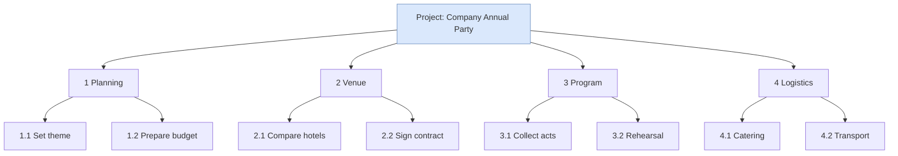

**Key points:** 100% rule — decomposition must cover all project work; lowest-level tasks should be finishable in 1-2 days.

---

### 5. Gantt Chart (Schedule)

**One-liner:** A horizontal timeline showing who does what when, and the dependencies between tasks.


**When to use:** Project scheduling, cross-functional collaboration, and progress reporting to leadership.

---

## II. Problem Analysis

### 6. 5Why (Drill Down to Root Cause)

**One-liner:** Ask "why" repeatedly to get past symptoms and reach an actionable root cause.

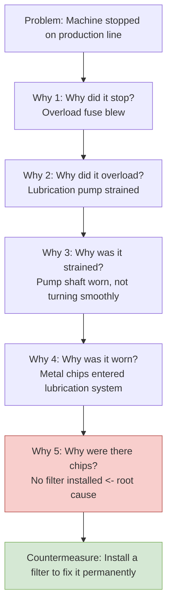

**Key points:** Ask "why," not "whose fault"; each link in the causal chain needs evidence — stop and check data when you cannot answer.

---

### 7. Fishbone / Cause-and-Effect Diagram (Find Causes Comprehensively)

**One-liner:** Brainstorm possible causes across dimensions such as Man, Machine, Material, Method, and Environment to avoid fixating on one angle.

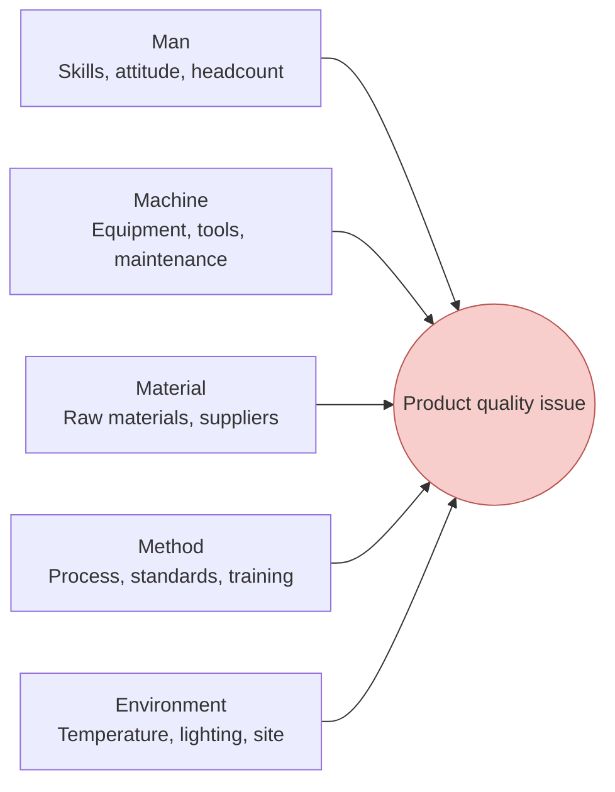

**Usage:** First diverge (brainstorm to fill every bone), then converge and use 5Why to dig deeper into the most suspicious bones. On shop floors, 4M1E / 6M are common (adding Measurement and Mother Nature).

---

### 8. 80/20 Rule / Pareto Principle (Catch the Main Contradiction)

**One-liner:** 80% of results often come from 20% of key factors — find that 20% first.

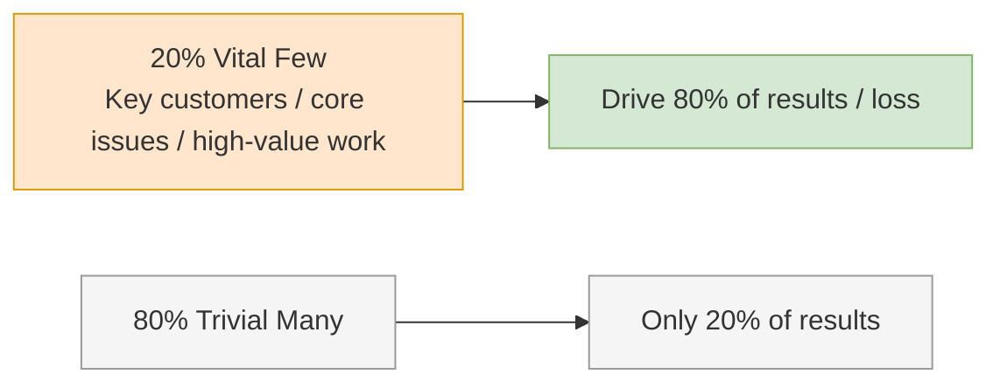

**When to use:** Prioritization, locating quality hotspots (Pareto chart), time management (eat the frog first).

---

## III. Decision & Analysis

### 9. SWOT (Strategic Direction)

**One-liner:** Lay internal strengths and weaknesses against external opportunities and threats, then derive action strategies.

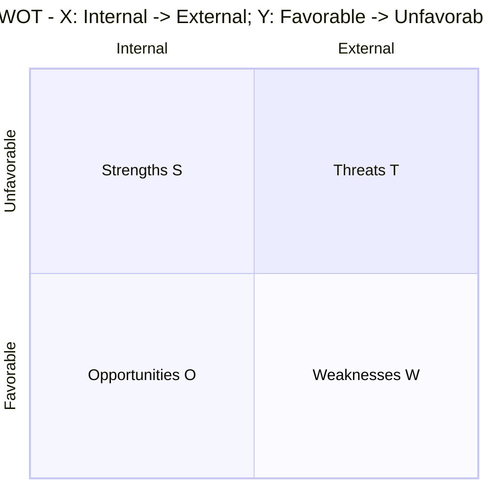

**Example:** Strengths = strong technology, good brand; Weaknesses = weak channels, talent shortage; Opportunities = policy support, market growth; Threats = intensifying competition, substitutes emerging.

**Cross-quadrant strategies:**

| Combo | Strategy | Meaning |
|---|---|---|
| S + O | SO Growth | Use strengths to seize opportunities; attack aggressively |
| W + O | WO Turnaround | Fix weaknesses to capture opportunities |
| S + T | ST Defense | Use strengths to withstand threats |
| W + T | WT Contraction | Reduce investment and survive first |

---

### 10. Eisenhower Matrix (Time Management)

**One-liner:** Sort tasks by importance and urgency, and reserve energy for "important but not urgent" work.

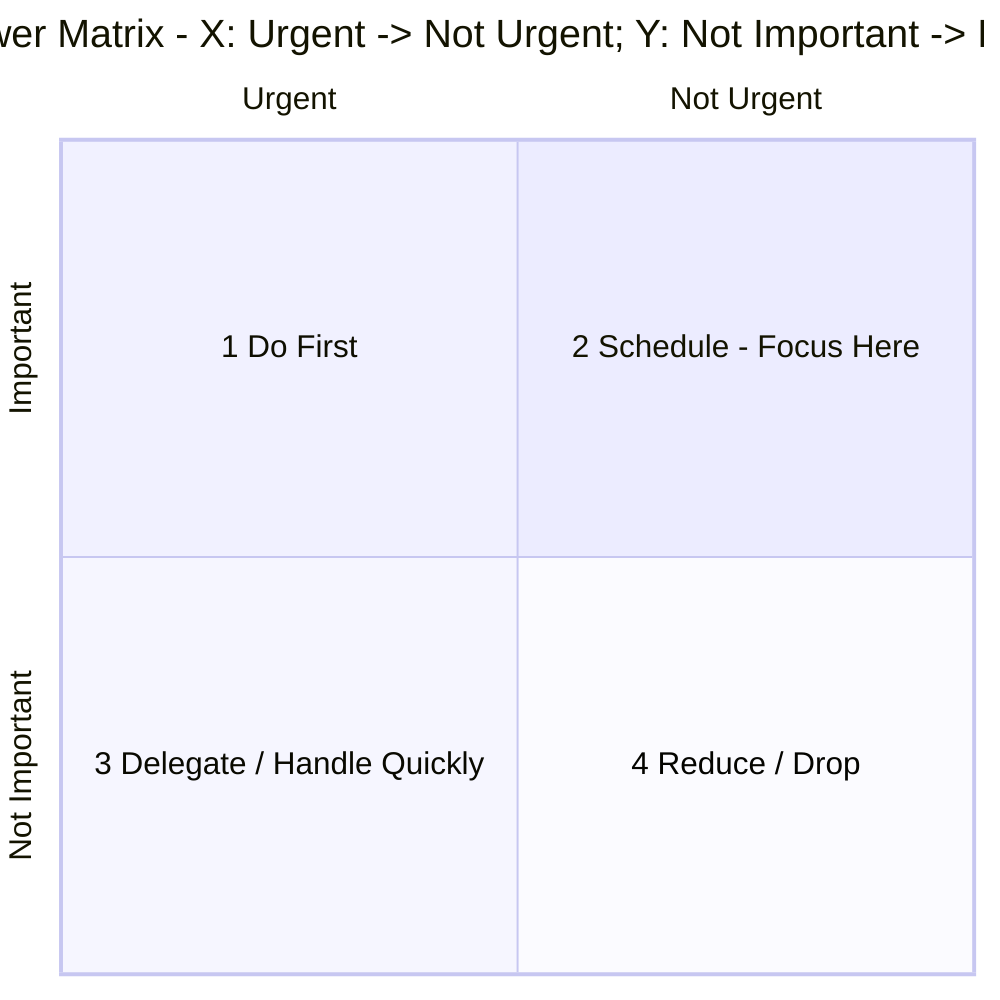

- **1 Important + Urgent** (crises, deadlines) → Do immediately
- **2 Important + Not Urgent** (planning, learning, prevention, exercise) → Do with a plan, **highest value**
- **3 Not Important + Urgent** (interruptions, some meetings) → Delegate or handle quickly
- **4 Not Important + Not Urgent** (mindless scrolling, idle chat) → Reduce or skip

**Core insight:** High performers spend most of their time in Q2; Q1 keeps catching fire precisely because Q2 is neglected.

---

### 11. Six Thinking Hats (Team Discussion)

**One-liner:** Wear one hat at a time and use only one mode of thinking, avoiding arguments and mental chaos.

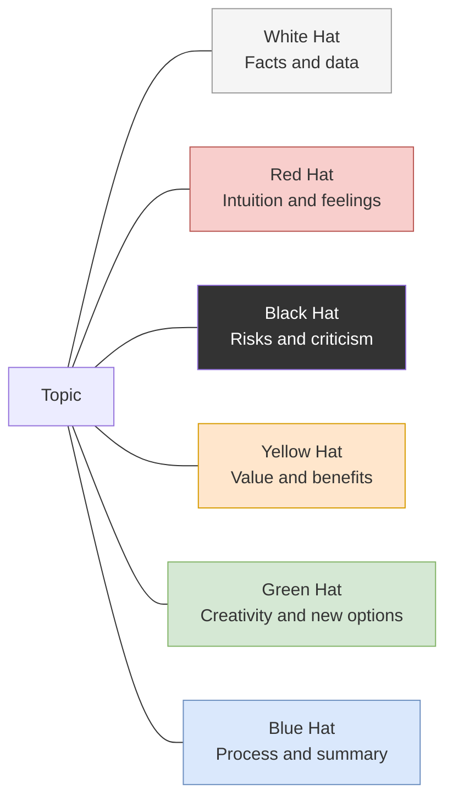

**Typical sequence:** Blue (set process) → White (state facts) → Green (generate options) → Yellow (see value) → Black (find risks) → Red (share feelings) → Blue (decide).

---

### 12. BCG Boston Matrix (Portfolio Decision)

**One-liner:** Classify businesses by market growth rate and relative market share, then decide whether to invest or harvest.

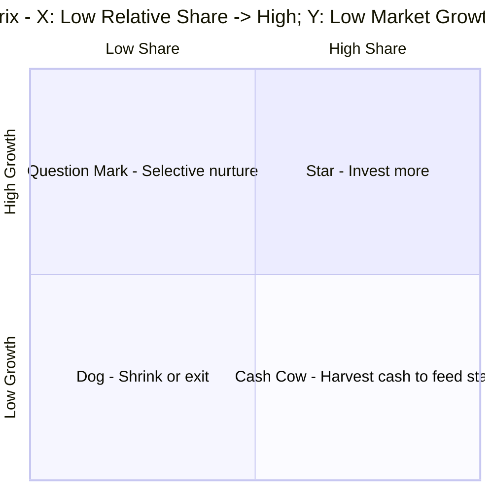

---

### 13. Porter's Five Forces (Industry Competition)

**One-liner:** Industry attractiveness is shaped by five forces; analyze them before deciding whether and how to enter.

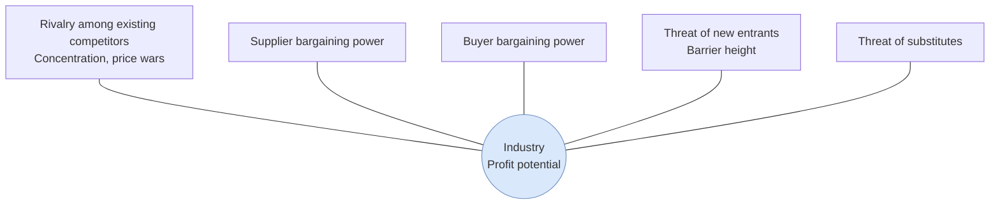

**The stronger the five forces, the lower the industry's average profit.**

---

### 14. MECE (Structured Breakdown)

**One-liner:** Categorize so categories are Mutually Exclusive and Collectively Exhaustive — no overlap, no omission.

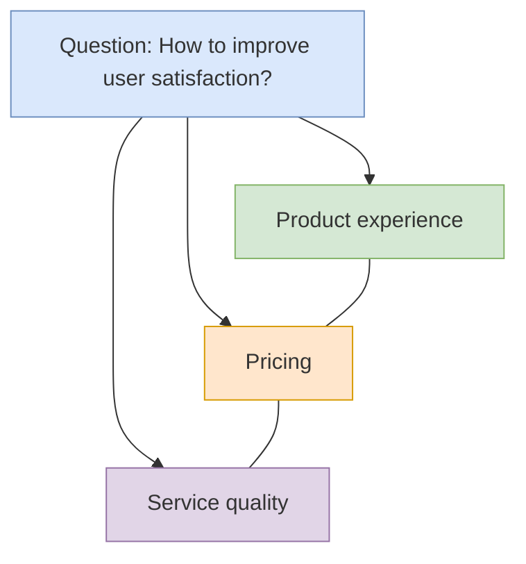

**Test:** If any two items can be merged, they are not mutually exclusive; if you can name a counterexample, they are not collectively exhaustive. MECE is a foundational skill of the pyramid principle and McKinsey-style consulting.

---

## IV. Communication & Expression

### 15. Pyramid Principle / SCQA (Reporting and Writing)

**One-liner:** Lead with the conclusion, support from above, group by category, and progress logically.

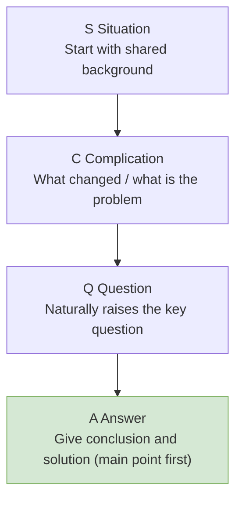

**Contrast:** "Boss, here is the budget, headcount, and progress... so I want to add people" (long buildup)
**SCQA:** "Boss, the project is at risk of delay (C). I recommend adding 2 developers (A). The reason is... (S + Q details)"

---

### 16. Golden Circle (Inspirational Communication)

**One-liner:** Great organizations communicate from "why"; mediocre ones only talk about "what."

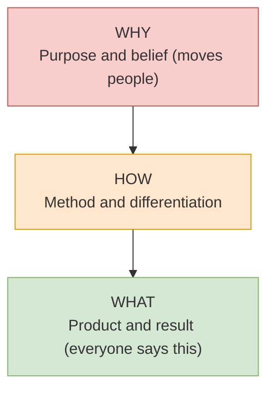

**Example:** Apple does not say "We make computers (What)"; it says "We believe in challenging the status quo (Why), so we design differently (How), and that produces great computers (What)."

---

## V. Execution & Improvement

### 17. PDCA Cycle (Continuous Improvement)

**One-liner:** Plan, Do, Check, Act — repeat the cycle, and level up with each turn.

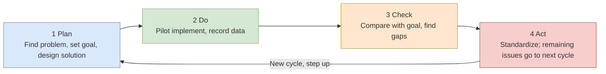

**Key points:** Check is the step most people skip; in Act, practices proven effective should be standardized (this is the basis of "big cycle containing small cycles" improvement).

---

### 18. DMAIC (Six Sigma Improvement)

**One-liner:** A data-driven five-step process for solving complex quality problems; heavier on measurement and statistics than PDCA.

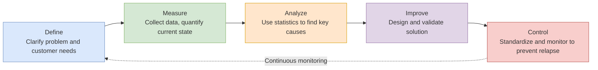

**When to use:** Manufacturing quality improvement, high defect rates, complex problems with sufficient data.

---

### 19. 8D Report (Customer Complaint / Quality Incident Handling)

**One-liner:** The automotive industry's standard team-based problem-solving process: D3 stops the bleeding first, then D4-D5 fix the root cause.

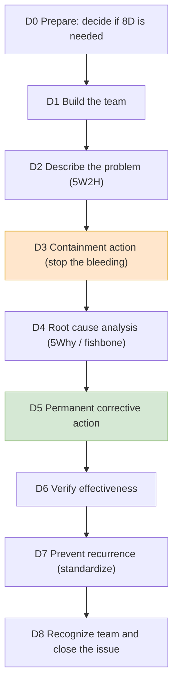

**Note:** Talking about a permanent fix without D3 containment is like performing surgery while the patient is bleeding out.

---

### 20. GRAI Retrospective (Turn Experience into Capability)

**One-liner:** Goal-Result-Analysis-Insight — four steps to turn "what happened" into "what to do next time."

```mermaid
flowchart LR
    G["G Goal Review<br/>What did we originally want?"] --> R["R Result Assessment<br/>What actually happened? Where are the gaps?"]
    R --> A["A Analysis<br/>Root causes of what went right / wrong"]
    A --> I["I Insight<br/>Reusable patterns: stop / continue / start"]
    I --> G2["Feed into next goal (PDCA closed loop)"]
    style G fill:#dae8fc,stroke:#6c8ebf
    style R fill:#d5e8d4,stroke:#82b366
    style A fill:#ffe6cc,stroke:#d79b00
    style I fill:#f8cecc,stroke:#b85450
```

**Key point:** A retrospective is not a blame session; judge the issue, not the person. Insight must translate into "what specifically to do next time."

---

## VI. Quality Management: QC Seven Basic Tools

### 21. QC Seven Basic Tools of Quality - Overview

**One-liner:** The basic toolbox for on-site quality improvement — 5 for describing the problem, 2 for analyzing causes.

```mermaid
flowchart TB
    ROOT["QC Seven Basic Tools"]
    ROOT --> D1["Describe problem (data-driven)"]
    ROOT --> D2["Analyze problem (find causes)"]
    D1 --> T1["Check sheet<br/>Collect data"]
    D1 --> T2["Stratification<br/>Classify and compare"]
    D1 --> T3["Pareto chart<br/>Catch the vital few"]
    D1 --> T4["Histogram<br/>See distribution shape"]
    D1 --> T5["Scatter diagram<br/>See relationship between two variables"]
    D1 --> T6["Control chart<br/>Monitor process variation"]
    D2 --> T7["Cause-and-effect (fishbone)<br/>Systematic cause finding"]
    style ROOT fill:#dae8fc,stroke:#6c8ebf
```

| Tool | Question it answers | Typical use |
|---|---|---|
| Check sheet | What is the actual situation? | Tick off items and record defect counts |
| Stratification | Which category is most concentrated? | Layer by shift / machine / material / operator |
| Pareto chart | Which to solve first? | Top 2-3 items usually account for 80% of defects |
| Histogram | Is the process stable? | See distribution shape, compare with spec limits |
| Scatter diagram | Is there a relationship between A and B? | Temperature vs defect rate, speed vs wear |
| Control chart | Is the process normal now? | Real-time monitoring, alert when out of limits |
| Fishbone | Why did it happen? | With 5Why to find root cause (see section 7) |

---

### 22. Check Sheet

**One-liner:** Turn "impression" into "data" by recording item by item according to pre-designed categories.

**Example: Injection molding defect check sheet (record every 2 hours)**

| Time | Batch | Inspected | Short shot | Flash | Sink mark | Black spot | Total |
|---|---|---|---|---|---|---|---|
| 08:00 | A-101 | 50 | 1 | 0 | 2 | 0 | 3 |
| 10:00 | A-101 | 50 | 0 | 3 | 1 | 1 | 5 |
| 12:00 | A-102 | 50 | 2 | 1 | 0 | 0 | 3 |

**Key points:** Item names must be specific ("Short shot" instead of "Appearance defect"); after a day's summary it can directly become a Pareto chart.

---

### 23. Stratification

**One-liner:** Break mixed data apart by dimension and compare — differences often appear immediately.

**Example:** Plant-wide defect rate 3.2% looks uniform, but after stratifying by machine:

| Machine | 1# | 2# | 3# | 4# |
|---|---|---|---|---|
| Defect rate | 1.1% | 1.3% | **8.9%** | 1.5% |

→ Problem locked on machine #3 (further check: mold wear + no adjustment after mold change).

**Common stratification dimensions:** Shift, machine, mold, material batch, supplier, operator, measuring instrument, environment temperature/humidity.

---

### 24. Pareto Chart

**One-liner:** Arrange defects from largest to smallest, focus on the top 20% to solve 80% of problems.

```mermaid
xychart-beta
    title "Injection molding defect Pareto - one week, n=92"
    x-axis ["Short shot", "Flash", "Sink mark", "Black spot", "Others"]
    bar [45, 22, 12, 9, 4]
```

**Cumulative share:** Short shot 49% → plus Flash 73% → plus Sink mark 86%. Improving "Short shot + Flash" solves nearly three-quarters of defects.

**Key point:** Pareto after stratification (e.g., one chart per machine) is more powerful.

---

### 25. Histogram

**One-liner:** Group measured values into bars to see process center and spread at a glance.

```mermaid
xychart-beta
    title "Shaft OD histogram - n=100, spec φ10±0.05"
    x-axis ["9.96", "9.98", "10.00", "10.02", "10.04", "10.06"]
    bar [4, 18, 35, 28, 11, 4]
```

**Reading:** Center about 10.005, basically centered in spec; bell-shaped → good process capability. If bars show bimodal, island, or skewed patterns, they respectively indicate: two machines mixed / outliers / needs adjustment.

---

### 26. Scatter Diagram

**One-liner:** See whether a correlation exists between two variables, and what shape it is.

| Pattern | Meaning | Direction |
|---|---|---|
| Strong positive (↗) | A up, B up | Control A to control B |
| Strong negative (↘) | A up, B down | Same as above |
| No correlation (scattered) | Unrelated | Look for other causes |
| Curved (∩) | Nonlinear relationship | Find optimal inflection point |

**Example:** Record 12 groups of "injection barrel temperature vs short shot defect count", calculate correlation coefficient r=0.85 (strong positive) → temperature is one of the main causes, DOE locks optimal 235℃.

---

### 27. Control Chart / SPC Monitoring

**One-liner:** Draw a "normal variation band" for the process; out-of-limit or abnormal patterns trigger alarms — catching problems before final inspection.

```mermaid
xychart-beta
    title "X control chart - target 10.0, control limits ±0.5"
    x-axis [1, 2, 3, 4, 5, 6, 7, 8, 9, 10, 11, 12]
    line [10.1, 9.9, 10.2, 10.0, 9.8, 10.3, 10.1, 9.9, 10.0, 10.2, 10.1, 11.2]
    line [10.5, 10.5, 10.5, 10.5, 10.5, 10.5, 10.5, 10.5, 10.5, 10.5, 10.5, 10.5]
    line [10.0, 10.0, 10.0, 10.0, 10.0, 10.0, 10.0, 10.0, 10.0, 10.0, 10.0, 10.0, 10.0]
    line [9.5, 9.5, 9.5, 9.5, 9.5, 9.5, 9.5, 9.5, 9.5, 9.5, 9.5, 9.5]
```

**Reading:** Four lines in order — measured values (wavy line), upper control limit UCL, center line CL, lower control limit LCL. Point 12 breaks UCL → abnormal! Stop line immediately to find cause (in this example: tool wear).

**Common out-of-control rules:** 1 point out / 7 consecutive same side / 7 consecutive rising or falling / 2 of 3 points near control limits.

---

## VII. Process Capability: CPK

### 28. CPK / PPK Process Capability Index

**One-liner:** Not only "everything made is within spec" (Cp looks at spread), but also "the process is steadily centered" (Cpk looks at offset).

```mermaid
flowchart LR
    A["Spec: shaft OD φ10 ± 0.05<br/>USL=10.05, LSL=9.95"] --> B["Collect data n≥100<br/>Calculate mean μ and std dev σ"]
    B --> C["Cp = (USL - LSL) / 6σ<br/>= 0.10 / 0.048 ≈ 2.08"]
    B --> D["Cpk = min(USL-μ, μ-LSL) / 3σ<br/>μ=10.01 → min(0.04, 0.06)/0.024 ≈ 1.67"]
    C --> E{"Capable?"}
    D --> E
    E -->|"Cpk ≥ 1.67"| F["Excellent<br/>Reduce or skip inspection"]
    E -->|"1.33 ~ 1.67"| G["Acceptable<br/>Normal production + SPC monitoring"]
    E -->|"< 1.33"| H["Insufficient<br/>Improve process or 100% inspect"]
    style F fill:#d5e8d4,stroke:#82b366
    style G fill:#ffe6cc,stroke:#d79b00
    style H fill:#f8cecc,stroke:#b85450
```

**Key difference:** Cp only compares spread vs tolerance band regardless of centering; Cpk additionally penalizes center offset. Example: same σ but μ shifted to 10.04, Cp stays 2.08, Cpk drops to 0.14 (large overflow) — **mass production always judges by Cpk.**

**Reference:** General industry Cpk≥1.33; automotive/safety parts Cpk≥1.67. PPK uses the same algorithm for the pilot-run stage (long-term data includes all variation).

---

## VIII. Measurement System Analysis: GRR

### 29. GRR (Gauge Repeatability & Reproducibility)

**One-liner:** First prove with data that "the gauge + people + method" itself is trustworthy; otherwise CPK and SPC are built on sand.

```mermaid
flowchart LR
    A["Select 10 parts<br/>Cover full tolerance range"] --> B["3 inspectors<br/>Each measures each part blindly 3 times"]
    B --> C["Calculate %GRR<br/>= gauge system variation / total variation"]
    C --> D{"Judge"}
    D -->|"%GRR < 10%"| E["Acceptable<br/>Measurement system reliable"]
    D -->|"10% ~ 30%"| F["Conditionally acceptable<br/>Depends on characteristic importance"]
    D -->|"> 30%"| G["Unacceptable<br/>Change gauge / train / improve method"]
    style E fill:#d5e8d4,stroke:#82b366
    style F fill:#ffe6cc,stroke:#d79b00
    style G fill:#f8cecc,stroke:#b85450
```

**Example:** Digital caliper measures shaft OD φ10±0.05, 10×3×3 test yields %GRR=8.2% → acceptable, data can be used for CPK. If %GRR=35%, even CPK 1.5 cannot be trusted — measurement noise has drowned real variation.

**Breakdown:** Repeatability (variation when same inspector measures same part, reflects gauge itself) + Reproducibility (differences between inspectors, reflects people).

---

## IX. Risk Prevention & Automotive Tools

### 30. FMEA Failure Mode and Effects Analysis

**One-liner:** In the design stage, list in advance "where it could fail, how severe, can it be caught", rank by risk, and prioritize prevention.

```mermaid
flowchart LR
    A["Identify potential failure mode<br/>e.g., solder joint cold solder"] --> B["Score each 1~10<br/>S Severity · O Occurrence · D Detection"]
    B --> C["RPN = S × O × D<br/>Ex: 8×4×3 = 96"]
    C --> D{"RPN ≥ 100 or S ≥ 9?"}
    D -->|"Yes"| E["Must improve<br/>Add error-proofing / redesign / add inspection"]
    D -->|"No"| F["Accept and monitor"]
    E --> G["Re-score after improvement<br/>RPN should drop significantly"]
    style C fill:#ffe6cc,stroke:#d79b00
```

**Example: Control board wave soldering FMEA excerpt**

| Failure mode | S | O | D | RPN | Action |
|---|---|---|---|---|---|
| Solder joint cold solder | 8 | 4 | 3 | 96 | Add AOI automatic optical inspection |
| Reverse polarity insertion | 9 | 2 | 5 | 90 | Change fool-proof PCB package (see Poka-Yoke) |
| Missing screw | 6 | 3 | 2 | 36 | Electric screwdriver count + alarm |

**Key points:** S≥9 (safety risk) must be fixed regardless of RPN; new AIAG-VDA uses AP (Action Priority) instead of RPN, same idea.

---

### 31. IATF Five Core Tools (Automotive)

**One-liner:** APQP manages the process rhythm, FMEA manages risk, SPC manages the process, MSA manages measurement, PPAP manages production release.

```mermaid
flowchart LR
    A["APQP Advanced Product Quality Planning<br/>5 phases: Plan→Design→Prototype→Pilot→Production"] --> B["FMEA<br/>Design/process risk analysis"]
    A --> C["SPC<br/>Critical characteristic process monitoring"]
    A --> D["MSA<br/>Measurement system validation (incl. GRR)"]
    B --> E["PPAP Production Part Approval<br/>Customer approval before mass production"]
    C --> E
    D --> E
    style A fill:#dae8fc,stroke:#6c8ebf
    style E fill:#d5e8d4,stroke:#82b366
```

**Practical scenario:** When supplying automotive customers, the PPAP package usually contains: FMEA, control plan, MSA (GRR report), initial process capability (Cpk), sample reports.

---

## X. Factory Floor & Equipment

### 32. 5S Workplace Organization

**One-liner:** Sort, Set in order, Shine, Standardize, Sustain — everything in workplace management starts with 5S.

```mermaid
flowchart LR
    S1["1S Sort<br/>Keep or discard<br/>Decisively remove"] --> S2["2S Set in order<br/>A place for everything<br/>Find in 30 seconds"]
    S2 --> S3["3S Shine<br/>Clean black spots/oil leaks<br/>Also inspect"]
    S3 --> S4["4S Standardize<br/>First 3S standardized<br/>Maintain results"]
    S4 --> S5["5S Sustain<br/>Habit becomes natural"]
    style S5 fill:#d5e8d4,stroke:#82b366
```

**Example:** Mold change tool finding dropped from 20 minutes to 2 minutes — tool wall with shadow board positioning, missing item visible at a glance (links with Poka-Yoke).

---

### 33. Poka-Yoke (Mistake-Proofing)

**One-liner:** Make mistakes physically impossible, instead of relying on people being careful.

| Type | Principle | Example |
|---|---|---|
| Physical | Asymmetric shape, won't fit if reversed | USB connector, asymmetric locating pin |
| Sequential | Cannot do next step until previous done | Cannot reach screwdriver without shell installed |
| Counting | Wrong quantity won't pass | Electric screwdriver: green light only after 4 screws |
| Alarm | Immediate visual/audible alert | Missing part triggers Andon pull cord |
| Information | Color/label distinguishes materials | Red/blue bins for different batches |

**Example:** Operator missed installing seal ring causing customer complaint → changed to vibratory bowl auto-feed + fiber optic counting, machine stops automatically when missing (counting + alarm).

---

### 34. OEE Overall Equipment Effectiveness

**One-liner:** The share of time a machine is truly producing effective output — three major losses multiplied layer by layer.

```mermaid
flowchart LR
    A["Loading time 480 min"] --> B["Minus: breakdown + changeover 60 min<br/>Availability 87.5%"]
    B --> C["Multiply: speed loss<br/>Performance efficiency 95%"]
    C --> D["Multiply: defects + rework<br/>Quality rate 98%"]
    D --> E["OEE = 87.5% × 95% × 98%<br/>≈ 81.5%"]
    E --> F{"World class 85%"}
    style E fill:#ffe6cc,stroke:#d79b00
```

**Six big losses quick check:** Breakdowns, changeover/adjustment (time loss); idling minor stops, reduced speed (performance loss); startup scrap, process defects (quality loss).

**Example:** For a machine with OEE only 45%, use Pareto to find the biggest loss — if changeover is 30%, do SMED first; if breakdown is 40%, do TPM first.

---

### 35. TPM Total Productive Maintenance

**One-liner:** Operators do daily inspection and maintenance, maintenance staff do professional upkeep — eliminate failures while they're still buds.

```mermaid
flowchart TB
    ROOT["TPM Eight Pillars"]
    ROOT --> P1["Autonomous maintenance<br/>Operators: cleaning is inspecting"]
    ROOT --> P2["Planned maintenance<br/>Maintenance: scheduled care"]
    ROOT --> P3["Focused improvement<br/>Eliminate six big losses"]
    ROOT --> P4["Education & training<br/>Multi-skilled workers"]
    ROOT --> P5["Early equipment management<br/>New equipment maintenance-free design"]
    ROOT --> P6["Quality maintenance<br/>Equipment guarantees no defects"]
    ROOT --> P7["Indirect department efficiency"]
    ROOT --> P8["Safety & environment<br/>Zero accidents"]
    style ROOT fill:#dae8fc,stroke:#6c8ebf
```

**Starter handle:** Start from "Autonomous maintenance step 1 — initial cleaning": during cleaning discover machine #3 guide rail oil leak → report and fix root cause → breakdown downtime drops 40% that month.

---

### 36. SMED Quick Changeover

**One-liner:** Convert "must stop to do" internal changeover into "can do while running" external changeover; cutting changeover time in half is common.

```mermaid
flowchart LR
    A["Current: changeover 120 min"] --> B["Step 1: separate internal/external<br/>Internal 70 / External 50"]
    B --> C["Step 2: convert internal to external<br/>Mold preheat, material pre-stage -25 min"]
    C --> D["Step 3: optimize internal<br/>Parallel work, quick-clamp -20 min"]
    D --> E["Step 4: standardize + train<br/>-25 min"]
    E --> F["Result: 50 min<br/>↓58%"]
    style F fill:#d5e8d4,stroke:#82b366
```

**Example:** After injection molding changeover 120→50 min, small-batch production no longer "make a big pile at once", WIP inventory drops 30%.

---

## XI. Safety & Improvement Activities

### 37. Heinrich's Law (Safety)

**One-liner:** For every 1 serious injury, about 29 minor injuries and 300 near misses — eliminate "near miss" events to break the accident chain.

```mermaid
flowchart TB
    A["300 near misses<br/>Almost happened / violation seen"] --> B["29 minor injuries<br/>Recordable accidents"]
    B --> C["1 serious injury / fatality"]
    D["Management action:<br/>Near misses also reported, analyzed, improved<br/>Many companies set 'near-miss proposal award'"] -.-> A
    style C fill:#f8cecc,stroke:#b85450
    style D fill:#d5e8d4,stroke:#82b366
```

**Example:** A plant recorded 600 near misses in a year (slips / near pinch), 2 injuries. Improved Top 3 near misses (anti-slip floor, light curtain) → zero injuries next year.

---

### 38. QCC Quality Control Circle

**One-liner:** Employees at the same workplace form small voluntary circles, use QC tools + PDCA to continuously solve nearby problems.

```mermaid
flowchart LR
    Q1["1 Select theme<br/>Management direction + self-proposed"] --> Q2["2 Grasp current situation<br/>Check sheet + stratification + Pareto"]
    Q2 --> Q3["3 Set target<br/>SMART"]
    Q3 --> Q4["4 Analyze<br/>Fishbone + 5Why"]
    Q4 --> Q5["5 Implement countermeasures<br/>PDCA"]
    Q5 --> Q6["6 Verify effect<br/>Before/after comparison"]
    Q6 --> Q7["7 Standardize<br/>Prevent recurrence"]
    Q7 --> Q8["8 Present and open issues"]
    style Q6 fill:#d5e8d4,stroke:#82b366
```

**Example: Assembly shop "Reduce screw stripped thread defects" QCC:** Current 2.3% → circle members used stratification to lock onto electric screwdriver torque issue → countermeasure: torque screwdriver + daily check → dropped to 0.4% in 3 months, saving ~180,000 yuan/year in rework.

---

### 39. A3 Report

**One-liner:** Condense the entire problem-solving process onto one A3 sheet — forces logical closure and one-page clarity.

| Area | Content | Key point |
|---|---|---|
| Top-left | Background (why do it) | Use data to show pain |
| Bottom-left | Current state and target | Stratification + Pareto; target SMART |
| Top-right | Root cause analysis | Fishbone + 5Why (must be verified) |
| Middle-right | Countermeasures and plan | 5W2H to assign owners |
| Bottom-right | Results and standardization | Before/after numbers; spread to other lines |

**Example:** A3 report on injury improvement — background (5 injuries this quarter) → current state (stratification: handling injuries 60%) → root cause (5Why: training stopped at signature) → countermeasure (practical test + assist carts) → result (0 next quarter).

**When to use:** Cross-functional problem reports, QCC/8D results summary, asking management for resources.

---

## XII. Line Efficiency & Logistics

### 40. Line Balancing

**One-liner:** The smaller the cycle-time difference between stations, the higher line efficiency — the bottleneck station determines total output.

```mermaid
flowchart LR
    A["Station 1<br/>20s"] --> B["Station 2<br/>35s ★ Bottleneck"]
    B --> C["Station 3<br/>25s"]
    C --> D["Station 4<br/>18s"]
    D --> E["Station 5<br/>22s"]
    F["Balance rate = sum of station times ÷ (stations × bottleneck time)<br/>= (20+35+25+18+22) ÷ (5×35) = 120÷175 ≈ 68.6%"]
    G["Improve: split bottleneck / add people / parallel<br/>Target balance rate ≥ 85%"]
    B -.-> F
    F --> G
    style B fill:#f8cecc,stroke:#b85450
    style G fill:#d5e8d4,stroke:#82b366
```

**Example:** Split station 2's 35s into two parallel workers (18+17s), new bottleneck becomes 25s → balance rate = 120÷125 = **96%**, capacity up 40% without buying equipment.

---

### 41. Kanban

**One-liner:** The downstream process takes what it needs; the upstream process produces only that amount — cards replace production orders, eliminating overproduction.

```mermaid
flowchart LR
    A["Customer / downstream"] -->|"Take parts, remove kanban"| B["Kanban collection box"]
    B -->|"Kanban = production order"| C["Upstream produces only kanban quantity"]
    C -->|"Replenish"| D["Supermarket buffer"]
    D --> A
    E["Number of kanban cards<br/>= avg demand × replenishment cycle × (1 + safety factor) ÷ container capacity<br/>Ex: 500/day × 2 days × 1.2 ÷ 50 = 24 cards"]
    style E fill:#fff2cc,stroke:#d6b656
```

**Example:** SMT shop uses 2-bin kanban (one in use, one replenishing); no more mountains of WIP, WIP down 60%.

---

### 42. Value Stream Mapping (VSM)

**One-liner:** Draw information flow + material flow + time on one page to see every waste step from raw material to delivery.

```mermaid
flowchart LR
    S["Supplier"] -->|"Weekly 1x"| P1["Stamping<br/>CT=10s<br/>Changeover 120min"]
    P1 -->|"Push<br/>Batch 5000"| P2["Welding<br/>CT=15s"]
    P2 -->|"Push"| P3["Assembly<br/>CT=45s"]
    P3 -->|"Daily 2x"| C["Customer"]
    T["Total lead time 23 days<br/>Value-added time only 70 seconds"]
    P1 -.-> T
    P2 -.-> T
    P3 -.-> T
    style T fill:#f8cecc,stroke:#b85450
```

**Usage:** Draw current state → mark inventory and waiting → draw future state (continuous flow + pull) → make improvement plan. In the example, only 70 seconds of the 23-day cycle is actual processing.

---

### 43. EOQ Economic Order Quantity

**One-liner:** Order too little → high ordering cost; order too much → high inventory cost; EOQ is the balance point with lowest total cost.

```mermaid
flowchart LR
    A["Annual demand D = 12000 pcs"] --> B["Order cost per order S = 500 yuan"]
    A --> C["Annual holding cost per unit H = 5 yuan/pc"]
    B --> D["EOQ = √(2DS ÷ H)"]
    C --> D
    D --> E["= √(2×12000×500÷5)<br/>≈ 1549 pcs/order"]
    E --> F["Orders per year 12000÷1549 ≈ 8<br/>Minimum total cost ≈ 7745 yuan"]
    style E fill:#ffe6cc,stroke:#d79b00
```

**Key points:** EOQ is an ideal model; in practice also consider MOQ, volume discounts, warehouse capacity, shelf life (use with caution for food/chemicals).

---

## XIII. Floor Management & Change Control

### 44. Gemba Walk (Three-Actual Principles)

**One-liner:** Actual place, actual thing, actual situation — don't sit in the office reading reports; go to the floor, see the real thing, grasp the truth.

```mermaid
flowchart TB
    A["Problem occurs"] --> B["Go to the actual place<br/>Gemba"]
    B --> C["See the actual thing<br/>Touch, measure, photograph"]
    C --> D["Grasp the actual situation<br/>Verify with data, not hearsay"]
    D --> E["Handle on spot / bring back true cause"]
    F["Managers spend 30 min/day walking the line<br/>Three questions: What is the standard? What is actual? Why the gap?"] -.-> B
    style E fill:#d5e8d4,stroke:#82b366
```

**Example:** Report shows defect rate 0.5% normal; line leader's gemba walk finds operator skipped cleaning step to hit quota — only visible on the floor.

---

### 45. 4M Change Management

**One-liner:** Any change in Man, Machine, Material, or Method can introduce new risk — changes must follow a process, not be done quietly.

```mermaid
flowchart LR
    A["Change request<br/>4M: Man/Machine/Material/Method"] --> B["Risk assessment<br/>Update FMEA"]
    B --> C["Small-lot trial run<br/>Verify CPK, GRR"]
    C --> D{"Customer approval?<br/>Required for automotive"}
    D -->|"Yes"| E["Official switchover<br/>First lot tightened inspection"]
    D -->|"No"| F["Continue validation or abandon"]
    E --> G["Update control plan / SOP<br/>Notify relevant people"]
    X["⚠ Unapproved change<br/>= complaints and batch incidents"] -.-> A
    style X fill:#f8cecc,stroke:#b85450
    style G fill:#d5e8d4,stroke:#82b366
```

**Example:** New screw supplier (Material change), no validation, direct production → 5000 units recalled for torque nonconformance — change process prevents this.

---

### 46. Visual Management

**One-liner:** Make floor status known at a glance — normal vs. abnormal without asking, using color, lines, and lights.

| Visual tool | Example |
|---|---|
| Color coding | Green = OK area, Red = defect area, Yellow = pending inspection |
| Location marking | Tool shadow boards, aisle lines, max-stock lines (overflow = abnormal) |
| Andon | Pull cord at station; light + sound on abnormality, team leader arrives within 3 min |
| Management board | Hourly update of daily output / defects / equipment status |
| Signal light | Machine green = running / yellow = standby / red = breakdown |

**Benchmark:** Can a stranger walk into the shop and tell within 30 seconds where things are normal and where they are abnormal?

---

## XIV. Inspection & Quality System

### 47. AQL Sampling Inspection

**One-liner:** Full inspection is impossible; sample statistically — AQL tells you "how many to sample, how many defects to allow."

```mermaid
flowchart LR
    A["Incoming lot N=1500 pcs"] --> B["Look up GB/T 2828.1<br/>General inspection level II"]
    B --> C["Sample size n=125 pcs"]
    C --> D["AQL=1.0<br/>Ac=3, Re=4"]
    D --> E{"Defects found in 125?"}
    E -->|"≤ 3"| F["Accept"]
    E -->|"≥ 4"| G["Reject<br/>Return / sort / special accept"]
    style F fill:#d5e8d4,stroke:#82b366
    style G fill:#f8cecc,stroke:#b85450
```

**Key points:** AQL is not an "allowed defect rate" but a sampling decision criterion; critical safety parts should use SPC + 100% inspection instead of AQL. Inspection level I = relaxed (familiar supplier), III = tightened (new supplier / problem lot).

---

### 48. Control Plan

**One-liner:** Write on one page "what to control at each process, how to control it, and what to do if something goes wrong" — a core IATF document.

**Example: Injection molding control plan excerpt**

| Process | Product characteristic | Spec | Measurement method | Frequency | Reaction to abnormality |
|---|---|---|---|---|---|
| Injection | Outer diameter | φ10±0.05 | Caliper | 5 pcs / 2h | Stop and adjust mold + trace |
| Injection | Short shot | Not allowed | Visual | 100% | Quarantine + adjust machine |
| Assembly | Screw torque | 1.2±0.1 N·m | Torque wrench | 10 pcs / shift | Stop line + re-tighten |

**Key point:** Control plan links with FMEA — high-RPN items from FMEA must have corresponding controls in the control plan.

---

### 49. SDCA Cycle (Standardize & Maintain)

**One-liner:** PDCA raises the level; SDCA prevents backsliding — standardize first, then talk about further improvement.

```mermaid
flowchart LR
    S["S Standardize<br/>Write countermeasure into SOP"] --> D["D Do<br/>Work per new standard"]
    D --> C["C Check<br/>Confirm compliance rate"]
    C --> A["A Act<br/>Correct deviation / retrain"]
    A -->|"Stable"| S2["Enter next PDCA<br/>Challenge higher target"]
    P["PDCA climbs stairs<br/>SDCA is the anti-slip mat"] -.-> S
    style S2 fill:#d5e8d4,stroke:#82b366
```

**Example:** After QCC reduced defect rate from 2.3% to 0.4%, if not written into SOP and checked daily, it likely rebounds to 1.5% in three months — common ending without SDCA.

---

### 50. FIFO First-In-First-Out & Traceability

**One-liner:** Materials leave in the order they arrived, batch information fully traceable — the "time machine" for quality incidents.

```mermaid
flowchart LR
    A["Incoming batch receipt<br/>Label: part no + batch no + date"] --> B["Arrange by receipt time<br/>Left-in right-out / top-in bottom-out"]
    B --> C["First-expired-first-out<br/>ERP enforces FIFO"]
    C --> D["Shipment records batch no"]
    D --> E["Customer complaint: trace by batch<br/>Lock inventory/in-transit/customer quantities"]
    E --> F["Quarantine → dispose → 8D"]
    style E fill:#ffe6cc,stroke:#d79b00
```

**Example:** Customer complains battery swelling; factory locks problem batch to March 12 Line B within 30 minutes, recalls 200 in transit, notifies customer to quarantine 1500 — impossible without traceability.

---

## XV. Needs & Strategy

### 51. Kano Model

**One-liner:** Needs fall into three types — basic (absence causes complaints), performance (more is better), excitement (creates word-of-mouth).

```mermaid
flowchart TB
    K["Kano Model"]
    K --> B["Basic<br/>Missing = complaint, present = silent<br/>e.g., phone can make calls"]
    K --> P["Performance<br/>More = more satisfied (linear)<br/>e.g., battery 1d→3d→7d"]
    K --> E["Excitement<br/>Exceeds expectations, creates delight<br/>e.g., on-time delivery insurance"]
    K --> I["Indifferent<br/>Presence or absence doesn't matter"]
    style B fill:#f8cecc,stroke:#b85450
    style P fill:#ffe6cc,stroke:#d79b00
    style E fill:#d5e8d4,stroke:#82b366
```

**Application:** Basic must be 100% met; performance optimized by ROI; excitement is differentiation weapon — and today's excitement decays into tomorrow's expectation.

---

### 52. PEST Macro Environment Analysis

**One-liner:** Before entering a new market/industry, scan the external environment through political, economic, social, and technology lenses.

```mermaid
flowchart TB
    PEST["PEST Analysis"]
    PEST --> P["P Political / Legal<br/>Policy stability, tariffs, labor law<br/>e.g., Vietnam tax incentives for foreign investment"]
    PEST --> E["E Economic<br/>Exchange rate, labor cost, inflation<br/>e.g., Vietnam wages rising 8-10% yearly"]
    PEST --> S["S Social / Cultural<br/>Demographics, language, religion<br/>e.g., Vietnam median age 32"]
    PEST --> T["T Technology<br/>Infrastructure, automation, supply chain<br/>e.g., northern Vietnam electronics cluster mature"]
    style PEST fill:#dae8fc,stroke:#6c8ebf
```

**When to use:** Overseas plant site selection, new business feasibility, annual strategy review.

---

### 53. Ansoff Matrix (Growth Strategy)

**One-liner:** Use "product × market" new/old combinations to generate four growth routes, ranked from low to high risk.

```mermaid
quadrantChart
    title Ansoff Matrix - X: Existing Product -> New Product; Y: Existing Market -> New Market
    x-axis "Existing Product" --> "New Product"
    y-axis "Existing Market" --> "New Market"
    quadrant-3 "Market penetration - sell more existing products to existing customers"
    quadrant-2 "Market development - existing products into new markets"
    quadrant-4 "Product development - new products for existing customers"
    quadrant-1 "Diversification - new product + new market, highest risk"
```

**Example:** Snack factory growth path — market penetration (channel down-extension to county supermarkets) → product development (low-sugar version for existing customers) → market development (export to Southeast Asia) → diversification (acquire beverage factory).

---

## XVI. Leading Teams

### 54. RACI Matrix

**One-liner:** Every task has only one A (Accountable) — avoids "everyone's responsible = no one is" or credit-grabbing/blame-shifting.

| Task | Project manager | Engineering | Quality | Production |
|---|---|---|---|---|
| New product introduction | **A** | R | C | C |
| Pilot run validation | C | **A**/R | R | R |
| Mass production release | **A** | C | R | I |
| Customer complaint handling | I | C | **A**/R | C |

R=Responsible, A=Accountable, C=Consulted, I=Informed. **Every row must have exactly one A.**

---

### 55. GROW Coaching Model

**One-liner:** Coach subordinates without giving answers — use four questions to help them find the answer, so they actually execute.

```mermaid
flowchart LR
    G["G Goal<br/>What do you want to achieve?"] --> R["R Reality<br/>What is the current situation?"]
    R --> O["O Options<br/>What are possible ways?"]
    O --> W["W Will<br/>What will you do? When will you start?"]
    W --> F["Employee-committed action<br/>Execution rate much higher than assigned tasks"]
    style F fill:#d5e8d4,stroke:#82b366
```

**Example dialogue:** Manager asks "What do you want to improve this month?" (G) → "How long is changeover now?" (R) → "How do you think it could be shortened?" (O) → "Then let's try internal/external separation next week?" (W) — SMED is "their choice," zero resistance to rollout.

---

### 56. KPT Retrospective

**One-liner:** Keep what to continue, Problem what went wrong, Try what to test next — the lightest daily retrospective.

```mermaid
flowchart LR
    K["K Keep<br/>What went well, standardize it"] --> P["P Problem<br/>Where stuck? Root cause?"]
    P --> T["T Try<br/>Which countermeasure to test next?"]
    T --> K
    style T fill:#ffe6cc,stroke:#d79b00
```

**Example (3-minute daily standup):** K=changeover completed faster than target today; P=material mix-up caused 20-min search; T=tomorrow try color-zoned storage. Lighter than GRAI, good for high-frequency small cycles (daily/weekly).

---

### 57. Conflict Handling Five Strategies (TKI)

**One-liner:** Conflict is not scary; choosing the right strategy is key — assertiveness (result) and cooperation (relationship) determine the approach.

| Strategy | Assertiveness × Cooperation | When to use | Example |
|---|---|---|---|
| Competing | High assertive, low cooperation | Urgent + principle issue | Safety issue must stop work immediately |
| Collaborating | Both high | Important and need win-win | Build quality standards with key supplier |
| Compromising | Both medium | Time tight, each gives a little | Delivery dispute, both sides give 2 days |
| Avoiding | Both low | Small matter, emotions hot | Let both sides cool 24 hours before talking |
| Accommodating | Low assertive, high cooperation | Relationship more important | Yield to senior expert's technical approach |

**Myth:** "Avoiding" is not weakness — pausing when emotions are high is professional.

---

### 58. Maslow's Hierarchy of Needs (Motivation)

**One-liner:** Employee needs progress from survival to self-actualization — frontline cares about money, key staff cares about growth; wrong incentives waste money.

```mermaid
flowchart TB
    M5["Self-actualization<br/>Challenge projects, patent credit, internal startup"] --> M4["Esteem<br/>Titles, recognition, private office"]
    M4 --> M3["Social<br/>Team building, mentorship, clubs"]
    M3 --> M2["Safety<br/>Insurance, stable orders, PPE"]
    M2 --> M1["Physiological<br/>Wages, canteen, dormitory, shuttle bus"]
    style M1 fill:#f8cecc,stroke:#b85450
    style M5 fill:#d5e8d4,stroke:#82b366
```

**Factory application:** Operators mainly motivated by M1-M2 (transparent overtime pay, dorm improvement); team leaders/engineers add M3-M4 (skill certification, outstanding employee trips); for M5-driven key staff, leading improvement projects retains them better than raises.

---

## XVII. Project & Risk

### 59. Critical Path Method (CPM)

**One-liner:** The longest-duration path in a project determines total duration — compressing non-critical paths is wasted effort.

```mermaid
flowchart LR
    A["A Design<br/>3 days"] --> B["B Procurement<br/>5 days"]
    A --> C["C Prototype<br/>2 days"]
    B --> D["D Assembly<br/>4 days"]
    C --> D
    D --> E["Delivery"]
    P["Critical path A→B→D = 12 days<br/>Compress duration only on these three<br/>C has 3 days float, not urgent"] -.-> B
    style B fill:#ffe6cc,stroke:#d79b00
    style P fill:#fff2cc,stroke:#d6b656
```

**Example:** To cut 2 days, paying supplier B for expedited delivery works; pushing prototype C is useless — it was already waiting.

---

### 60. Risk Matrix (Probability × Impact)

**One-liner:** Too many risks to manage? Rank by "probability × impact" and handle red zone first.

```mermaid
flowchart TB
    M["Risk matrix RPN = P × I"]
    M --> H["Red zone P×I ≥ 12<br/>Act now: avoid/transfer/mitigate"]
    M --> MID["Yellow zone 6 ~ 11<br/>Make plan, review regularly"]
    M --> L["Green zone ≤ 5<br/>Accept, keep monitoring"]
    E1["High-risk e.g. single-supplier material cutoff<br/>P=3 × I=5 = 15 → dual source + safety stock"] --> H
    E2["Medium-risk e.g. new employee proficiency<br/>P=4 × I=2 = 8 → mentorship + first-month buddy"] --> MID
    E3["Low-risk e.g. office relocation<br/>P=2 × I=2 = 4 → pack early"] --> L
    style H fill:#f8cecc,stroke:#b85450
    style MID fill:#ffe6cc,stroke:#d79b00
    style L fill:#d5e8d4,stroke:#82b366
```

**When to use:** Project kickoff, new product introduction, plant relocation, annual risk assessment. More general than FMEA (not limited to product/process).

---

## Ready-Made Open Resources

| Resource | Description |
|---|---|
| [mermaid-js/mermaid](https://github.com/mermaid-js/mermaid) | The open-source chart engine used for all diagrams in this file |
| [MackDing/mentalModelMap](https://github.com/MackDing/mentalModelMap) | 79 classic mental-model visual maps (Chinese, open source) |
| ["12 Tools for Life" PDF](http://chenweixiang.github.io/docs/12_tools_for_everyone.pdf) | Illustrated collection of SWOT/PDCA/6W2H/SMART/WBS/80-20 and more |
| [drawio (diagrams.net)](https://app.diagrams.net) | Free open-source diagramming tool with built-in management chart templates |
| [Excalidraw](https://excalidraw.com) | Open-source hand-drawn style whiteboard, great for quick framework sketches |
| [Miro Templates](https://miro.com/templates) | Huge library of ready-made templates for SWOT, fishbone, 5Why, etc. (some free) |
| [5xWhys Free Tools](https://5xwhys.com/tools/) | Online generators for 5Why, fishbone, and Pareto charts with export options |

## Usage Tips

1. **Start with the roadmap:** Pick a tool by your current task type; do not try to use all 20.
2. **Combine tools:** Use 5W2H to describe the problem (D2 in 8D) → fishbone to diverge → 5Why to converge on root cause → PDCA to track improvement.
3. **Edit diagrams:** Just change the text inside the `mermaid` code blocks; GitHub, Typora, and `index.html` will update automatically.
