# 管理方法论图解（开源 · 可编辑 · 共 20 个）

**语言 Language Ngôn ngữ**：**中文** · [English](README.en.md) · [Tiếng Việt](README.vi.md)

所有图解均使用 **Mermaid** 文本语法绘制（开源格式，[mermaid-js/mermaid](https://github.com/mermaid-js/mermaid) 82k+ stars）。
任何支持 Mermaid 的工具都能直接渲染成图：

- **本目录的 `index.html`**：双击即可在浏览器中查看渲染好的全套图解（无需安装任何东西）
- **GitHub / Gitee**：直接上传，自动渲染
- **VS Code**：装插件 "Markdown Preview Mermaid Support"
- **Typora / Obsidian**：原生支持

修改图解只需改文本，无需绘图软件。

## 按场景速查

| 你要做的事 | 推荐工具 |
|---|---|
| 定目标 | SMART、OKR、5W2H |
| 做计划 / 拆解任务 | 5W2H、WBS、甘特图 |
| 找问题根因 | 5Why、鱼骨图、二八法则 |
| 做决策 / 分析 | SWOT、艾森豪威尔四象限、六顶思考帽、BCG 矩阵、波特五力 |
| 抓执行 / 持续改进 | PDCA、DMAIC、8D |
| 沟通与表达 | 金字塔原理、黄金圈法则 |
| 复盘总结 | GRAI 复盘法 |

## 工具选择路线图

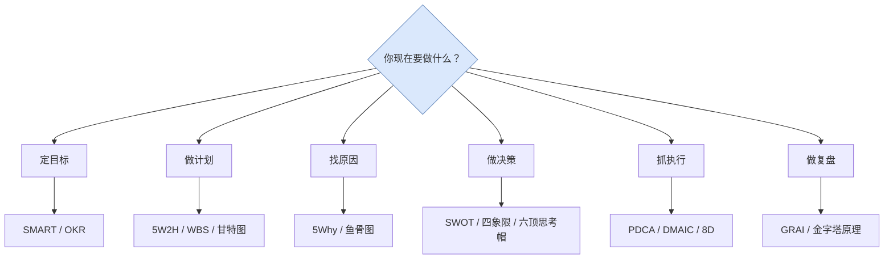

---

## 一、目标与计划类

### 1. SMART 原则（定目标）

**一句话**：好目标必须具体、可衡量、可实现、相关联、有时限。

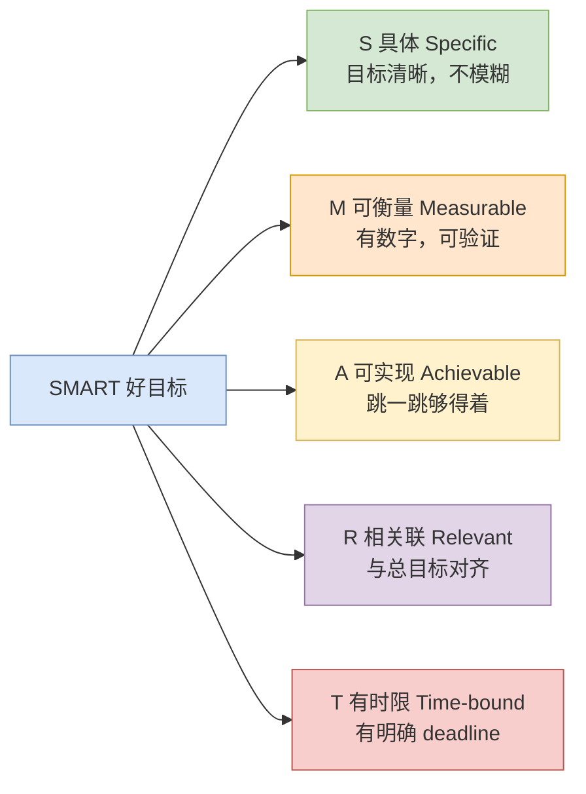

**反例**：「提升客户满意度」（模糊）
**正例**：「3 个月内，将客服首次响应时间从 4 小时降至 1 小时以内」（SMART 全满足）

---

### 2. 5W2H 分析法（把一件事想清楚）

**一句话**：用 7 个问题把任务/方案的全貌问出来，防止遗漏、杜绝盲目。

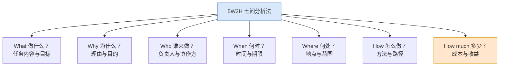

**何时用**：布置任务、写方案、做汇报、复盘检查遗漏。

---

### 3. OKR（目标与关键结果）

**一句话**：O 是鼓舞人心的定性目标，KR 是衡量目标是否达成的量化结果。

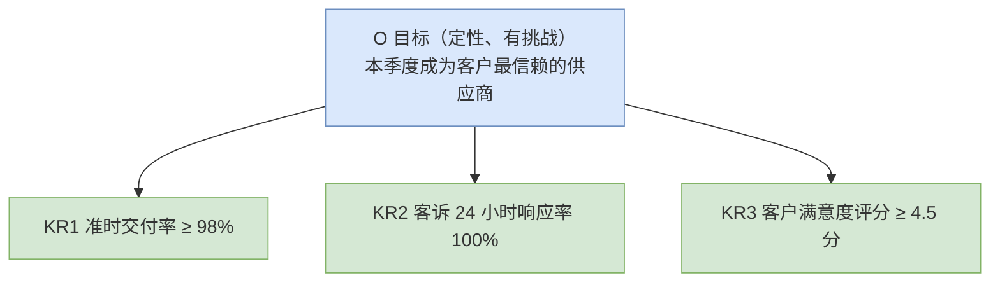

**要点**：1 个 O 配 3-5 个 KR；完成 60-70% 最佳（说明目标有挑战）；不与奖金直接挂钩。

---

### 4. WBS 工作分解结构（拆任务）

**一句话**：把大项目按「可交付成果」逐层拆解到「可执行、可分配、可估算」的小任务。

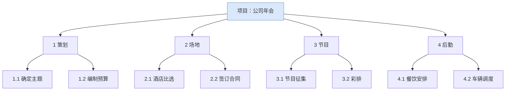

**要点**：100% 原则——拆解要覆盖项目全部工作；最底层任务 1-2 天内能完成。

---

### 5. 甘特图（排进度）

**一句话**：横向时间轴上看清「谁在什么时间做什么、前后依赖关系」。

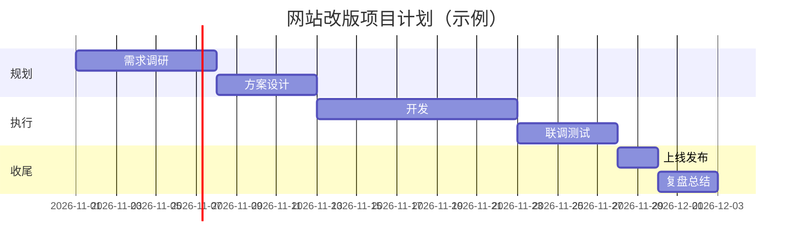

**何时用**：项目排期、跨部门协作、向上汇报进度。

---

## 二、问题分析类

### 6. 5Why 分析法（追问根因）

**一句话**：对一个连续追问「为什么」，穿过表象直到找到可采取行动的根本原因。

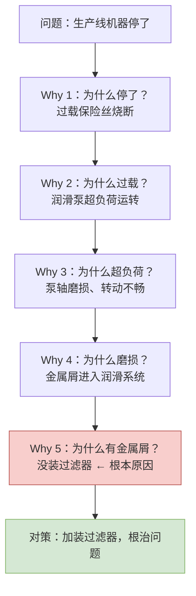

**要点**：问「为什么」不是问「谁的责任」；每条因果链要有证据，回答不了就停下来查数据。

---

### 7. 鱼骨图 / 因果图（全面找原因）

**一句话**：从人、机、料、法、环等维度穷举所有可能原因，避免只盯一个方向。

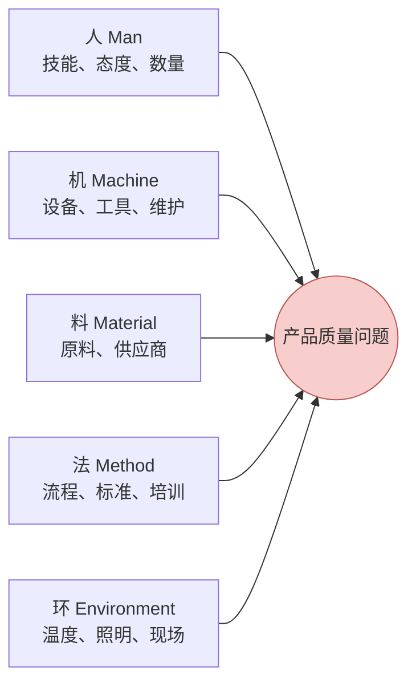

**用法**：先发散（头脑风暴把鱼骨填满），收敛后用 5Why 对最可疑的几根骨头深挖。生产现场常用 4M1E / 6M（再加测量 Measurement、自然 Mother Nature）。

---

### 8. 二八法则 / 帕累托法则（抓主要矛盾）

**一句话**：80% 的结果往往由 20% 的关键因素决定，先找到那 20%。

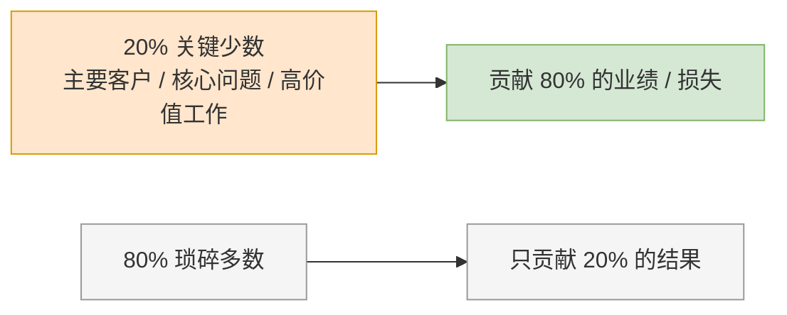

**何时用**：排优先级、找质量问题集中点（帕累托图）、时间管理（先吃掉那只青蛙）。

---

## 三、决策与分析类

### 9. SWOT 分析（定战略方向）

**一句话**：把内部优劣与外部机会威胁摆到一张图上，组合出行动策略。

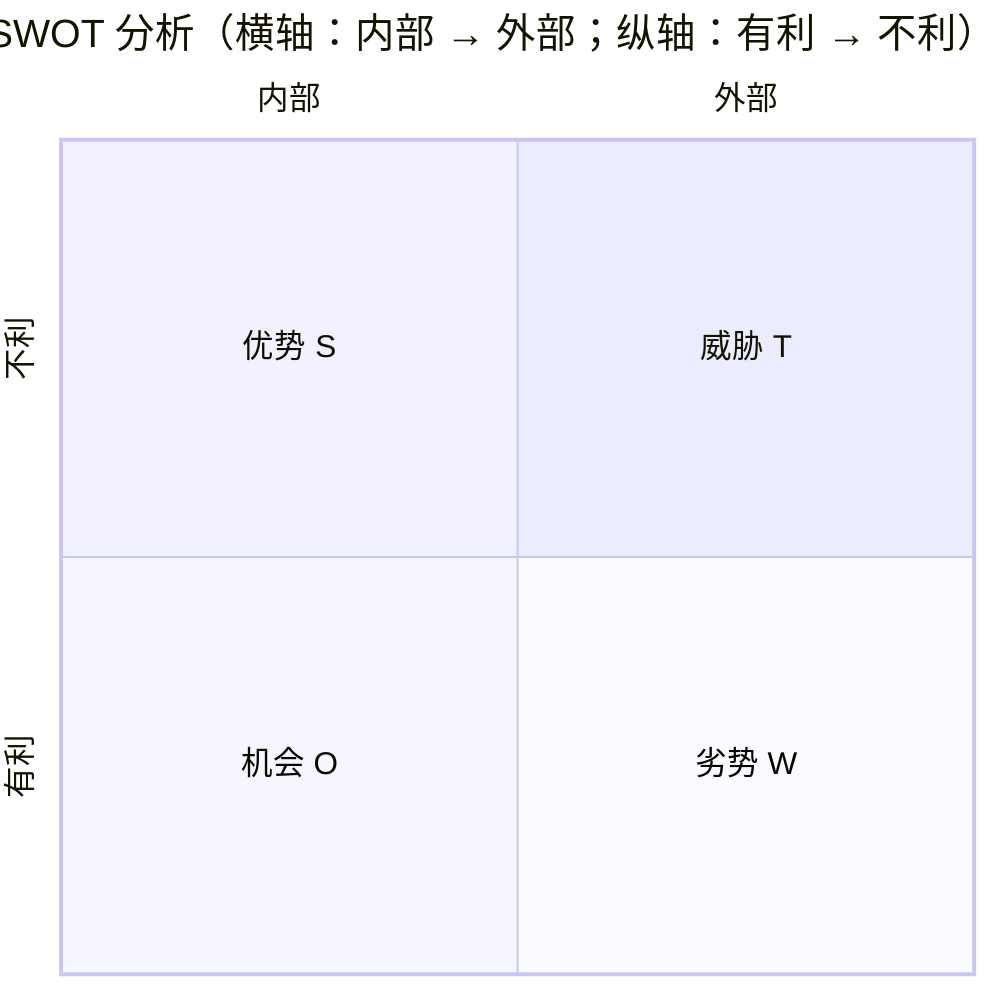

**示例**：优势=技术强、品牌好；劣势=渠道弱、人才缺；机会=政策扶持、市场增长；威胁=竞争加剧、替代品出现。

**四象组合策略**：

| 组合 | 策略 | 含义 |
|---|---|---|
| S + O | SO 增长型 | 用优势抓机会，全力进攻 |
| W + O | WO 扭转型 | 补短板抓机会 |
| S + T | ST 防御型 | 用优势抵御威胁 |
| W + T | WT 收缩型 | 减少投入，先活下来 |

---

### 10. 艾森豪威尔四象限（时间管理）

**一句话**：按「重要 / 紧急」分四类，把精力留给「重要不紧急」的事。

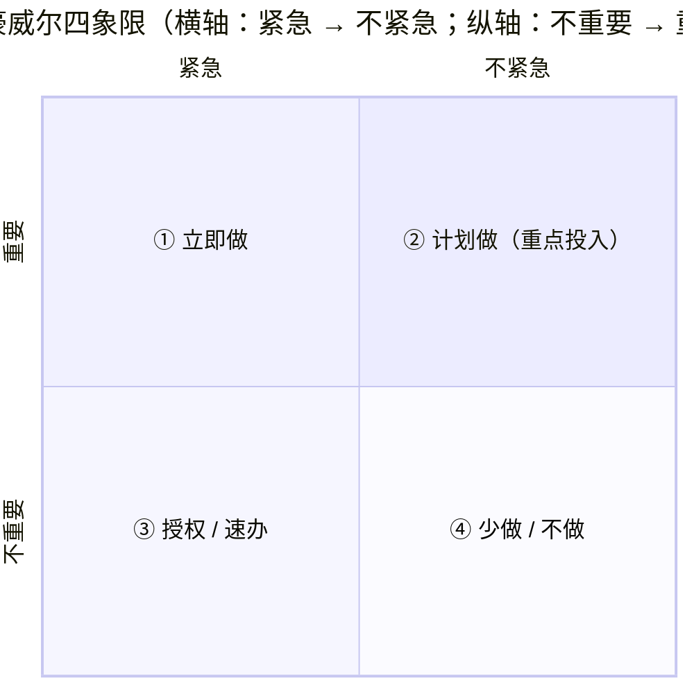

- **① 重要 + 紧急**（危机、临期任务）→ 立即做
- **② 重要 + 不紧急**（规划、学习、预防、锻炼）→ 有计划地做，**价值最高**
- **③ 不重要 + 紧急**（临时打扰、部分会议）→ 授权他人或速办
- **④ 不重要 + 不紧急**（无目的刷屏、闲聊）→ 减少或不做

**核心洞察**：高效的人把大部分时间投在 Q2；Q1 之所以总着火，正是因为 Q2 做得不够。

---

### 11. 六顶思考帽（团队讨论）

**一句话**：一次只戴一顶帽子、只用一种思维方式讨论，避免争吵和思维混乱。

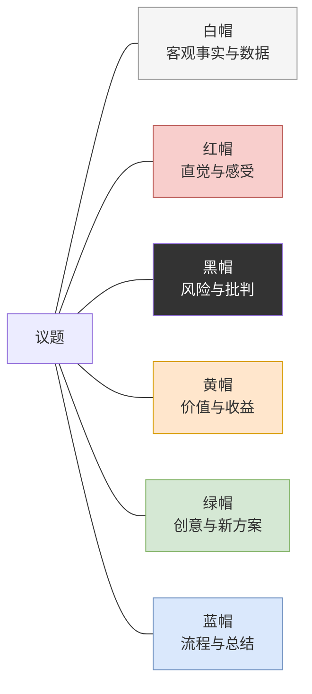

**典型顺序**：蓝（定流程）→ 白（摆事实）→ 绿（出方案）→ 黄（看价值）→ 黑（找风险）→ 红（表态度）→ 蓝（拍结论）。

---

### 12. BCG 波士顿矩阵（业务组合决策）

**一句话**：按「市场增长率 × 相对份额」把业务分成四类，决定投入还是收割。

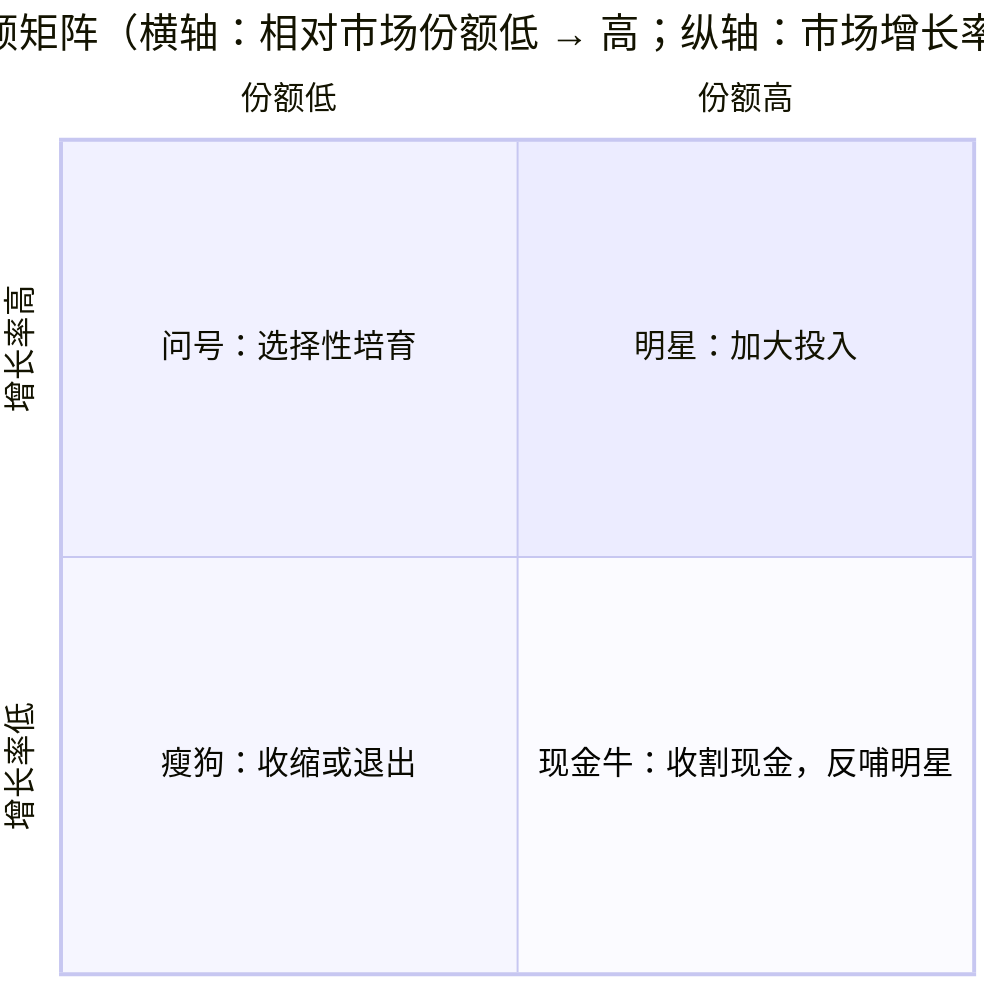

---

### 13. 波特五力模型（行业竞争分析）

**一句话**：行业吸引力由五种力量决定，分析清楚再决定进不进、怎么进。

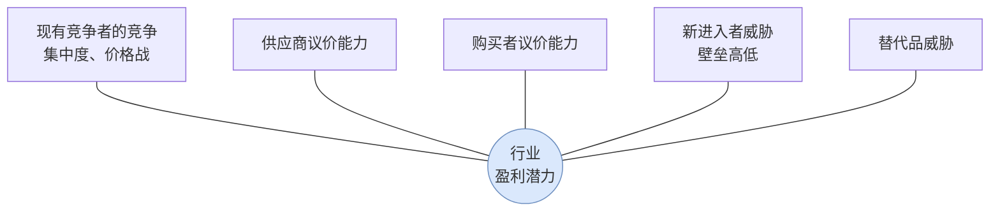

**五种力量越强，行业平均利润越低。**

---

### 14. MECE 原则（结构化拆解）

**一句话**：分类要做到「相互独立、完全穷尽」——不重、不漏。

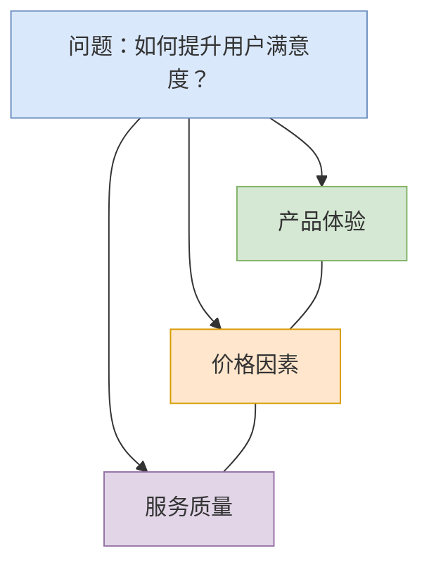

**检验方法**：把任意两项放一起，能合并就说明不独立；能举出反例就说明不穷尽。它是金字塔原理和麦肯锡式咨询的基本功。

---

## 四、沟通与表达类

### 15. 金字塔原理 / SCQA（汇报与写作）

**一句话**：结论先行、以上统下、归类分组、逻辑递进。

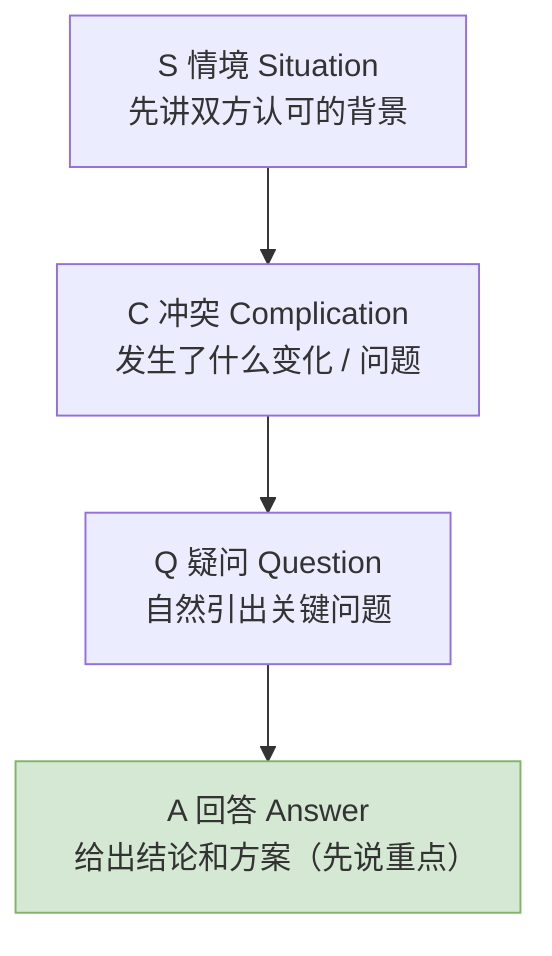

**对比**：「领导，预算、人手、进度是这样的……所以我想申请加人」（铺垫半天）
**SCQA**：「领导，项目有延期风险（C）。建议增加 2 名开发（A）。原因是……（S+Q 细节）」

---

### 16. 黄金圈法则（激励性表达）

**一句话**：卓越的组织从「为什么」开始沟通，平庸的组织只讲「做什么」。

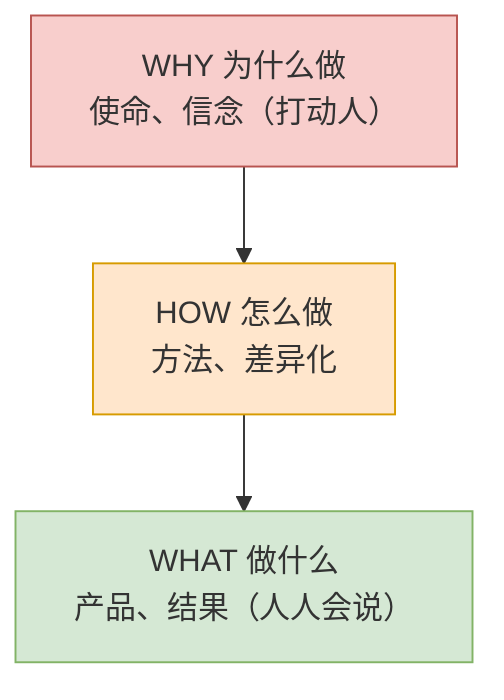

**例子**：苹果公司不说「我们造电脑（What）」，而说「我们相信挑战现状（Why），所以我们用与众不同的方式设计（How），造出好用的电脑（What）」。

---

## 五、执行与改进类

### 17. PDCA 循环（持续改进）

**一句话**：计划—执行—检查—处理，循环不止，每转一圈水平上一个台阶。

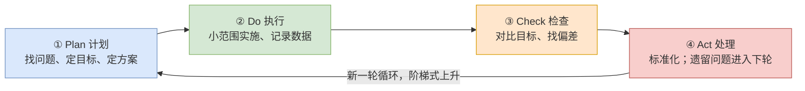

**要点**：Check 是多数人跳过的环节；Act 里被验证有效的做法要固化为标准（这是「大环套小环」改进的基础）。

---

### 18. DMAIC（六西格玛改进流程）

**一句话**：用数据驱动五步流程解决复杂质量问题，比 PDCA 更重测量与统计。

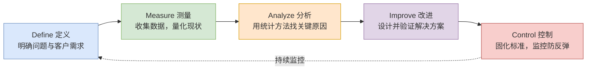

**何时用**：制造业质量改进、流程缺陷率高、数据充分的复杂问题。

---

### 19. 8D 报告（客诉 / 质量事故处理）

**一句话**：汽车行业标准的团队化问题解决流程，D3 先止血，D4-D5 再根治。

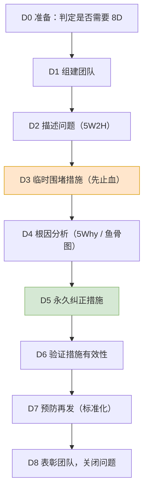

**注意**：没有 D3 止血就谈根治，等于一边流血一边做手术。

---

### 20. GRAI 复盘法（把经验变成能力）

**一句话**：目标—结果—分析—总结，四步把「发生过的事」变成「下次用得上的经验」。

```mermaid
flowchart LR
    G["G Goal 目标回顾<br/>当初想达成什么？"] --> R["R Result 结果评估<br/>实际发生了什么？差距在哪？"]
    R --> A["A Analysis 原因分析<br/>做对/做错的根本原因"]
    A --> I["I Insight 经验总结<br/>可复用的规律，停止/继续/开始做"]
    I --> G2["进入下一轮目标（PDCA 闭环）"]
    style G fill:#dae8fc,stroke:#6c8ebf
    style R fill:#d5e8d4,stroke:#82b366
    style A fill:#ffe6cc,stroke:#d79b00
    style I fill:#f8cecc,stroke:#b85450
```

**关键**：复盘不是追责会，只对事不对人；Insight 必须落到「下次具体怎么做」。

---

## 现成的开源资源

| 资源 | 说明 |
|---|---|
| [mermaid-js/mermaid](https://github.com/mermaid-js/mermaid) | 本文件全部图解使用的开源图表引擎 |
| [MackDing/mentalModelMap](https://github.com/MackDing/mentalModelMap) | 79 个经典思维模型可视化导图（中文，开源） |
| [《12 个人生工具》PDF](http://chenweixiang.github.io/docs/12_tools_for_everyone.pdf) | SWOT/PDCA/6W2H/SMART/WBS/二八原则等图解合集 |
| [drawio（diagrams.net）](https://app.diagrams.net) | 开源免费绘图工具，自带管理图表模板库 |
| [Excalidraw](https://excalidraw.com) | 开源手绘风白板，适合快速画框架图 |
| [Miro 模板库](https://miro.com/templates) | SWOT/鱼骨图/5Why 等海量现成模板（部分免费） |
| [5xWhys 免费工具](https://5xwhys.com/tools/) | 5Why / 鱼骨图 / 帕累托在线生成，可导出 |

## 使用建议

1. **先看路线图**：按你当前的任务类型选工具，不要 20 个全用。
2. **组合使用**：5W2H 描述问题（8D 的 D2）→ 鱼骨图发散 → 5Why 收敛根因 → PDCA 跟踪改进。
3. **修改图解**：直接改 ```mermaid 代码块里的文字即可，保存后 GitHub / Typora / `index.html` 会自动更新。
