# Sơ đồ các phương pháp quản trị (mã nguồn mở · có thể chỉnh sửa · tổng cộng 39 phương pháp)

**Ngôn ngữ / Language**：**Tiếng Việt** · [English](README.en.md) · [中文](README.md)

Tất cả sơ đồ đều được vẽ bằng cú pháp văn bản **Mermaid** (định dạng mã nguồn mở, [mermaid-js/mermaid](https://github.com/mermaid-js/mermaid) 82k+ stars).
Mọi công cụ hỗ trợ Mermaid đều có thể render trực tiếp thành biểu đồ:

- **File `index.html` trong thư mục này**: nhấp đúp để xem toàn bộ sơ đồ đã render trong trình duyệt (không cần cài đặt gì)
- **GitHub / Gitee**: tải lên trực tiếp, tự động render
- **VS Code**: cài plugin "Markdown Preview Mermaid Support"
- **Typora / Obsidian**: hỗ trợ sẵn

Chỉ cần sửa văn bản là chỉnh được sơ đồ, không cần phần mềm vẽ.

## Tra cứu theo kịch bản

| Việc bạn cần làm | Công cụ đề xuất |
|---|---|
| Đặt mục tiêu | SMART, OKR, 5W2H |
| Lập kế hoạch / phân rã nhiệm vụ | 5W2H, WBS, biểu đồ Gantt |
| Tìm nguyên nhân gốc rễ | 5Why, sơ đồ xương cá, quy tắc 80/20 |
| Ra quyết định / phân tích | SWOT, ma trận Eisenhower, sáu chiếc mũ tư duy, ma trận BCG, năm lực lượng Porter |
| Bám thực thi / cải tiến liên tục | PDCA, DMAIC, 8D |
| Giao tiếp và trình bày | Tháp nguyên lý, vòng tròn vàng |
| Rút kinh nghiệm | Phương pháp hoàn tất GRAI |
| Phân tích chất lượng nhà máy | QC 7 công cụ, sơ đồ kiểm soát, CPK, GRR, FMEA |
| Hiện trường & thiết bị | 5S, Poka-Yoke, TPM, OEE, SMED |
| An toàn sản xuất | Quy tắc Heinrich |
| Hoạt động cải tiến | QCC, báo cáo A3 |

## Lộ trình chọn công cụ

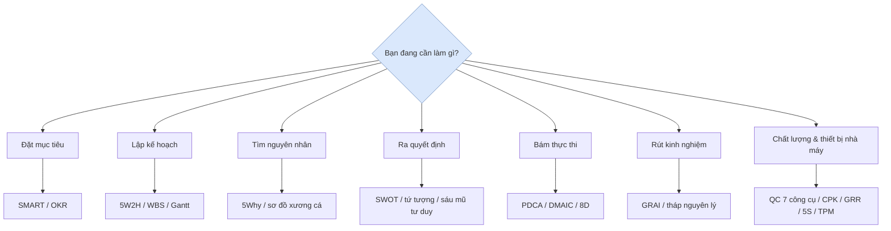

---

## I. Nhóm mục tiêu và kế hoạch

### 1. Nguyên tắc SMART (đặt mục tiêu)

**Một câu**: Mục tiêu tốt phải cụ thể, có thể đo lường, khả thi, liên quan và có thời hạn.

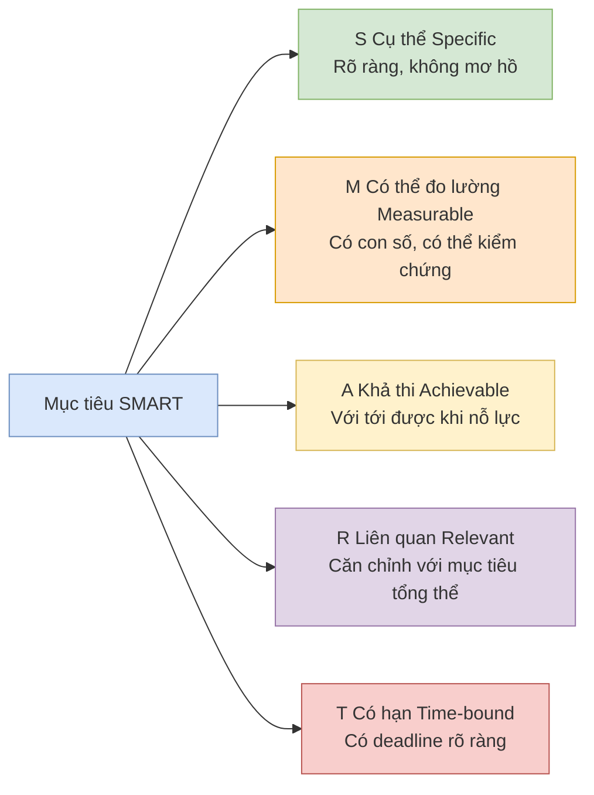

**Ví dụ sai**: "Nâng cao sự hài lòng của khách hàng" (mơ hồ)
**Ví dụ đúng**: "Trong 3 tháng, giảm thời gian phản hồi lần đầu của tổ CSKH từ 4 giờ xuống dưới 1 giờ" (đáp ứng đủ SMART)

---

### 2. Phân tích 5W2H (nghĩ kỹ một việc)

**Một câu**: Dùng 7 câu hỏi để làm rõ toàn cảnh nhiệm vụ / phương án, tránh bỏ sót và làm việc mù quáng.

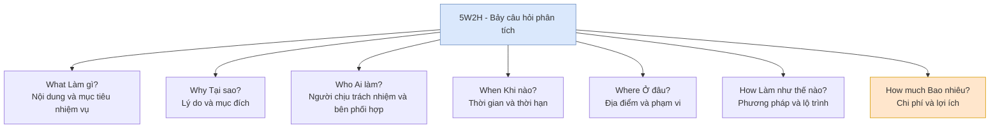

**Khi nào dùng**: giao nhiệm vụ, viết đề án, báo cáo, kiểm tra bỏ sót khi rút kinh nghiệm.

---

### 3. OKR (mục tiêu và kết quả then chốt)

**Một câu**: O là mục tiêu định tính, có tính thách thức và truyền cảm hứng; KR là kết quả định lượng để đo mức độ hoàn thành mục tiêu.

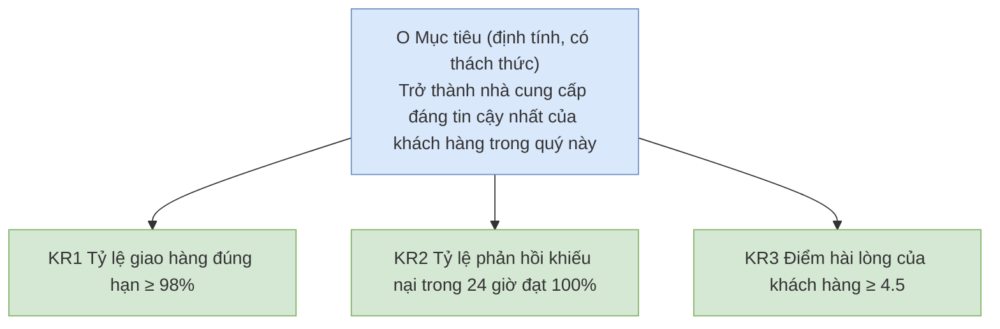

**Điểm cần nhớ**: 1 O kèm 3-5 KR; hoàn thành 60-70% là tốt nhất (chứng tỏ mục tiêu có thách thức); không gắn trực tiếp với thưởng.

---

### 4. WBS - Cấu trúc phân rã công việc (chia nhỏ nhiệm vụ)

**Một câu**: Chia dự án lớn thành các nhiệm vụ nhỏ theo từng cấp "kết quả có thể giao nhận", đến mức "có thể thực hiện, phân công và ước tính" được.

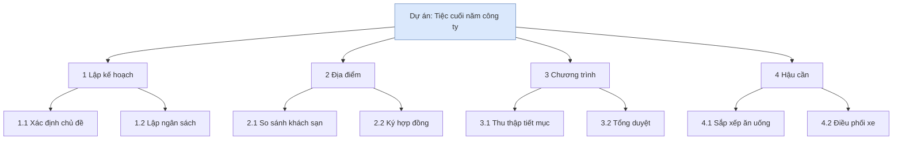

**Điểm cần nhớ**: Nguyên tắc 100% — phân rã phải bao quát toàn bộ công việc của dự án; nhiệm vụ tầng dưới cùng nên hoàn thành trong 1-2 ngày.

---

### 5. Biểu đồ Gantt (lập tiến độ)

**Một câu**: Trên trục thời gian ngang, nhìn thấy rõ "ai làm gì vào lúc nào, quan hệ phụ thuộc ra sao".

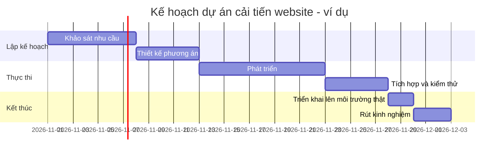

**Khi nào dùng**: lập lịch dự án, phối hợp liên phòng ban, báo cáo tiến độ với cấp trên.

---

## II. Nhóm phân tích vấn đề

### 6. Phân tích 5Why (truy nguyên nhân gốc rễ)

**Một câu**: Liên tục hỏi "tại sao" để xuyên qua biểu hiện, tìm ra nguyên nhân gốc rễ có thể hành động.

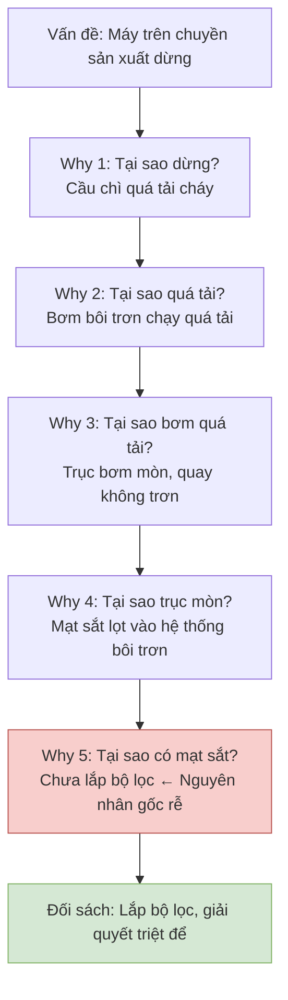

**Điểm cần nhớ**: Hỏi "tại sao" không phải để đổ lỗi; mỗi mắt xích nhân quả cần có bằng chứng, nếu không trả lời được thì dừng lại đi tìm dữ liệu.

---

### 7. Sơ đồ xương cá / sơ đồ Ishikawa (tìm nguyên nhân toàn diện)

**Một câu**: Từ các chiều Người - Máy - Nguyên liệu - Phương pháp - Môi trường, liệt kê mọi nguyên nhân có thể, tránh chỉ nhìn một hướng.

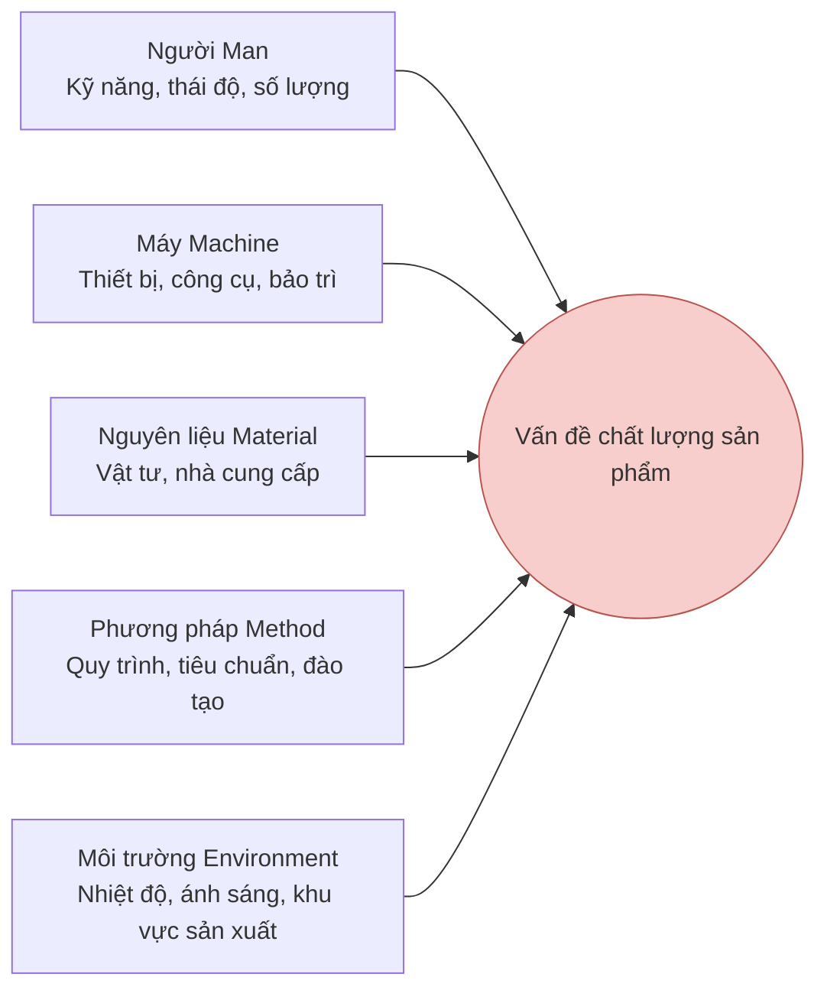

**Cách dùng**: Trước phát tán (brainstorm điền đầy các "xương"), sau đó thu hẹp và dùng 5Why đào sâu những "xương" đáng ngờ nhất. Tại hiện trường sản xuất thường dùng 4M1E / 6M (thêm Đo lường Measurement và Tự nhiên Mother Nature).

---

### 8. Quy tắc 80/20 / Pareto (nắm mâu thuẫn chính)

**Một câu**: 80% kết quả thường do 20% yếu tố then chốt quyết định, hãy tìm ra 20% đó trước.

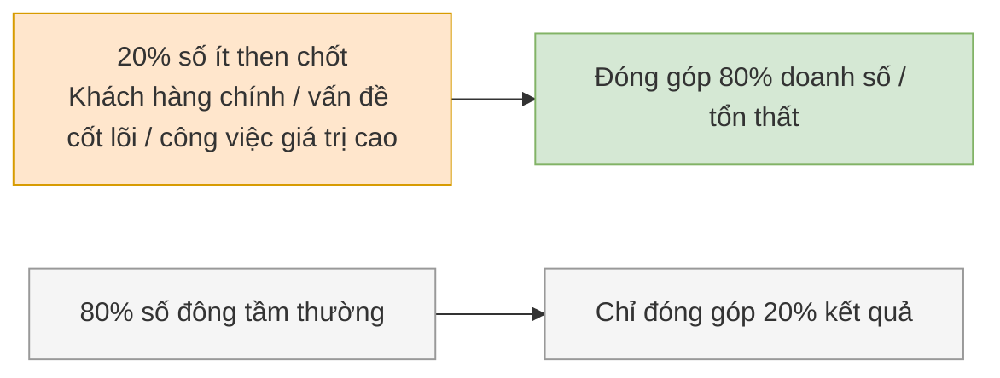

**Khi nào dùng**: sắp xếp thứ tự ưu tiên, tìm điểm tập trung của vấn đề chất lượng (biểu đồ Pareto), quản lý thời gian (ăn con ếch trước).

---

## III. Nhóm ra quyết định và phân tích

### 9. Phân tích SWOT (định hướng chiến lược)

**Một câu**: Đưa điểm mạnh / yếu nội bộ và cơ hội / đe dọa bên ngoài lên một mặt bằng, từ đó kết hợp thành chiến lược hành động.

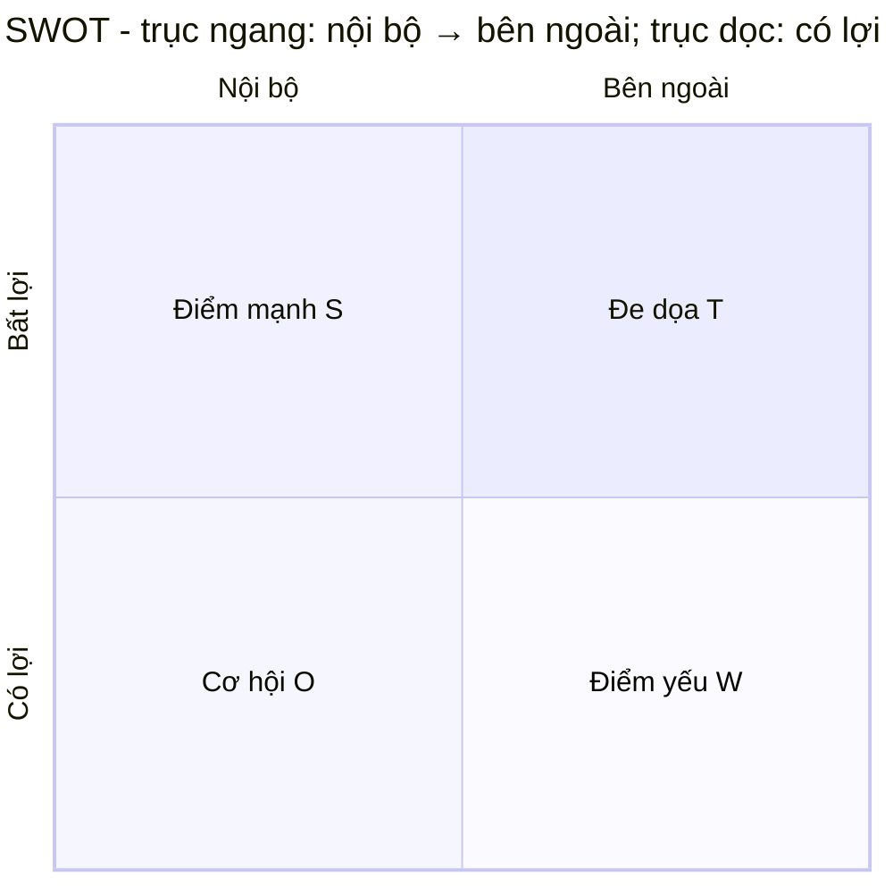

**Ví dụ**: Điểm mạnh = công nghệ mạnh, thương hiệu tốt; Điểm yếu = kênh phân phối yếu, thiếu nhân tài; Cơ hội = chính sách hỗ trợ, thị trường tăng trưởng; Đe dọa = cạnh tranh gay gắt, sản phẩm thay thế xuất hiện.

**Chiến lược tổ hợp bốn tượng**:

| Tổ hợp | Chiến lược | Ý nghĩa |
|---|---|---|
| S + O | SO - Tăng trưởng | Dùng điểm mạnh nắm cơ hội, tấn công toàn lực |
| W + O | WO - Chuyển đổi | Bù đắp điểm yếu để tận dụng cơ hội |
| S + T | ST - Phòng thủ | Dùng điểm mạnh chống lại đe dọa |
| W + T | WT - Thu hẹp | Giảm đầu tư, ưu tiên tồn tại trước |

---

### 10. Ma trận Eisenhower (quản lý thời gian)

**Một câu**: Phân loại theo "quan trọng / khẩn cấp", dành năng lượng cho việc "quan trọng nhưng không khẩn cấp".

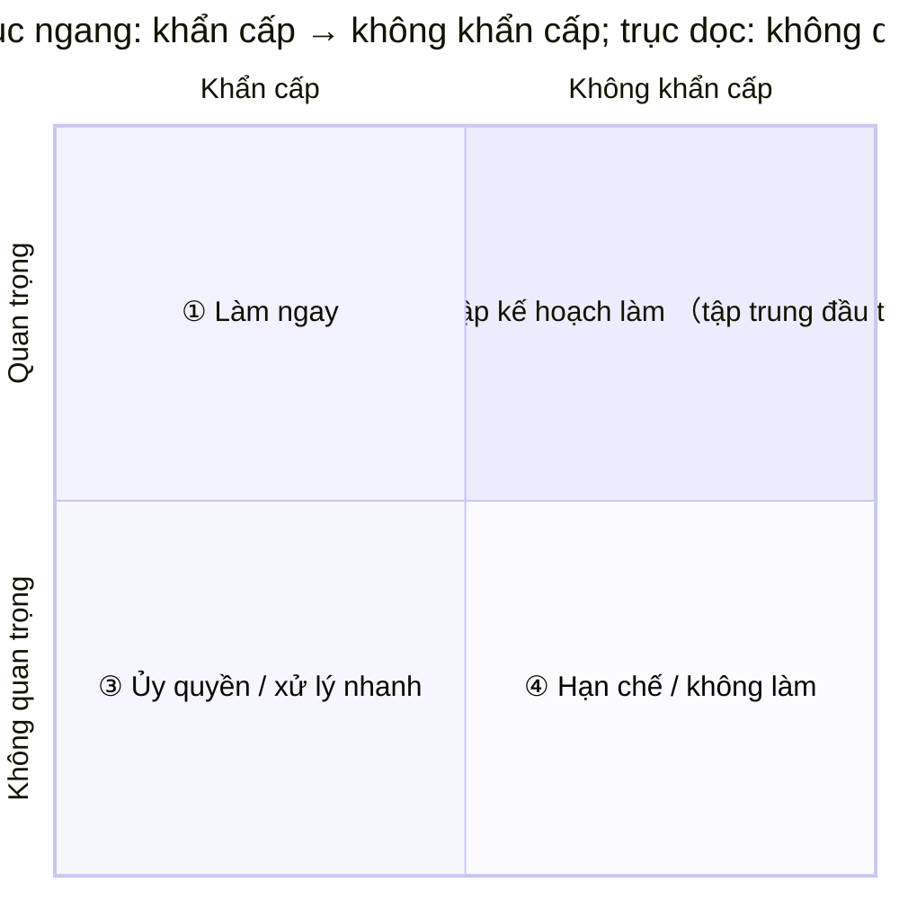

- **① Quan trọng + Khẩn cấp** (khủng hoảng, nhiệm vụ sắp đến hạn) → Làm ngay
- **② Quan trọng + Không khẩn cấp** (hoạch định, học tập, phòng ngừa, rèn luyện) → Làm có kế hoạch, **giá trị cao nhất**
- **③ Không quan trọng + Khẩn cấp** (bị gián đoạn đột xuất, một số cuộc họp) → Ủy quyền hoặc xử lý nhanh
- **④ Không quan trọng + Không khẩn cấp** (lướt mạng vô mục đích, tán gẫu) → Giảm thiểu hoặc không làm

**Insight cốt lõi**: Người làm việc hiệu quả dành phần lớn thời gian cho ô Q2; ô Q1 liên tục bốc cháy chính vì Q2 làm chưa đủ.

---

### 11. Sáu chiếc mũ tư duy (thảo luận nhóm)

**Một câu**: Mỗi lần chỉ đội một mũ, chỉ dùng một kiểu tư duy để thảo luận, tránh cãi vã và rối loạn tư duy.

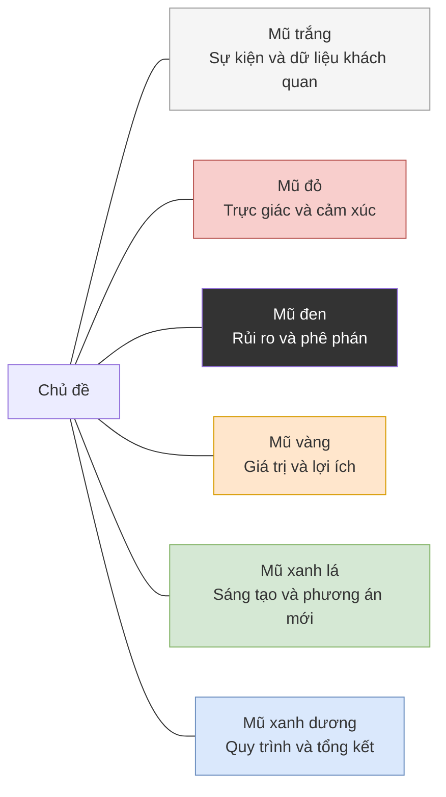

**Trình tự điển hình**: Xanh dương (định quy trình) → Trắng (đưa ra sự thật) → Xanh lá (đề xuất phương án) → Vàng (nhìn giá trị) → Đen (tìm rủi ro) → Đỏ (bày tỏ thái độ) → Xanh dương (kết luận).

---

### 12. Ma trận BCG (quyết định danh mục kinh doanh)

**Một câu**: Chia doanh nghiệp thành bốn nhóm theo "tốc độ tăng trưởng thị trường × thị phần tương đối", từ đó quyết định đầu tư hay thu hoạch.

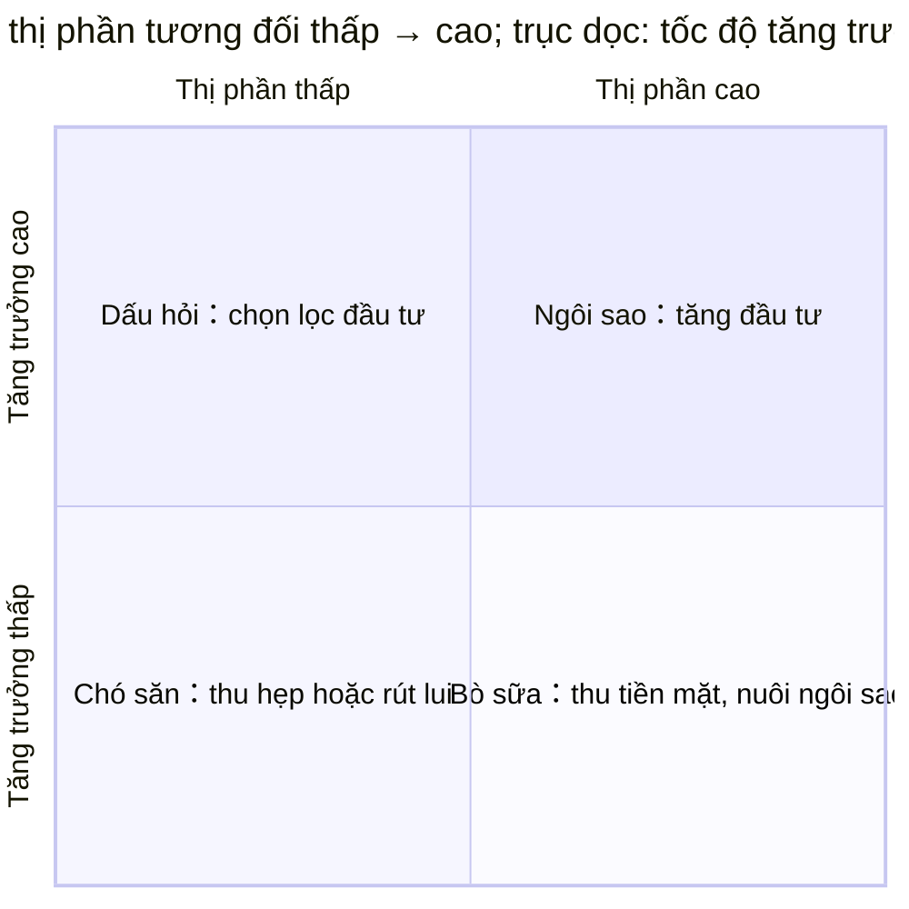

---

### 13. Mô hình năm lực lượng Porter (phân tích cạnh tranh ngành)

**Một câu**: Sức hấp dẫn của ngành do năm lực lượng quyết định, phân tích rõ rồi mới quyết định có nên vào, vào bằng cách nào.

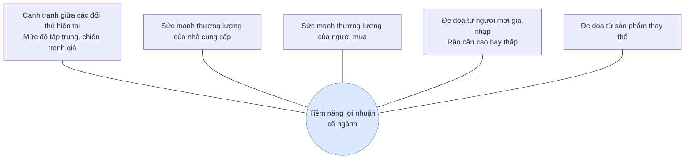

**Năm lực lượng càng mạnh, lợi nhuận trung bình của ngành càng thấp.**

---

### 14. Nguyên tắc MECE (phân rã có cấu trúc)

**Một câu**: Phân loại phải đạt "loại trừ lẫn nhau, bao quát toàn bộ" — không trùng, không sót.

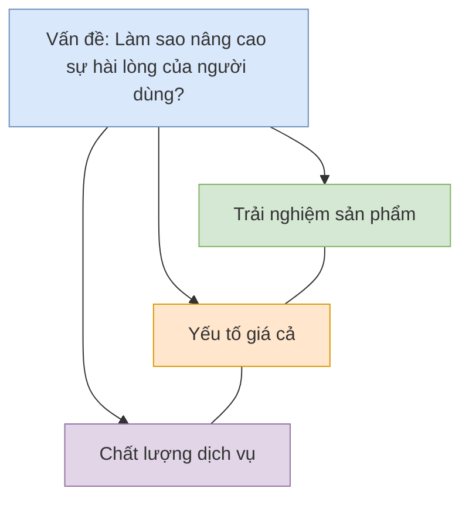

**Cách kiểm tra**: Lấy hai hạng mục bất kỳ ghép lại, nếu có thể gộp thì chưa loại trừ lẫn nhau; nếu có thể đưa ra phản ví dụ thì chưa bao quát toàn bộ. Đây là kỹ năng nền của tháp nguyên lý và tư vấn theo phong cách McKinsey.

---

## IV. Nhóm giao tiếp và trình bày

### 15. Tháp nguyên lý / SCQA (báo cáo và viết lách)

**Một câu**: Kết luận đi trước, trên dưới thống nhất, phân nhóm có hệ thống, logic tiến triển.

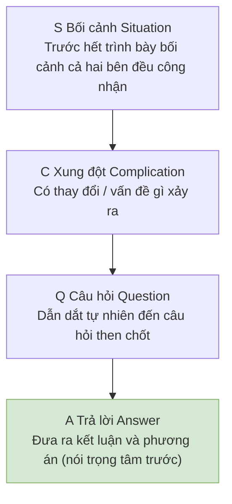

**So sánh**: "Sếp, ngân sách, nhân sự, tiến độ là như vậy… nên em muốn xin thêm người" (vòng vo lâu)
**SCQA**: "Sếp, dự án có nguy cơ chậm tiến độ (C). Em đề xuất bổ sung 2 lập trình viên (A). Lý do là… (chi tiết S+Q)"

---

### 16. Vòng tròn vàng - Golden Circle (truyền cảm hứng)

**Một câu**: Tổ chức xuất sắc bắt đầu truyền thông từ "tại sao", tổ chức tầm thường chỉ nói "làm gì".

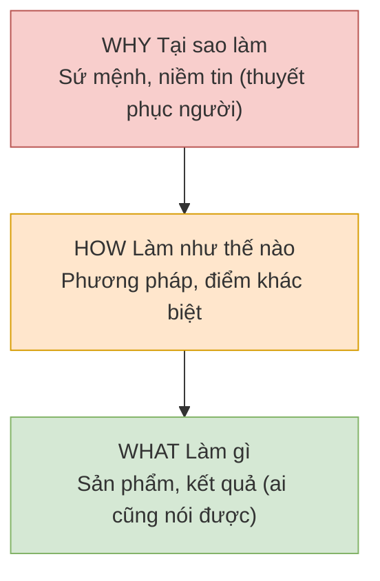

**Ví dụ**: Apple không nói "Chúng tôi làm máy tính (What)", mà nói "Chúng tôi tin vào việc thách thức hiện trạng (Why), vì vậy chúng tôi thiết kế theo cách khác biệt (How), tạo ra những chiếc máy tính dễ dùng (What)".

---

## V. Nhóm thực thi và cải tiến

### 17. Vòng lặp PDCA (cải tiến liên tục)

**Một câu**: Kế hoạch — Thực hiện — Kiểm tra — Hành động, lặp đi lặp lại không ngừng, mỗi vòng lên một bậc.

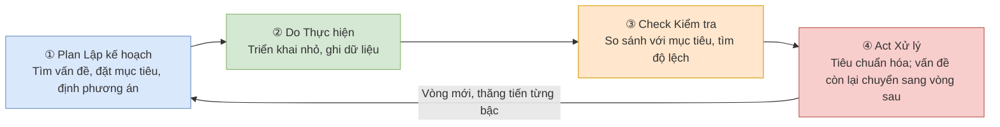

**Điểm cần nhớ**: Check là khâu nhiều người bỏ qua; trong Act, những cách làm đã được chứng minh hiệu quả cần được cố định thành tiêu chuẩn (đây là nền tảng của cải tiến "vòng lớn lồng vòng nhỏ").

---

### 18. DMAIC (quy trình cải tiến Six Sigma)

**Một câu**: Dùng quy trình 5 bước dựa trên dữ liệu để giải quyết vấn đề chất lượng phức tạp, nặng đo lường và thống kê hơn PDCA.

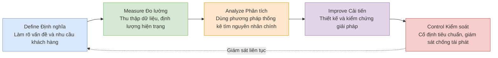

**Khi nào dùng**: cải tiến chất lượng sản xuất, tỷ lệ lỗi quy trình cao, vấn đề phức tạp có đủ dữ liệu.

---

### 19. Báo cáo 8D (xử lý khiếu nại / sự cố chất lượng)

**Một câu**: Quy trình giải quyết vấn đề theo nhóm chuẩn của ngành ô tô, D3 cầm máu trước, D4-D5 mới trị gốc rễ.

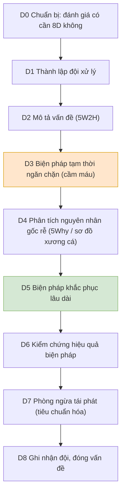

**Lưu ý**: Chưa D3 cầm máu đã bàn trị gốc rễ giống như vừa mổ vừa để máu chảy.

---

### 20. Phương pháp hoàn tất GRAI (biến kinh nghiệm thành năng lực)

**Một câu**: Mục tiêu — Kết quả — Phân tích — Kết luận, bốn bước biến "chuyện đã xảy ra" thành "kinh nghiệm dùng được lần sau".

```mermaid
flowchart LR
    G["G Goal Hồi tưởng mục tiêu<br/>Ban đầu muốn đạt gì?"] --> R["R Result Đánh giá kết quả<br/>Thực tế xảy ra gì? Khoảng cách ở đâu?"]
    R --> A["A Analysis Phân tích nguyên nhân<br/>Nguyên nhân gốc rễ của đúng/sai"]
    A --> I["I Insight Tổng kết kinh nghiệm<br/>Quy luật tái sử dụng, việc nên dừng / tiếp tục / bắt đầu"]
    I --> G2["Chuyển sang mục tiêu vòng tiếp theo (vòng kín PDCA)"]
    style G fill:#dae8fc,stroke:#6c8ebf
    style R fill:#d5e8d4,stroke:#82b366
    style A fill:#ffe6cc,stroke:#d79b00
    style I fill:#f8cecc,stroke:#b85450
```

**Điểm then chốt**: Hoàn tất không phải họp đổ lỗi, chỉ bàn việc không bàn người; Insight phải cụ thể thành "lần sau làm như thế nào".

---

## VI. Nhóm quản lý chất lượng: QC 7 công cụ

### 21. Tổng quan QC 7 công cụ

**Một câu**: "Bộ công cụ cơ bản" để cải tiến chất lượng tại hiện trường — 5 công cụ dùng để mô tả vấn đề, 2 công cụ dùng để phân tích nguyên nhân.

```mermaid
flowchart TB
    ROOT["QC 7 công cụ"]
    ROOT --> D1["Mô tả vấn đề (dữ liệu nói)"]
    ROOT --> D2["Phân tích vấn đề (tìm nguyên nhân)"]
    D1 --> T1["Phiếu kiểm tra<br/>Thu thập dữ liệu"]
    D1 --> T2["Phân tầng<br/>Phân loại so sánh"]
    D1 --> T3["Pareto<br/>Nắm số ít then chốt"]
    D1 --> T4["Histogram<br/>Nhìn hình dạng phân bố"]
    D1 --> T5["Sơ đồ phân tán<br/>Xem quan hệ hai biến"]
    D1 --> T6["Sơ đồ kiểm soát<br/>Giám sát dao động quy trình"]
    D2 --> T7["Sơ đồ nhân quả (xương cá)<br/>Tìm nguyên nhân có hệ thống"]
    style ROOT fill:#dae8fc,stroke:#6c8ebf
```

| Công cụ | Trả lời câu hỏi | Cách dùng điển hình |
|---|---|---|
| Phiếu kiểm tra | Hiện trạng thực ra thế nào? | Ghi chép số lượng lỗi theo từng hạng mục |
| Phân tầng | Loại vấn đề nào tập trung nhất? | Phân theo ca, máy, khuôn, vật liệu, người vận hành |
| Pareto | Giải quyết trước cái nào? | Top 2-3 hạng mục thường chiếm 80% lỗi |
| Histogram | Quy trình ổn định không? | Xem hình dạng phân bố, so sánh với giới hạn quy cách |
| Sơ đồ phân tán | A và B có quan hệ không? | Nhiệt độ vs tỷ lệ lỗi, tốc độ vs độ mòn |
| Sơ đồ kiểm soát | Quy trình hiện tại bình thường không? | Giám sát thời gian thực, cảnh báo khi vượt giới hạn |
| Sơ đồ xương cá | Tại sao xảy ra? | Kết hợp 5Why tìm nguyên nhân gốc rễ (xem mục 7) |

---

### 22. Phiếu kiểm tra (Check Sheet)

**Một câu**: Biến "dựa vào cảm tính" thành "dựa vào dữ liệu", ghi chép từng hạng mục theo mẫu thiết kế sẵn.

**Ví dụ: Phiếu kiểm tra lỗi ép nhựa (ghi mỗi 2 giờ)**

| Thời gian | Số lô | Số kiểm | Thiếu liệu | Burr | Co rút | Đốm đen | Tổng |
|---|---|---|---|---|---|---|---|
| 08:00 | A-101 | 50 | 1 | 0 | 2 | 0 | 3 |
| 10:00 | A-101 | 50 | 0 | 3 | 1 | 1 | 5 |
| 12:00 | A-102 | 50 | 2 | 1 | 0 | 0 | 3 |

**Điểm cần nhớ**: Tên hạng mục phải cụ thể ("thiếu liệu" thay vì "lỗi ngoại quan"); cuối ngày tổng hợp có thể chuyển thẳng thành Pareto.

---

### 23. Phân tầng (Stratification)

**Một câu**: Tách dữ liệu hỗn hợp theo chiều so sánh, sự khác biệt thường lộ rõ ngay.

**Ví dụ**: Tỷ lệ lỗi toàn nhà máy 3.2% trông có vẻ đều, nhưng khi phân tầng theo máy:

| Máy | 1# | 2# | 3# | 4# |
|---|---|---|---|---|
| Tỷ lệ lỗi | 1.1% | 1.3% | **8.9%** | 1.5% |

→ Vấn đề thu hẹp vào máy 3# (điều tra tiếp: khuôn máy này mòn + chưa căn chỉnh sau đổi khuôn).

**Chiều phân tầng thường dùng**: ca làm việc, máy, khuôn, lô vật liệu, nhà cung cấp, người vận hành, thiết bị đo, nhiệt độ / độ ẩm môi trường.

---

### 24. Pareto

**Một câu**: Sắp xếp số lượng lỗi từ lớn đến nhỏ, tập trung vào 20% hạng mục để giải quyết 80% vấn đề.

```mermaid
xychart-beta
    title "Pareto lỗi ép nhựa - một tuần, n=92"
    x-axis ["Thiếu liệu", "Burr", "Co rút", "Đốm đen", "Khác"]
    bar [45, 22, 12, 9, 4]
```

**Tỷ lệ tích lũy**: Thiếu liệu 49% → cộng Burr 73% → cộng Co rút 86%. Cải tiện hai hạng mục "Thiếu liệu + Burr" là giải quyết gần ba phần tư số lỗi.

**Điểm cần nhớ**: Pareto sau khi phân tầng (ví dụ vẽ riêng từng máy) còn mạnh hơn nhiều.

---

### 25. Histogram

**Một câu**: Chia giá trị đo thành các nhóm và vẽ thành cột, nhìn một cái là thấy trung tâm và độ phân tán của quy trình.

```mermaid
xychart-beta
    title "Histogram đường kính ngoài trục - n=100, quy cách φ10±0.05"
    x-axis ["9.96", "9.98", "10.00", "10.02", "10.04", "10.06"]
    bar [4, 18, 35, 28, 11, 4]
```

**Đọc biểu đồ**: Trung tâm khoảng 10.005, gần như nằm giữa quy cách; phân bố gần dạng chuông → năng lực quy trình tốt. Nếu cột xuất hiện hai đỉnh, đảo hoặc lệch một bên, lần lượt gợi ý: trộn lẫn hai máy / có giá trị bất thường / cần căn chỉnh máy.

---

### 26. Sơ đồ phân tán (Scatter Diagram)

**Một câu**: Xem hai biến số có quan hệ tương quan hay không, và là dạng quan hệ gì.

| Dạng | Ý nghĩa | Hướng xử lý |
|---|---|---|
| Tương quan dương mạnh (↗) | A tăng thì B tăng | Kiểm soát A là kiểm soát B |
| Tương quan âm mạnh (↘) | A tăng thì B giảm | Tương tự như trên |
| Không tương quan (phân tán) | Hai bên không liên quan | Tìm nguyên nhân khác |
| Tương quan phi tuyến (∩) | Quan hệ không tuyến tính | Tìm điểm uốn / giá trị tối ưu |

**Ví dụ**: Ghi 12 cặp "nhiệt độ phễu nhựa vs số lỗi thiếu liệu", tính hệ số tương quan r=0.85 (tương quan dương mạnh) → nhiệt độ là một trong những nguyên nhân chính, sau đó dùng thử nghiệm DOE khóa giá trị tối ưu 235℃.

---

### 27. Sơ đồ kiểm soát (Control Chart / SPC)

**Một câu**: Vẽ "vùng dao động bình thường" cho quy trình, khi vượt giới hạn hoặc sắp xếp bất thường thì báo động — phát hiện sớm hơn kiểm tra hậu kiểm.

```mermaid
xychart-beta
    title "Sơ đồ kiểm soát X - mục tiêu 10.0, giới hạn kiểm soát ±0.5"
    x-axis [1, 2, 3, 4, 5, 6, 7, 8, 9, 10, 11, 12]
    line [10.1, 9.9, 10.2, 10.0, 9.8, 10.3, 10.1, 9.9, 10.0, 10.2, 10.1, 11.2]
    line [10.5, 10.5, 10.5, 10.5, 10.5, 10.5, 10.5, 10.5, 10.5, 10.5, 10.5, 10.5]
    line [10.0, 10.0, 10.0, 10.0, 10.0, 10.0, 10.0, 10.0, 10.0, 10.0, 10.0, 10.0, 10.0]
    line [9.5, 9.5, 9.5, 9.5, 9.5, 9.5, 9.5, 9.5, 9.5, 9.5, 9.5, 9.5]
```

**Đọc biểu đồ**: Bốn đường lần lượt là — giá trị đo (đường gấp khúc), giới hạn kiểm soát trên UCL, đường trung tâm CL, giới hạn kiểm soát dưới LCL. Điểm thứ 12 vượt UCL → bất thường! Dừng chuyền ngay để điều tra (ví dụ: dao cắt mòn).

**Quy tắc nhận biết bất thường thường gặp**: 1 điểm ra ngoài giới hạn / 7 điểm liên tiếp cùng bên / 7 điểm liên tiếp tăng hoặc giảm / 3 điểm trong đó 2 điểm gần giới hạn kiểm soát.

---

## VII. Nhóm năng lực quy trình: CPK

### 28. CPK / PPK - Chỉ số năng lực quy trình

**Một câu**: Không chỉ "làm ra đều đạt" (Cp xem độ phân tán), mà còn phải "quy trình luôn nằm giữa" (Cpk xem độ lệch tâm).

```mermaid
flowchart LR
    A["Quy cách: đường kính trục φ10 ± 0.05<br/>USL=10.05, LSL=9.95"] --> B["Thu thập dữ liệu n≥100<br/>Tính trung bình μ và độ lệch chuẩn σ"]
    B --> C["Cp = (USL - LSL) / 6σ<br/>= 0.10 / 0.048 ≈ 2.08"]
    B --> D["Cpk = min(USL-μ, μ-LSL) / 3σ<br/>μ=10.01 → min(0.04, 0.06)/0.024 ≈ 1.67"]
    C --> E{"Năng lực đủ không?"}
    D --> E
    E -->|"Cpk ≥ 1.67"| F["Xuất sắc<br/>Có thể miễn kiểm / giảm tần suất kiểm"]
    E -->|"1.33 ~ 1.67"| G["Đạt<br/>Sản xuất hàng loạt bình thường + SPC"]
    E -->|"< 1.33"| H["Chưa đủ<br/>Cải tiến công nghệ hoặc kiểm tra 100%"]
    style F fill:#d5e8d4,stroke:#82b366
    style G fill:#ffe6cc,stroke:#d79b00
    style H fill:#f8cecc,stroke:#b85450
```

**Khác biệt then chốt**: Cp chỉ so "độ phân tán vs dải công sai", không quan tâm lệch tâm; Cpk còn phạt thêm độ lệch tâm. Ví dụ: σ giống nhau nhưng μ lệch về 10.04, Cp vẫn 2.08, Cpk tụt xuống 0.14 (siêu sai nhiều) — **sản xuất hàng loạt luôn đánh giá bằng Cpk**.

**Tiêu chuẩn tham khảo**: Cpk≥1.33 cho ngành thông thường; Cpk≥1.67 cho ô tô / chi tiết an toàn. PPK tính toán tương tự, dùng cho giai đoạn thử sản xuất (dữ liệu dài hạn chứa mọi biến động).

---

## VIII. Nhóm phân tích hệ thống đo lường: GRR

### 29. GRR (Gauge Repeatability & Reproducibility)

**Một câu**: Trước hết phải chứng minh bằng dữ liệu rằng "dụng cụ đo + người + phương pháp" đáng tin, nếu không CPK, SPC phía sau đều là xây nhà trên cát.

```mermaid
flowchart LR
    A["Chọn 10 chi tiết<br/>bao phủ toàn dải công sai"] --> B["3 kiểm tra viên<br/>mỗi người đo mỗi chi tiết 3 lần"]
    B --> C["Tính %GRR<br/>= biến thiên của hệ thống đo / biến thiên tổng"]
    C --> D{"Phán định"}
    D -->|"%GRR ＜ 10%"| E["Chấp nhận được<br/>Hệ thống đo đáng tin"]
    D -->|"10% ~ 30%"| F["Chấp nhận có điều kiện<br/>tùy mức độ quan trọng của đặc tính"]
    D -->|"＞ 30%"| G["Không chấp nhận<br/>Đổi dụng cụ / đào tạo / đổi phương pháp"]
    style E fill:#d5e8d4,stroke:#82b366
    style F fill:#ffe6cc,stroke:#d79b00
    style G fill:#f8cecc,stroke:#b85450
```

**Ví dụ**: Dùng thước kẹp điện tử đo đường kính trục φ10±0.05, thử nghiệm 10×3×3 cho %GRR=8.2% → chấp nhận được, dữ liệu của dụng cụ này có thể dùng để tính CPK. Nếu %GRR=35%, dù CPK tính ra 1.5 cũng không đáng tin — nhiễu đo đã che mờ biến thiên thực sự.

**Phân rã**: Lặp lại (Repeatability — biến động khi cùng một kiểm tra viên đo cùng một chi tiết, phản ánh bản thân dụng cụ) + Tái hiện (Reproducibility — chênh lệch giữa các kiểm tra viên, phản ánh yếu tố con người).

---

## IX. Nhóm phòng ngừa rủi ro và công cụ ngành ô tô

### 30. FMEA - Phân tích chế độ hỏng và hậu quả

**Một câu**: Ngay từ giai đoạn thiết kế liệt kê trước "chỗ nào có thể hỏng, hỏng nghiêm trọng mức nào, có chặn được không", sau đó sắp xếp theo rủi ro để ưu tiên phòng ngừa.

```mermaid
flowchart LR
    A["Nhận diện chế độ hỏng tiềm ẩn<br/>VD: Hàn chân không"] --> B["Chấm điểm (mỗi tiêu chí 1~10)<br/>S Mức độ nghiêm trọng · O Tần suất xảy ra · D Khả năng phát hiện"]
    B --> C["RPN = S × O × D<br/>VD: 8×4×3 = 96"]
    C --> D{"RPN ≥ 100 hoặc S ≥ 9?"}
    D -->|"Có"| E["Phải cải tiến<br/>Thêm Poka-Yoke / đổi thiết kế / tăng kiểm tra"]
    D -->|"Không"| F["Chấp nhận và giám sát"]
    E --> G["Chấm điểm lại sau cải tiến<br/>RPN phải giảm rõ rệt"]
    style C fill:#ffe6cc,stroke:#d79b00
```

**Ví dụ (trích FMEA hàn sóng bảng điều khiển)**:

| Chế độ hỏng | S | O | D | RPN | Biện pháp |
|---|---|---|---|---|---|
| Hàn chân không | 8 | 4 | 3 | 96 | Tăng kiểm tra AOI tự động |
| Lắp ngược cực tính | 9 | 2 | 5 | 90 | Đổi footprint PCB chống lắp ngược (xem Poka-Yoke) |
| Thiếu vặn ốc | 6 | 3 | 2 | 36 | Máy bắn vít đếm số + cảnh báo |

**Điểm cần nhớ**: S≥9 (rủi ro an toàn) bất kể RPN là bao nhiêu cũng phải sửa; phiên bản AIAG-VDA mới dùng AP (Action Priority) thay thế RPN, tư tưởng vẫn tương tự.

---

### 31. Năm công cụ IATF (ngành ô tô)

**Một câu**: APQP quản lý nhịp độ quy trình, FMEA quản lý rủi ro, SPC quản lý quy trình, MSA quản lý đo lường, PPAP quản lý phê duyệt sản xuất hàng loạt.

```mermaid
flowchart LR
    A["APQP Lập kế hoạch chất lượng sản phẩm ban đầu<br/>5 giai đoạn: Kế hoạch → Thiết kế → Mẫu → Thử sản xuất → Hàng loạt"] --> B["FMEA<br/>Phân tích rủi ro thiết kế / quy trình"]
    A --> C["SPC<br/>Giám sát đặc tính then chốt của quy trình"]
    A --> D["MSA<br/>Thẩm định hệ thống đo (bao gồm GRR)"]
    B --> E["PPAP Phê duyệt sản phẩm sản xuất<br/>Khách hàng đồng ý mới được sản xuất hàng loạt"]
    C --> E
    D --> E
    style A fill:#dae8fc,stroke:#6c8ebf
    style E fill:#d5e8d4,stroke:#82b366
```

**Tình huống thực tế**: Khi cung cấp cho khách hàng ô tô, bộ hồ sơ PPAP thường gồm: FMEA, kế hoạch kiểm soát, MSA (báo cáo GRR), năng lực quy trình ban đầu (Cpk), báo cáo mẫu.

---

## X. Nhóm hiện trường & thiết bị nhà máy

### 32. 5S - Quản lý hiện trường

**Một câu**: Sàng lọc, Sắp xếp, Sạch sẽ, Săn sóc, Sẵn sàng — mọi thứ trong quản lý hiện trường đều bắt đầu từ 5S.

```mermaid
flowchart LR
    S1["1S Sàng lọc<br/>Cần và không cần<br/>Loại bỏ dứt khoát"] --> S2["2S Sắp xếp<br/>Đúng vị trí, đúng dung lượng, đúng số lượng<br/>Tìm trong 30 giây"]
    S2 --> S3["3S Sạch sẽ<br/>Quét bụi, dầu mỡ<br/>Vừa sạch vừa kiểm tra"]
    S3 --> S4["4S Săn sóc<br/>Tiêu chuẩn hóa 3S đầu<br/>Duy trì thành quả"]
    S4 --> S5["5S Sẵn sàng<br/>Thành thói quen"]
    style S5 fill:#d5e8d4,stroke:#82b366
```

**Ví dụ**: Thời gian tìm dụng cụ đổi khuôn giảm từ 20 phút xuống 2 phút — dụng cụ treo theo bảng mẫu (shadow board), thiếu là nhìn thấy ngay (kết hợp với Poka-Yoke).

---

### 33. Poka-Yoke (Phòng ngừa sai sót)

**Một câu**: Khiến lỗi "muốn phạm cũng không phạm được", thay vì trông chờ vào sự cẩn thận của con người.

| Loại Poka-Yoke | Nguyên lý | Ví dụ |
|---|---|---|
| Hình dạng | Bất đối xứng, lắp ngược không vừa | Cổng USB, chốt định vị bất đối xứng |
| Thứ tự | Chưa hoàn thành bước trước thì bước sau không làm được | Chưa lắp vỏ thì tuốc nơ vít không chạm được ốc |
| Đếm | Số lượng không đủ không cho qua | Máy bắn vít đủ 4 con mới báo đèn xanh |
| Cảnh báo | Bất thường báo động ngay lập tức | Thiếu linh kiện kéo Andon |
| Thông tin | Màu sắc / nhãn mác phân biệt tránh nhầm lẫn | Thùng đỏ / xanh tương ứng lô khác nhau |

**Ví dụ**: Nhân viên thường xuyên lắp thiếu gioăng cao su gây khiếu nại → đổi sang cấp liệu rung + đếm quang, thiếu gioăng máy tự dừng (Poka-Yoke dạng đếm + cảnh báo).

---

### 34. OEE - Hiệu suất thiết bị tổng hợp

**Một câu**: Tỷ lệ thời gian thiết bị thực sự tạo ra sản phẩm có giá trị, bằng tích của ba tổn thất lớn.

```mermaid
flowchart LR
    A["Thời gian tải 480 phút"] --> B["Trừ: Hỏng hóc + đổi khuôn 60 phút<br/>Hiệu suất thời gian 87.5%"]
    B --> C["Nhân: Tổn thất tốc độ<br/>Hiệu suất hiệu suất 95%"]
    C --> D["Nhân: Lỗi + tái chế<br/>Tỷ lệ hàng đạt 98%"]
    D --> E["OEE = 87.5% × 95% × 98%<br/>≈ 81.5%"]
    E --> F{"Mức thế giới 85%"}
    style E fill:#ffe6cc,stroke:#d79b00
```

**Sáu tổn thất nhanh**: Hỏng máy, đổi khuôn / căn chỉnh (thuộc "tổn thất thời gian"); Chạy không tải, giảm tốc (thuộc "tổn thất hiệu suất"); Phế phẩm khởi động, lỗi quy trình (thuộc "tổn thất chất lượng").

**Ví dụ**: Thiết bị có OEE chỉ 45%, ưu tiên dùng Pareto tìm tổn thất lớn nhất — nếu đổi khuôn chiếm 30%, làm SMED trước; nếu hỏng hóc chiếm 40%, làm TPM trước.

---

### 35. TPM - Bảo trì sản xuất toàn diện

**Một câu**: Người vận hành làm kiểm tra bảo dưỡng hàng ngày, kỹ thuật viên bảo trì làm chuyên môn, tiêu diệt hỏng hóc ngay từ khi còn là mầm mống.

```mermaid
flowchart TB
    ROOT["8 trụ cột TPM"]
    ROOT --> P1["Tự chủ bảo dưỡng<br/>Người vận hành: vệ sinh là kiểm tra"]
    ROOT --> P2["Bảo dưỡng có kế hoạch<br/>Kỹ thuật: bảo dưỡng định kỳ"]
    ROOT --> P3["Cải tiến riêng lẻ<br/>Tiêu diệt sáu tổn thất"]
    ROOT --> P4["Đào tạo<br/>Đào tạo công nhân đa kỹ năng"]
    ROOT --> P5["Quản lý giai đoạn đầu<br/>Thiết kế thiết bị mới ít cần bảo trì"]
    ROOT --> P6["Bảo đảm chất lượng<br/>Thiết bị không sản xuất hàng lỗi"]
    ROOT --> P7["Hiệu quả hóa bộ phận gián tiếp"]
    ROOT --> P8["An toàn · Môi trường<br/>Zero tai nạn"]
    style ROOT fill:#dae8fc,stroke:#6c8ebf
```

**Điểm khởi đầu**: Bắt đầu từ "bước 1 tự chủ bảo dưỡng — vệ sinh ban đầu": trong lúc lau chùi phát hiện ray máy 3# chảy dầu → báo sửa triệt để → thời gian dừng máy tháng đó giảm 40%.

---

### 36. SMED - Đổi khuôn nhanh

**Một câu**: Biến những việc đổi khuôn "phải dừng máy" thành "không cần dừng máy cũng làm được", giảm một nửa thời gian đổi khuôn là chuyện thường.

```mermaid
flowchart LR
    A["Hiện trạng: đổi khuôn 120 phút"] --> B["Bước 1: Tách nội / ngoại<br/>Nội bộ 70 / Ngoại bộ 50"]
    B --> C["Bước 2: Chuyển nội ra ngoại<br/>Làm nóng khuôn trước, chuẩn bị vật tư trước -25 phút"]
    C --> D["Bước 3: Tối ưu nội bộ<br/>Làm song song, kẹp nhanh -20 phút"]
    D --> E["Bước 4: Tiêu chuẩn hóa + huấn luyện<br/>-25 phút"]
    E --> F["Kết quả: 50 phút<br/>↓58%"]
    style F fill:#d5e8d4,stroke:#82b366
```

**Ví dụ**: Máy ép nhựa đổi khuôn từ 120 phút xuống 50 phút, sản xuất lô nhỏ không còn "làm một lần cho xong", tồn kho WIP giảm 30%.

---

## XI. Nhóm an toàn & hoạt động cải tiến

### 37. Quy tắc Heinrich (an toàn)

**Một câu**: Cứ 1 vụ tai nạn nặng, phía sau khoảng 29 vụ nhẹ và 300 vụ suýt xảy ra — tiêu diệt các sự kiện "hú hồn" mới cắt đứt được chuỗi tai nạn.

```mermaid
flowchart TB
    A["300 sự kiện suýt xảy ra<br/>(suýt té / vi phạm bị phát hiện)"] --> B["29 vụ thương tích nhẹ<br/>(có ghi nhận)"]
    B --> C["1 vụ thương tích nặng hoặc tử vong"]
    D["Hành động quản lý:<br/>Sự kiện suýt xảy ra cũng phải báo cáo, phân tích, cải tiến<br/>(nhiều công ty đặt giải thưởng 'đề xuất hú hồn')"] -.-> A
    style C fill:#f8cecc,stroke:#b85450
    style D fill:#d5e8d4,stroke:#82b366
```

**Ví dụ**: Một nhà máy thống kê 600 sự kiện suýt xảy ra (trượt chân / suýt kẹp tay) trong năm, 2 vụ thương tích. Cải tiến top 3 sự kiện suýt xảy ra (chống trượt sàn, lắp rào quang) năm sau về 0 vụ.

---

### 38. QCC - Vòng chất lượng

**Một câu**: Nhóm nhỏ nhân viên cùng khu vực làm việc tự nguyện thành lập vòng, dùng công cụ QC + PDCA để giải quyết vấn đề ngay bên cạnh mình.

```mermaid
flowchart LR
    Q1["1 Chọn đề tài<br/>(cấp trên định hướng + tự đề xuất)"] --> Q2["2 Nắm hiện trạng<br/>Phiếu kiểm tra + Phân tầng + Pareto"]
    Q2 --> Q3["3 Đặt mục tiêu<br/>(SMART)"]
    Q3 --> Q4["4 Phân tích<br/>Sơ đồ xương cá + 5Why"]
    Q4 --> Q5["5 Thực hiện đối sách<br/>(PDCA)"]
    Q5 --> Q6["6 Xác nhận hiệu quả<br/>So sánh trước / sau"]
    Q6 --> Q7["7 Tiêu chuẩn hóa<br/>Phòng ngừa tái phát"]
    Q7 --> Q8["8 Báo cáo và vấn đề còn lại"]
    style Q6 fill:#d5e8d4,stroke:#82b366
```

**Ví dụ (QCC "Giảm lỗi trượt vít ở chuyền lắp ráp")**: Hiện trạng 2.3% → vòng viên dùng phân tầng phát hiện vấn đề nằm ở mô-men xoắn tua vít điện → đối sách: tua vít lực cố định + kiểm tra điểm hàng ngày → sau 3 tháng giảm xuống 0.4%, tiết kiệm khoảng 180 triệu đồng chi phí tái làm mỗi năm.

---

### 39. Báo cáo A3

**Một câu**: Gói toàn bộ quá trình giải quyết vấn đề vào một tờ A3 — buộc bạn phải logic khép kín, kể lại gọn gàng trong một trang.

| Vùng trang | Nội dung | Điểm cần nhớ |
|---|---|---|
| Trên trái | Bối cảnh (tại sao làm) | Dùng dữ liệu nói điểm đau |
| Dưới trái | Hiện trạng và mục tiêu | Phân tầng + Pareto; mục tiêu SMART |
| Trên phải | Phân tích nguyên nhân gốc rễ | Sơ đồ xương cá + 5Why (đã kiểm chứng) |
| Giữa phải | Đối sách và kế hoạch | 5W2H rõ người chịu trách nhiệm |
| Dưới phải | Hiệu quả và tiêu chuẩn hóa | So sánh số liệu trước / sau; nhân rộng sang chuyền khác |

**Ví dụ**: A3 cải tiến tai nạn lao động — Bối cảnh (5 vụ/quý) → Hiện trạng (phân tầng: 60% là vận chuyển) → Nguyên nhân gốc rễ (5Why: đào tạo chỉ dừng ở ký nhận) → Đối sách (thi thực hành + xe đẩy trợ lực) → Hiệu quả (quý sau 0 vụ).

**Khi nào dùng**: Báo cáo vấn đề liên phòng ban, tổng kết QCC/8D, xin nguồn lực từ ban lãnh đạo.

---

## Tài nguyên mã nguồn mở có sẵn

| Tài nguyên | Mô tả |
|---|---|
| [mermaid-js/mermaid](https://github.com/mermaid-js/mermaid) | Công cụ vẽ sơ đồ mã nguồn mở dùng cho toàn bộ file này |
| [MackDing/mentalModelMap](https://github.com/MackDing/mentalModelMap) | 79 sơ đồ tư duy kinh điển trực quan hóa (tiếng Trung, mã nguồn mở) |
| [《12 个人生工具》PDF](http://chenweixiang.github.io/docs/12_tools_for_everyone.pdf) | Tuyển tập sơ đồ SWOT/PDCA/6W2H/SMART/WBS/quy tắc 80/20 |
| [drawio (diagrams.net)](https://app.diagrams.net) | Công cụ vẽ miễn phí mã nguồn mở, có thư viện mẫu biểu đồ quản trị |
| [Excalidraw](https://excalidraw.com) | Bảng trắng phong cách vẽ tay mã nguồn mở, phù hợp phác thảo nhanh |
| [Miro Templates](https://miro.com/templates) | Thư viện mẫu SWOT/sơ đồ xương cá/5Why phong phú (một phần miễn phí) |
| [5xWhys Free Tools](https://5xwhys.com/tools/) | Tạo 5Why / sơ đồ xương cá / Pareto trực tuyến, có thể xuất file |

## Khuyến nghị sử dụng

1. **Trước tiên xem lộ trình**: chọn công cụ theo loại công việc hiện tại, không cần dùng cả 39.
2. **Kết hợp sử dụng**: 5W2H mô tả vấn đề (D2 của 8D) → sơ đồ xương cá phát tán → 5Why thu hẹp nguyên nhân gốc rễ → PDCA theo dõi cải tiến.
3. **Chỉnh sửa sơ đồ**: trực tiếp sửa chữ trong khối code `mermaid`, sau khi lưu GitHub / Typora / `index.html` sẽ tự động cập nhật.
