# Sơ đồ các phương pháp quản trị (mã nguồn mở · có thể chỉnh sửa · tổng cộng 20 phương pháp)

**Ngôn ngữ Language 语言**：[中文](README.md) · [English](README.en.md) · **Tiếng Việt**

Tất cả sơ đồ đều được vẽ bằng cú pháp văn bản **Mermaid** (định dạng mã nguồn mở, [mermaid-js/mermaid](https://github.com/mermaid-js/mermaid) 82k+ stars).
Mọi công cụ hỗ trợ Mermaid đều có thể render trực tiếp thành biểu đồ:

- **File `index.html` trong thư mục này**: nhấp đúp để xem toàn bộ sơ đồ đã render trong trình duyệt (không cần cài đặt gì)
- **GitHub / Gitee**: tải lên trực tiếp, tự động render
- **VS Code**: cài plugin "Markdown Preview Mermaid Support"
- **Typora / Obsidian**: hỗ trợ sẵn

Chỉ cần sửa văn bản là chỉnh được sơ đồ, không cần phần mềm vẽ.

## Tra cứu theo kịch bản

| Việc bạn cần làm | Công cụ đề xuất |
|---|---|
| Đặt mục tiêu | SMART, OKR, 5W2H |
| Lập kế hoạch / phân rã nhiệm vụ | 5W2H, WBS, biểu đồ Gantt |
| Tìm nguyên nhân gốc rễ | 5Why, sơ đồ xương cá, quy tắc 80/20 |
| Ra quyết định / phân tích | SWOT, ma trận Eisenhower, sáu chiếc mũ tư duy, ma trận BCG, năm lực lượng Porter |
| Bám thực thi / cải tiến liên tục | PDCA, DMAIC, 8D |
| Giao tiếp và trình bày | Tháp nguyên lý, vòng tròn vàng |
| Rút kinh nghiệm | Phương pháp hoàn tất GRAI |

## Lộ trình chọn công cụ

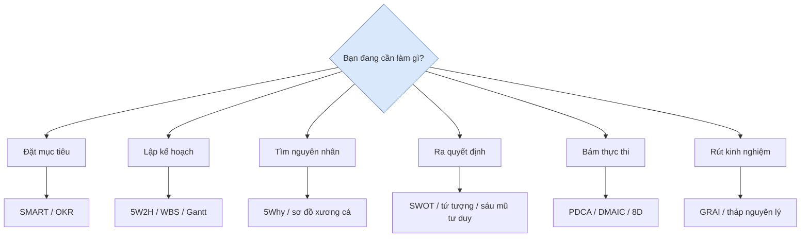

---

## I. Nhóm mục tiêu và kế hoạch

### 1. Nguyên tắc SMART (đặt mục tiêu)

**Một câu**: Mục tiêu tốt phải cụ thể, có thể đo lường, khả thi, liên quan và có thời hạn.

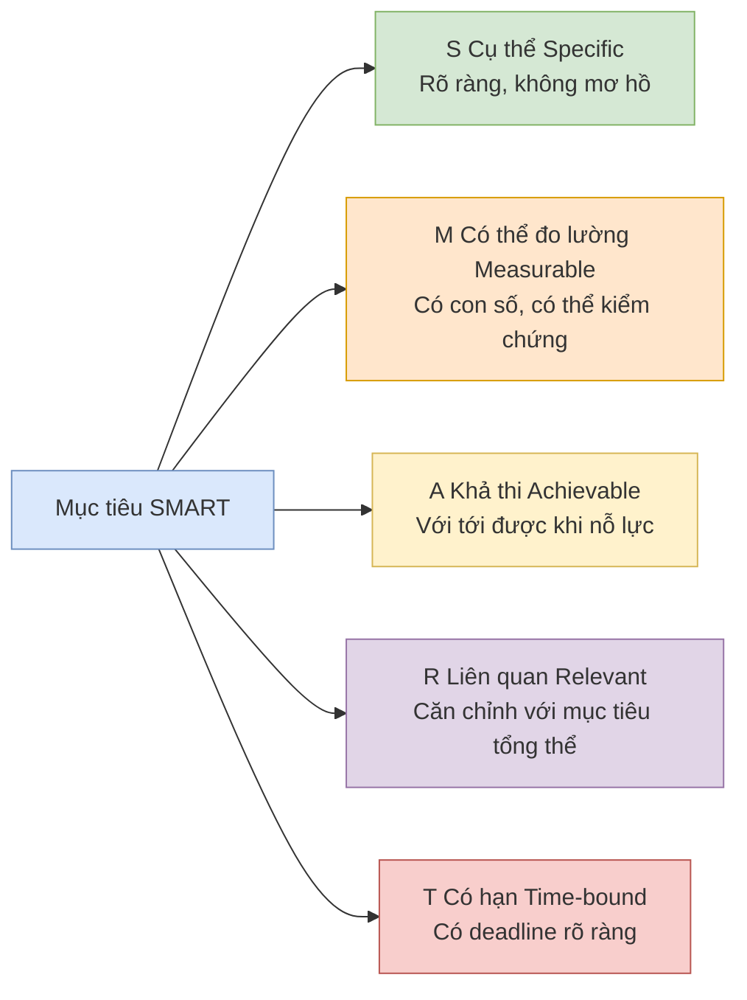

**Ví dụ sai**: "Nâng cao sự hài lòng của khách hàng" (mơ hồ)
**Ví dụ đúng**: "Trong 3 tháng, giảm thời gian phản hồi lần đầu của tổ CSKH từ 4 giờ xuống dưới 1 giờ" (đáp ứng đủ SMART)

---

### 2. Phân tích 5W2H (nghĩ kỹ một việc)

**Một câu**: Dùng 7 câu hỏi để làm rõ toàn cảnh nhiệm vụ / phương án, tránh bỏ sót và làm việc mù quáng.

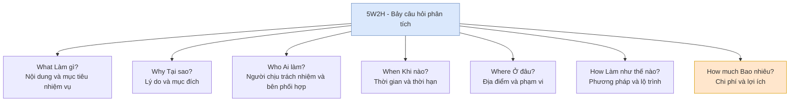

**Khi nào dùng**: giao nhiệm vụ, viết đề án, báo cáo, kiểm tra bỏ sót khi rút kinh nghiệm.

---

### 3. OKR (mục tiêu và kết quả then chốt)

**Một câu**: O là mục tiêu định tính, có tính thách thức và truyền cảm hứng; KR là kết quả định lượng để đo mức độ hoàn thành mục tiêu.

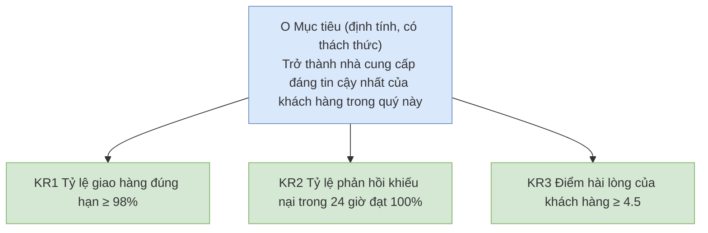

**Điểm cần nhớ**: 1 O kèm 3-5 KR; hoàn thành 60-70% là tốt nhất (chứng tỏ mục tiêu có thách thức); không gắn trực tiếp với thưởng.

---

### 4. WBS - Cấu trúc phân rã công việc (chia nhỏ nhiệm vụ)

**Một câu**: Chia dự án lớn thành các nhiệm vụ nhỏ theo từng cấp "kết quả có thể giao nhận", đến mức "có thể thực hiện, phân công và ước tính" được.

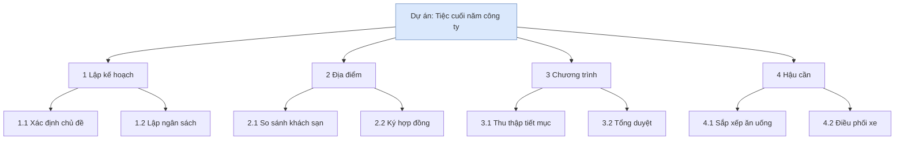

**Điểm cần nhớ**: Nguyên tắc 100% — phân rã phải bao quát toàn bộ công việc của dự án; nhiệm vụ tầng dưới cùng nên hoàn thành trong 1-2 ngày.

---

### 5. Biểu đồ Gantt (lập tiến độ)

**Một câu**: Trên trục thời gian ngang, nhìn thấy rõ "ai làm gì vào lúc nào, quan hệ phụ thuộc ra sao".

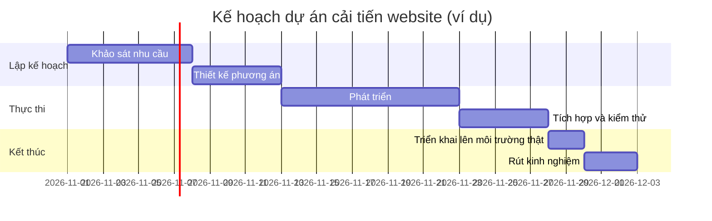

**Khi nào dùng**: lập lịch dự án, phối hợp liên phòng ban, báo cáo tiến độ với cấp trên.

---

## II. Nhóm phân tích vấn đề

### 6. Phân tích 5Why (truy nguyên nhân gốc rễ)

**Một câu**: Liên tục hỏi "tại sao" để xuyên qua biểu hiện, tìm ra nguyên nhân gốc rễ có thể hành động.

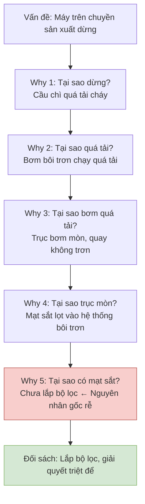

**Điểm cần nhớ**: Hỏi "tại sao" không phải để đổ lỗi; mỗi mắt xích nhân quả cần có bằng chứng, nếu không trả lời được thì dừng lại đi tìm dữ liệu.

---

### 7. Sơ đồ xương cá / sơ đồ Ishikawa (tìm nguyên nhân toàn diện)

**Một câu**: Từ các chiều Người - Máy - Nguyên liệu - Phương pháp - Môi trường, liệt kê mọi nguyên nhân có thể, tránh chỉ nhìn một hướng.

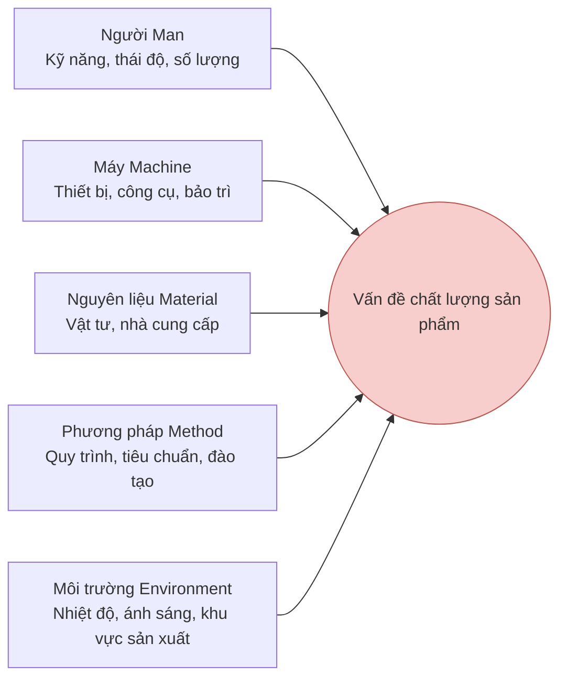

**Cách dùng**: Trước phát tán (brainstorm điền đầy các "xương"), sau đó thu hẹp và dùng 5Why đào sâu những "xương" đáng ngờ nhất. Tại hiện trường sản xuất thường dùng 4M1E / 6M (thêm Đo lường Measurement và Tự nhiên Mother Nature).

---

### 8. Quy tắc 80/20 / Pareto (nắm mâu thuẫn chính)

**Một câu**: 80% kết quả thường do 20% yếu tố then chốt quyết định, hãy tìm ra 20% đó trước.

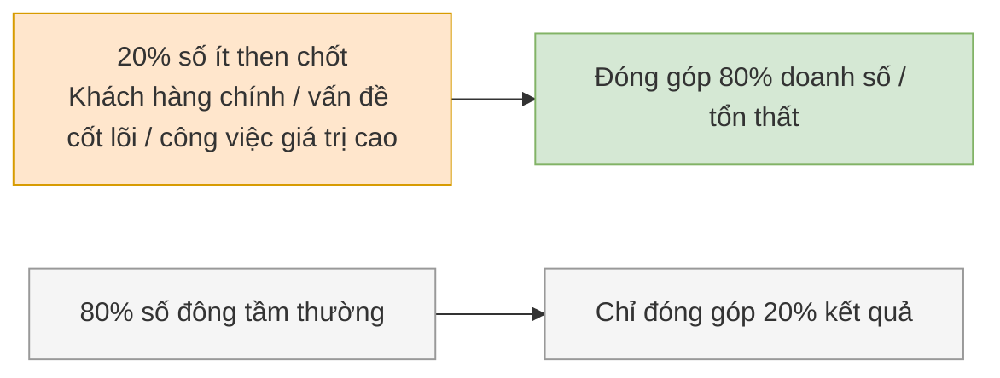

**Khi nào dùng**: sắp xếp thứ tự ưu tiên, tìm điểm tập trung của vấn đề chất lượng (biểu đồ Pareto), quản lý thời gian (ăn con ếch trước).

---

## III. Nhóm ra quyết định và phân tích

### 9. Phân tích SWOT (định hướng chiến lược)

**Một câu**: Đưa điểm mạnh / yếu nội bộ và cơ hội / đe dọa bên ngoài lên một mặt bằng, từ đó kết hợp thành chiến lược hành động.

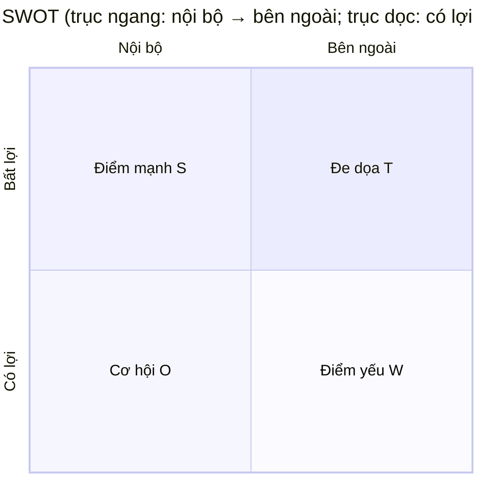

**Ví dụ**: Điểm mạnh = công nghệ mạnh, thương hiệu tốt; Điểm yếu = kênh phân phối yếu, thiếu nhân tài; Cơ hội = chính sách hỗ trợ, thị trường tăng trưởng; Đe dọa = cạnh tranh gay gắt, sản phẩm thay thế xuất hiện.

**Chiến lược tổ hợp bốn tượng**:

| Tổ hợp | Chiến lược | Ý nghĩa |
|---|---|---|
| S + O | SO - Tăng trưởng | Dùng điểm mạnh nắm cơ hội, tấn công toàn lực |
| W + O | WO - Chuyển đổi | Bù đắp điểm yếu để tận dụng cơ hội |
| S + T | ST - Phòng thủ | Dùng điểm mạnh chống lại đe dọa |
| W + T | WT - Thu hẹp | Giảm đầu tư, ưu tiên tồn tại trước |

---

### 10. Ma trận Eisenhower (quản lý thời gian)

**Một câu**: Phân loại theo "quan trọng / khẩn cấp", dành năng lượng cho việc "quan trọng nhưng không khẩn cấp".


- **① Quan trọng + Khẩn cấp** (khủng hoảng, nhiệm vụ sắp đến hạn) → Làm ngay
- **② Quan trọng + Không khẩn cấp** (hoạch định, học tập, phòng ngừa, rèn luyện) → Làm có kế hoạch, **giá trị cao nhất**
- **③ Không quan trọng + Khẩn cấp** (bị gián đoạn đột xuất, một số cuộc họp) → Ủy quyền hoặc xử lý nhanh
- **④ Không quan trọng + Không khẩn cấp** (lướt mạng vô mục đích, tán gẫu) → Giảm thiểu hoặc không làm

**Insight cốt lõi**: Người làm việc hiệu quả dành phần lớn thời gian cho ô Q2; ô Q1 liên tục bốc cháy chính vì Q2 làm chưa đủ.

---

### 11. Sáu chiếc mũ tư duy (thảo luận nhóm)

**Một câu**: Mỗi lần chỉ đội một mũ, chỉ dùng một kiểu tư duy để thảo luận, tránh cãi vã và rối loạn tư duy.

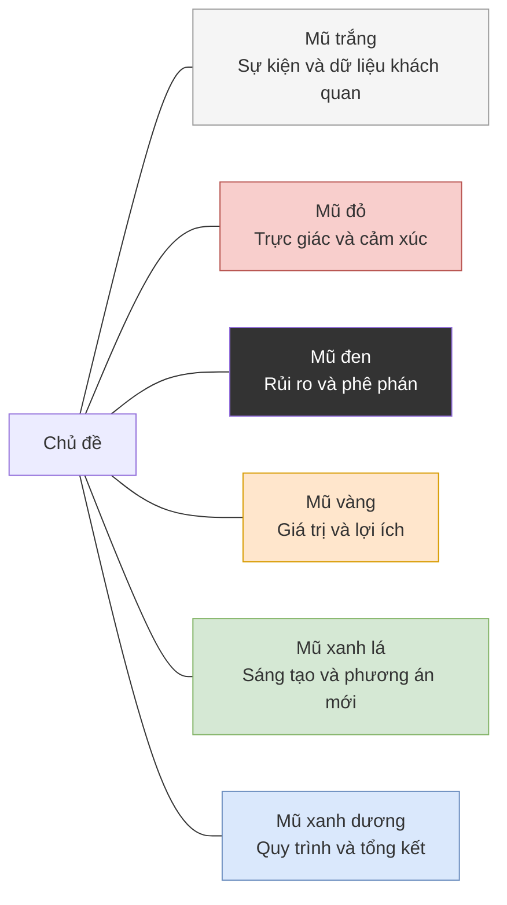

**Trình tự điển hình**: Xanh dương (định quy trình) → Trắng (đưa ra sự thật) → Xanh lá (đề xuất phương án) → Vàng (nhìn giá trị) → Đen (tìm rủi ro) → Đỏ (bày tỏ thái độ) → Xanh dương (kết luận).

---

### 12. Ma trận BCG (quyết định danh mục kinh doanh)

**Một câu**: Chia doanh nghiệp thành bốn nhóm theo "tốc độ tăng trưởng thị trường × thị phần tương đối", từ đó quyết định đầu tư hay thu hoạch.

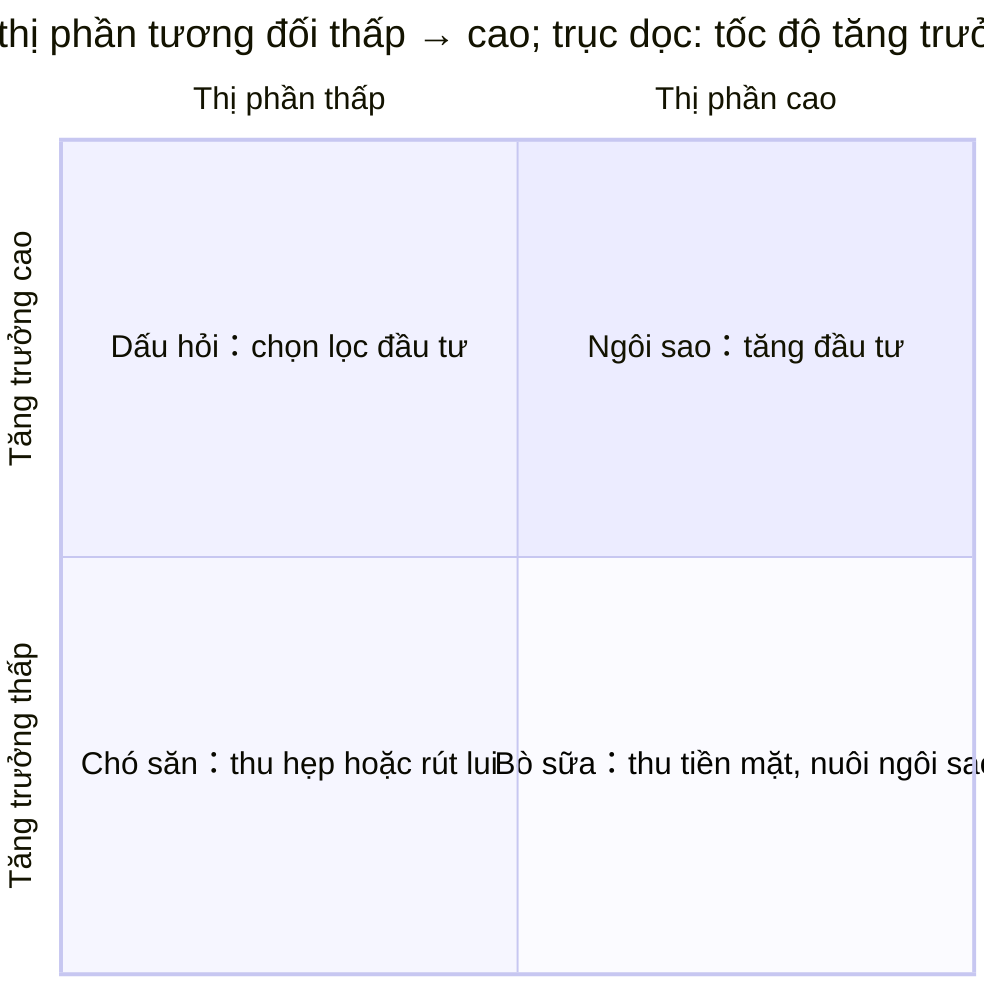

---

### 13. Mô hình năm lực lượng Porter (phân tích cạnh tranh ngành)

**Một câu**: Sức hấp dẫn của ngành do năm lực lượng quyết định, phân tích rõ rồi mới quyết định có nên vào, vào bằng cách nào.

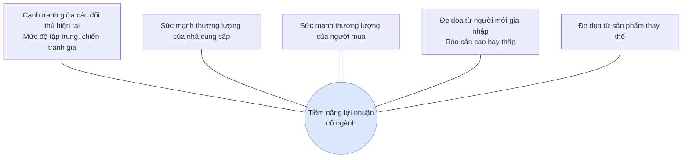

**Năm lực lượng càng mạnh, lợi nhuận trung bình của ngành càng thấp.**

---

### 14. Nguyên tắc MECE (phân rã có cấu trúc)

**Một câu**: Phân loại phải đạt "loại trừ lẫn nhau, bao quát toàn bộ" — không trùng, không sót.

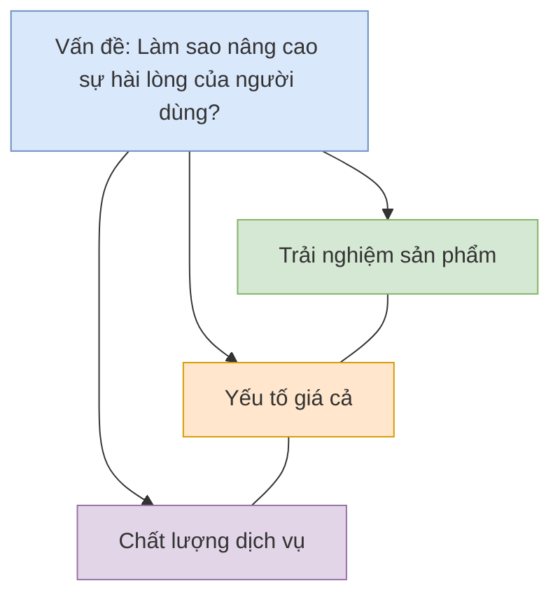

**Cách kiểm tra**: Lấy hai hạng mục bất kỳ ghép lại, nếu có thể gộp thì chưa loại trừ lẫn nhau; nếu có thể đưa ra phản ví dụ thì chưa bao quát toàn bộ. Đây là kỹ năng nền của tháp nguyên lý và tư vấn theo phong cách McKinsey.

---

## IV. Nhóm giao tiếp và trình bày

### 15. Tháp nguyên lý / SCQA (báo cáo và viết lách)

**Một câu**: Kết luận đi trước, trên dưới thống nhất, phân nhóm có hệ thống, logic tiến triển.

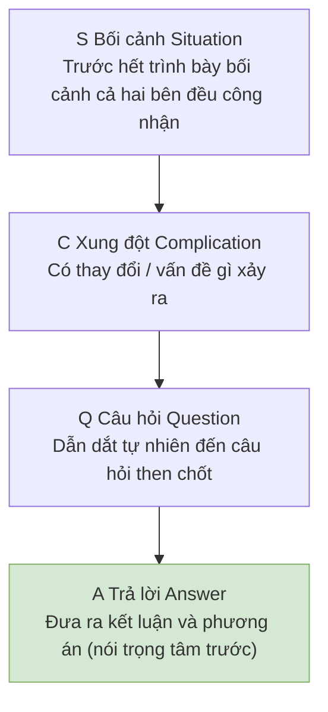

**So sánh**: "Sếp, ngân sách, nhân sự, tiến độ là như vậy… nên em muốn xin thêm người" (vòng vo lâu)
**SCQA**: "Sếp, dự án có nguy cơ chậm tiến độ (C). Em đề xuất bổ sung 2 lập trình viên (A). Lý do là… (chi tiết S+Q)"

---

### 16. Vòng tròn vàng - Golden Circle (truyền cảm hứng)

**Một câu**: Tổ chức xuất sắc bắt đầu truyền thông từ "tại sao", tổ chức tầm thường chỉ nói "làm gì".

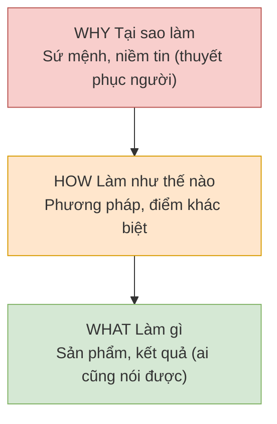

**Ví dụ**: Apple không nói "Chúng tôi làm máy tính (What)", mà nói "Chúng tôi tin vào việc thách thức hiện trạng (Why), vì vậy chúng tôi thiết kế theo cách khác biệt (How), tạo ra những chiếc máy tính dễ dùng (What)".

---

## V. Nhóm thực thi và cải tiến

### 17. Vòng lặp PDCA (cải tiến liên tục)

**Một câu**: Kế hoạch — Thực hiện — Kiểm tra — Hành động, lặp đi lặp lại không ngừng, mỗi vòng lên một bậc.

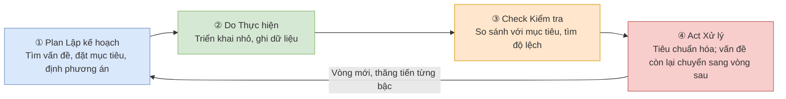

**Điểm cần nhớ**: Check là khâu nhiều người bỏ qua; trong Act, những cách làm đã được chứng minh hiệu quả cần được cố định thành tiêu chuẩn (đây là nền tảng của cải tiến "vòng lớn lồng vòng nhỏ").

---

### 18. DMAIC (quy trình cải tiến Six Sigma)

**Một câu**: Dùng quy trình 5 bước dựa trên dữ liệu để giải quyết vấn đề chất lượng phức tạp, nặng đo lường và thống kê hơn PDCA.

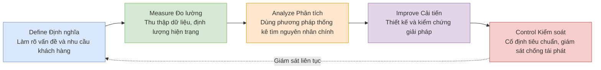

**Khi nào dùng**: cải tiến chất lượng sản xuất, tỷ lệ lỗi quy trình cao, vấn đề phức tạp có đủ dữ liệu.

---

### 19. Báo cáo 8D (xử lý khiếu nại / sự cố chất lượng)

**Một câu**: Quy trình giải quyết vấn đề theo nhóm chuẩn của ngành ô tô, D3 cầm máu trước, D4-D5 mới trị gốc rễ.

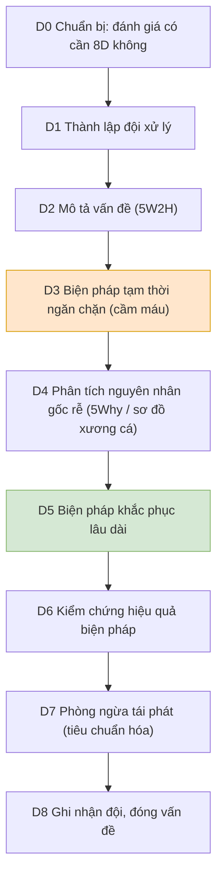

**Lưu ý**: Chưa D3 cầm máu đã bàn trị gốc rễ giống như vừa mổ vừa để máu chảy.

---

### 20. Phương pháp hoàn tất GRAI (biến kinh nghiệm thành năng lực)

**Một câu**: Mục tiêu — Kết quả — Phân tích — Kết luận, bốn bước biến "chuyện đã xảy ra" thành "kinh nghiệm dùng được lần sau".

```mermaid
flowchart LR
    G["G Goal Hồi tưởng mục tiêu<br/>Ban đầu muốn đạt gì?"] --> R["R Result Đánh giá kết quả<br/>Thực tế xảy ra gì? Khoảng cách ở đâu?"]
    R --> A["A Analysis Phân tích nguyên nhân<br/>Nguyên nhân gốc rễ của đúng/sai"]
    A --> I["I Insight Tổng kết kinh nghiệm<br/>Quy luật tái sử dụng, việc nên dừng / tiếp tục / bắt đầu"]
    I --> G2["Chuyển sang mục tiêu vòng tiếp theo (vòng kín PDCA)"]
    style G fill:#dae8fc,stroke:#6c8ebf
    style R fill:#d5e8d4,stroke:#82b366
    style A fill:#ffe6cc,stroke:#d79b00
    style I fill:#f8cecc,stroke:#b85450
```

**Điểm then chốt**: Hoàn tất không phải họp đổ lỗi, chỉ bàn việc không bàn người; Insight phải cụ thể thành "lần sau làm như thế nào".

---

## Tài nguyên mã nguồn mở có sẵn

| Tài nguyên | Mô tả |
|---|---|
| [mermaid-js/mermaid](https://github.com/mermaid-js/mermaid) | Công cụ vẽ sơ đồ mã nguồn mở dùng cho toàn bộ file này |
| [MackDing/mentalModelMap](https://github.com/MackDing/mentalModelMap) | 79 sơ đồ tư duy kinh điển trực quan hóa (tiếng Trung, mã nguồn mở) |
| [《12 个人生工具》PDF](http://chenweixiang.github.io/docs/12_tools_for_everyone.pdf) | Tuyển tập sơ đồ SWOT/PDCA/6W2H/SMART/WBS/quy tắc 80/20 |
| [drawio (diagrams.net)](https://app.diagrams.net) | Công cụ vẽ miễn phí mã nguồn mở, có thư viện mẫu biểu đồ quản trị |
| [Excalidraw](https://excalidraw.com) | Bảng trắng phong cách vẽ tay mã nguồn mở, phù hợp phác thảo nhanh |
| [Miro Templates](https://miro.com/templates) | Thư viện mẫu SWOT/sơ đồ xương cá/5Why phong phú (một phần miễn phí) |
| [5xWhys Free Tools](https://5xwhys.com/tools/) | Tạo 5Why / sơ đồ xương cá / Pareto trực tuyến, có thể xuất file |

## Khuyến nghị sử dụng

1. **Trước tiên xem lộ trình**: chọn công cụ theo loại công việc hiện tại, không cần dùng cả 20.
2. **Kết hợp sử dụng**: 5W2H mô tả vấn đề (D2 của 8D) → sơ đồ xương cá phát tán → 5Why thu hẹp nguyên nhân gốc rễ → PDCA theo dõi cải tiến.
3. **Chỉnh sửa sơ đồ**: trực tiếp sửa chữ trong khối code `mermaid`, sau khi lưu GitHub / Typora / `index.html` sẽ tự động cập nhật.
